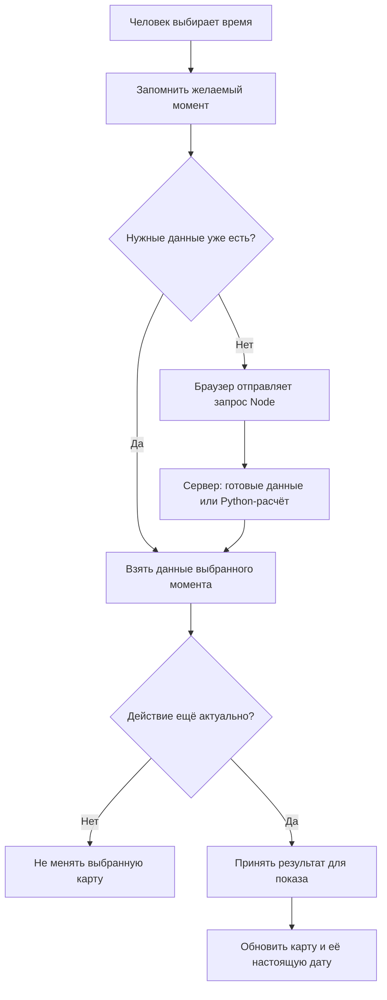
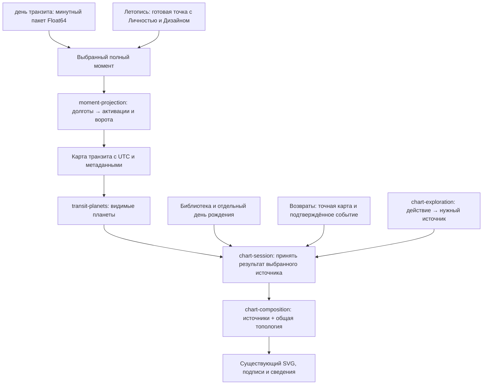
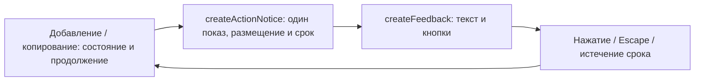

# Форма

«Форма» строит карту Human Design по дате, времени и городу рождения. Здесь можно рассматривать свою карту, двигаться по времени, изучать возвраты планет и читать объяснения элементов рисунка.

Это руководство ведёт от запуска сайта на своём компьютере до понимания его кода. Начните с первых двух разделов. К справочнику форматов и полной карте файлов можно вернуться, когда понадобится конкретное изменение.

## Содержание

0. [Запустить сайт на Windows](#запустить-сайт-на-windows)
1. [Запустить сайт на Mac](#запустить-сайт-на-mac)
2. [Освоить основные действия](#освоить-основные-действия)
3. [Подключить Летопись и Возвраты](#подключить-летопись-и-возвраты)
4. [Понять путь от ползунка до рисунка](#понять-путь-от-ползунка-до-рисунка)
5. [Разобраться в состояниях и сохранении](#разобраться-в-состояниях-и-сохранении)
6. [Найти нужное место в коде](#найти-нужное-место-в-коде)
7. [Изменять, проверять и обновлять проект](#изменять-проверять-и-обновлять-проект)
8. [Точные данные и ограничения](#точные-данные-и-ограничения)
9. [Полная карта проекта](#полная-карта-проекта)

## Запустить сайт на Windows

В этой локальной копии зависимости уже установлены. «Форма 2» использует порт 36; для доступа с телефона сервер слушает домашнюю сеть. Откройте PowerShell и выполните:

```powershell
Set-Location 'C:\Users\Марат\Дизайн человека\form'
$env:PORT = '36'
$env:HOST = '0.0.0.0'
npm start
```

Откройте [http://localhost:36](http://localhost:36). Для телефона в той же сети используйте адрес компьютера, который сервер печатает при запуске, с портом 36. Если адрес уже работает, второй сервер запускать не нужно. Остановка своего запуска — `Ctrl+C` в его терминале. В главном меню выберите **Библиотека**: статьи, поиск и связи доступны без предварительного расчёта личной карты. Без этих переменных окружения стандартный порт проекта остаётся 3636.

Для новой установки нужны Node.js 24 и Python 3.12. Из корня репозитория выполните `npm ci`, затем создайте окружение и установите Python-зависимости. Если установлен `uv`, команды такие:

```powershell
uv venv --python 3.12 .venv
uv pip install --python .venv/Scripts/python.exe -r requirements.txt
```

С уже установленным Python 3.12 вместо `uv` можно использовать `py -3.12 -m venv .venv`, затем `.venv\Scripts\python.exe -m pip install -r requirements.txt`. Активация окружения не нужна: сервер и npm-команды сами находят `.venv\Scripts\python.exe` на Windows и `.venv/bin/python` на Mac/Linux.

Файлы эфемерид лежат в `data/ephe`. Python запускается из корня проекта с относительным `SE_EPHE_PATH=data/ephe`: это позволяет Swiss Ephemeris читать данные даже при кириллице в полном пути к проекту. Переносить проект или устанавливать отдельные C++-библиотеки для уже подготовленного окружения не требуется.

Проверки: `npm run typecheck`, `npm test`, `npm run test:python`, `npm run build`. Обычная карта и библиотека работают без тяжёлых подготовленных данных; **Летопись и Возвраты** требуют отдельных файлов из [соответствующего раздела](#подключить-летопись-и-возвраты). Их подготовка не входит в `npm start`.

Готовый индекс Возвратов с проверенных прежних версий принимается после переноса на Windows без пересчёта: точные допустимые подписи перечислены в `returnIndexPortable` файла `shared/prepared-data-revisions.json`. Проверенные изменения касаются только разделителей путей и установки POSIX-прав, численные траектории прежние. Формат, диапазон, контрольные суммы и остальные проверки загрузки сохранены; неизвестные подписи не принимаются.

### Наполнение библиотеки

Публичные тексты находятся в `src/reference/knowledge-content.ru.json`: 184 статьи в 12 разделах. У статьи есть короткое описание, абзацы и связи с другими статьями. `knowledge-content.ts` содержит тот же набор для отложенной загрузки в браузере; тест проверяет совпадение двух представлений. При редактуре обновляйте оба файла. `knowledge-catalog.ts` отвечает за поиск и сопоставление статей элементам рисунка, `src/views/knowledge.ts` — за экран чтения.

В публичном наборе нет внутренних ссылок на источники и учебные материалы, описаний отдельных линий ворот или крестов. «О карте» и «С чего начать» в эту библиотеку не добавлены.

На телефоне каталог и чтение занимают отдельные полноразмерные экраны внутри Библиотеки. Кнопка «К списку» над статьёй возвращает прежние поиск, раздел и прокрутку. Переходы по связям не заменяют каталог. На компьютере список и статья остаются рядом. Для горизонтального телефона применяется та же граница компоновки, что и у карты; новая боковая панель из `8396b33` сохраняет своё управление.

На широком экране текст статьи начинается рядом с каталогом. В статьях девяти центров рисунок встроен в текст с обтеканием: это фрагмент исходной SVG-схемы с родными цветами, положениями ворот и геометрией каналов. Нажатие на номер или белую полоску выделяет чёрным ворота и их собственную половину канала; Enter и пробел выбирают номер с клавиатуры. Статья центра остаётся на месте, под рисунком появляются краткое описание ворот и раскрываемые описания связанных каналов с переходами к соседним воротам и центру. Полные статьи открываются отдельными ссылками. Возврат по цепочке статей сохраняет выбранные ворота, раскрытые каналы и место чтения. На узком экране рисунок и связи идут после краткого описания, основной текст — ниже. В остальных статьях связи остаются сгруппированными по теме.

Библиотека и Картотека используют общую верхнюю полосу высотой шапки Формы с поиском. На узком экране поиск раскрывается в этой же полосе. Картотека ищет по имени, дате и месту; оба раздела сохраняют запрос при возвращении. На локальных портах 36 и 3636 доступны исходные «Палитры», макет Аккаунта и «Превью»: загрузочный вид Библиотеки и Картотеки повторяет новую шапку. Все пять состояний макета Аккаунта также оформлены с общей шапкой; их содержание и действия сохранены.

Внизу меню, справа от «Палитр», на стенде находится маленькая кнопка «Случайная карта». Одно нажатие независимо выбирает имя из пула 200 имён и прошедшую дату и время в пределах 1950–2005 годов, запускает обычный расчёт по эфемеридам для Москвы, сохраняет и открывает карту без заполнения формы. Имя показывается без слова «Пример» и даты; все имена имеют равные шансы. Пул и генерация принадлежат `src/views/random-chart.ts`. Это отдельный пример, существующие карты не заменяются. В настоящей начальной загрузке и в Превью кнопка одинаково видна как недоступная заглушка; общий `holdLoadingContent` разрешает действие только после готовности или ошибки загрузки. Релиз исключает стендовые модули и эту кнопку.

Пул имён основан на [перечне ЕГР ЗАГС по популярности](https://zags.nalog.gov.ru/api/nameselect/firstnames?search=&favorite=false&gender=&page=1&size=350&clearfavorites=false&sort=p), проверенном 25 октября 2026 года. По [описанию ФНС](https://www.nalog.gov.ru/rn77/news/activities_fts/13872282/) это имена родившихся с 1926 года, а не рейтинг живущих сегодня. Берутся первые 199 разных имён после объединения Е/Ё и пропуска написаний «Владимер», «Томара», «Пелогея», «Алефтина», «Таисья»; двухсотым добавлен «Алмаз» по просьбе автора. «Марат», «Тимур» и «Рустам» уже входят в выборку. Список фиксированный; при создании карты загрузки имён из сети нет.

## Три режима и формы для приёмки — 25 октября 2026

Контрольная точка до прохода: `3e03420`, ветка «Библиотека». Изменения следующего прохода находятся в рабочей папке. Автор возобновил работу после разбора общей модели; новые конкретные тексты, переходы и ограничения подготовлены для его целостной приёмки, а не объявлены принятыми.

- `src/data/http-transport.ts` — общий сетевой вызов и чтение состояния связи. Стенд подключает источник `src/dev/stand-connection.ts`; готовые местные данные не проходят через эту границу. JSON и три клиента двоичных данных используют одну точку. Новый кэш и автоматический повтор записи не добавлены.
- `src/ui/action-state.ts` — общая доступность кнопок по признакам владельца действия. `src/ui/messages.ts` содержит общие фразы, `src/ui/feedback.ts` показывает сообщение у поля, инструмента, действия или страницы; его `createActionNotice` владеет единственной всплывающей оболочкой действия, безопасным размещением, заменой, сроком и Escape. Смысл ошибки, актуальность ответа и разрешение повтора остаются у действия.
- `src/state/account-flow.ts` ведёт почту, код, ожидание, отмену и актуальность ответа; `src/views/account.ts` отображает форму через общие сообщения. `AccountIdentity` передаёт подтверждённые почту и Telegram отдельно от вводимой почты; общее состояние и представление не создают примерные данные. Начальные образцы и ответы макета принадлежат `src/dev/account-adapter.ts` — **только демонстрация**: писем, Telegram-запросов, серверного входа и изменений пользовательских карт нет. `account-preview.ts` подключает её только на стенде и сохраняет только выбранный экран макета, без кода и незавершённой попытки.
- В «Палитрах» аккаунта доступны гостевой и выполненный вход, истёкший вход, ошибки отправки/доставки/проверки, сроки кода/попытки и конфликт Telegram. Проверочный код — `123456`. Повторная выдача ограничена сроком в показанной попытке; счётчик не пересоздаёт поле ввода. Закрытие и отмена прекращают ожидание и исключают поздний переход. Полноценное восстановление попытки входа, синхронизация вкладок, настоящие ограничения частоты и серверная авторизация не реализованы. **Отключение ввода почты и кода без сети — предложение для приёмки**, а не следствие правила редактирования карт.
- Форма карты подключена к общим сообщениям поля и действия. При потере сети открытый ввод сохраняется, поля и отправка недоступны, ожидание и поиск города отменяются. Возврат сети не отправляет форму. «Новая карта» и «Редактировать» отражают ту же доступность в меню и Картотеке. Выбор и удаление готовой местной карты доступны независимо от связи. После удаления выбранной карты открывается текущий транзит.
- Ожидание допуска к расчёту принято, но автоматическое продолжение после ответа о полной очереди пока не подключено. Настоящий ответ `busy` завершается нейтральным «Сервер занят», сохраняет ввод и не выдаётся за активное ожидание. Стендовый `src/dev/calculation-preview.ts` подключён только через служебный транспорт: «Палитры → Расчёт → Ожидание» удерживает запрос открытой формы до отправки: та же форма показывает «Готовим карту…» и позволяет отменить действие. Отмена, закрытие, смена связи или возврат к обычному режиму не запускают расчёт и запись. Этот пример проверяет подачу ожидания, а не работоспособность будущего автоматического допуска. Для его просмотра создайте карту или измените дату, время либо город в редактировании: одно изменение имени/заметки использует прежний местный путь без нового расчёта и этим ожиданием не удерживается.
- Создание, изменение и удаление карт пока используют действующее местное хранилище. Подтверждённая ошибка этого хранилища не называется ошибкой сервера. Неизвестный исход серверной записи, согласование между вкладками и серверное сохранение аккаунта не имитируются как готовые возможности.
- В раннем запуске `src/entry.ts` ждёт существующий стендовый модуль из HTML до загрузки данных. Серверный загрузочный рисунок показывается до готовности управления; если рисунка нет, остаётся «Загружаем приложение…». Ошибка загрузки модуля сохраняет рисунок вместе с явной ошибкой и кнопкой «Повторить», без автоматической перезагрузки и без частично подключённых действий. Выпуск удаляет стендовые теги и не включает демонстрационный аккаунт.
- Для проверки первого запуска на стенде допустимы `?connection=offline` и `?connection=server`. Они задают исходный режим только при отсутствии уже сохранённого выбора в этой вкладке; последующий выбор в «Палитрах» важнее URL. Адрес и порт стенда остаются прежними.

Связи: страница/форма → владелец действия → общая доступность и представление сообщения; сетевой запрос → общий транспорт → источник связи стенда. Принятые правила, фактическая реализация и предложенный вид проверяются раздельно. Общая матрица — «Задачи/Материалы/7ф — проверка состояний 0.2.md», точные сообщения и их условия — «Задачи/Материалы/Состояния и сообщения.md».

## Запустить сайт на Mac

Локальный запуск означает, что сайт обслуживает ваш компьютер. Браузер показывает страницу, а отдельная работающая программа отвечает на её запросы. Эта программа называется **сервером**.

Браузерная часть и сервер Формы написаны на **TypeScript** — JavaScript с проверкой типов данных. **Node.js 24** запускает серверные файлы напрямую; браузеру сервер выдаёт JavaScript без типов. Для астрономических расчётов сервер запускает **Python**. Если вы знакомы с Django: здесь его нет, входящие запросы принимает программа на Node.

### Если проект уже установлен

Сначала откройте [http://localhost:3636](http://localhost:3636). Если Форма появилась, сервер уже работает: второй запуск не нужен. `localhost` означает «этот компьютер», а `3636` — номер входа к приложению, **порт**. Это адрес в строке браузера, не команда терминала.

Если сайт не открылся:

1. Откройте приложение **Терминал** через поиск Spotlight (`⌘ Space`).
2. Напечатайте `cd ` с пробелом, перетащите папку проекта из Finder в окно терминала и нажмите Enter.

В терминале команды выполняются в текущей папке. `cd` меняет эту папку; перетаскивание подставляет её полный путь. Команды ниже можно копировать по одной и выполнять клавишей Enter.

Проверьте папку:

```sh
pwd
ls package.json requirements.txt README.md
```

`pwd` показывает, где вы находитесь. Вторая команда должна перечислить три файла без ошибки. Это **корень проекта**: папка, внутри которой находятся `src`, `server`, `public` и остальные части приложения. Далее все команды выполняются отсюда, если явно не сказано иначе.

Если файл летописи ещё не создан, сначала выполните [шаг 5](#5-создать-файл-летописи). Для работы возвратов подготовьте общий индекс по [шагу 6](#6-подготовить-поиск-возвратов). Уже готовые данные повторно считать не нужно. Запустите сайт:

```sh
npm start
```

`npm` поставляется вместе с Node.js. Здесь он читает команду `start` из `package.json` и запускает сервер. Готовую летопись сервер сам найдёт в папке `.cache/lifetime/` внутри проекта. Дождитесь строки `Форма: http://localhost:3636/`, затем откройте этот адрес. Терминал останется занят сервером — это нормально. Закрытие вкладки браузера сервер не останавливает.

Чтобы остановить **этот запуск**, вернитесь в его терминал и нажмите `Ctrl+C`. Появится обычная строка ввода команд. Для следующего запуска снова перейдите в ту же папку и повторите команду выше. Если сервер был запущен другим приложением, останавливать его нужно там, где он был запущен: `Ctrl+C` в новом пустом терминале на него не влияет.

### Если это новый компьютер или новая копия проекта

Нужно один раз получить исходники и установить программы, от которых они зависят. **Исходники** — читаемые файлы проекта. **Зависимости** — готовые чужие библиотеки, которые проект использует, например для астрономии или сборки браузерных файлов.

#### 1. Установить Node.js

Установите **Node.js ветки 24 LTS** с [официальной страницы Node.js](https://nodejs.org/en/download/): выберите macOS и установщик `.pkg`. LTS — ветка с длительной поддержкой. После установки откройте новое окно терминала.

Проверьте Node и npm:

```sh
node --version
npm --version
```

Ожидается `v24.…` у Node и номер версии npm. Если видите `command not found`, программа недоступна этому терминалу: проверьте установку и откройте новое окно.

#### 2. Получить файлы проекта

Для получения и обновления исходников нужен **Git**. Он сохраняет версии файлов; **GitHub** хранит их удалённую копию.

```sh
git --version
```

Если macOS предложит установить инструменты разработчика, завершите установку и повторите команду. Должен появиться номер версии Git. Затем получите проект в новую папку:

```sh
mkdir -p ~/Projects
cd ~/Projects
git clone --branch main https://github.com/JMahach/forma.git
cd forma
```

`~` обозначает вашу домашнюю папку. `mkdir -p` создаёт папку `Projects`, если её ещё нет. `git clone` скачивает исходники вместе с историей изменений. **Ветка** — именованная последовательность версий: эта инструкция использует `main`. Если папка `forma` уже существует, не удаляйте её ради повторного клонирования: используйте имеющийся проект либо выберите новое имя папки. Если GitHub просит доступ, войдите в аккаунт, которому доступен репозиторий.

#### 3. Подготовить Python

Для новой установки используйте **Python 3.12**. Эта версия указана в `.python-version`. Астрономическая библиотека `pyswisseph` закреплена в `requirements.txt`. Если готового пакета для вашего компьютера нет, установщик соберёт библиотеку из исходников; на Mac для этого нужны инструменты разработчика, устанавливаемые на шаге с Git.

Один путь установки — [Homebrew](https://brew.sh/), программа для установки инструментов. Его установщик `.pkg` рассчитан на **Apple Silicon — процессоры серии M**. Для Intel Mac или старой macOS сначала сверьтесь с [актуальными требованиями и способом установки](https://docs.brew.sh/Installation): тот же `.pkg` для них не подходит.

На подходящем Mac установите Homebrew, выполните указанные установщиком завершающие шаги и откройте новый терминал. Команда `brew --version` должна вывести версию.

Установите Python и проверьте его:

```sh
brew install python@3.12
"$(brew --prefix python@3.12)/bin/python3.12" --version
```

`brew --prefix` находит место установки, поэтому не нужно угадывать путь для Intel или Apple Silicon. Ожидается `Python 3.12.…`. Затем снова перейдите в корень нового клона, если открыли другое окно терминала.

Создайте **виртуальное окружение**: отдельную папку Python и его библиотек для этого проекта. Благодаря ей зависимости Формы не смешиваются с другими Python-проектами. В чистом клоне папки `.venv` ещё нет. Если она уже есть или скопирована из другого проекта, не выполняйте создание поверх неё: используйте новый клон без чужой среды, сохранив старую рабочую папку.

```sh
"$(brew --prefix python@3.12)/bin/python3.12" -m venv .venv
.venv/bin/python -m pip install -r requirements.txt
```

Первая команда создаёт `.venv`. Вторая устанавливает перечисленные в `requirements.txt` версии библиотек именно в неё. `pip` — установщик библиотек Python; сообщения `Building wheel` означают подготовку устанавливаемого пакета, которой нужно дождаться. Отдельно активировать окружение не требуется: команды явно указывают `.venv/bin/python`, и сервер использует тот же путь.

Рабочая среда этого этапа — macOS на Apple Silicon, Node 24.18.1 и Python 3.12.14. Для неё заново создана отдельная среда и установлены закреплённые зависимости, включая сборку `pyswisseph`. Полная установка Homebrew на чистом новом Mac отдельно не проверялась. В новом клоне `.venv` создают заново: окружение с другого компьютера не является переносимой частью проекта.

#### 4. Установить библиотеки Node

Установите зависимости Node:

```sh
npm ci
```

Команда читает точные версии из `package-lock.json` и создаёт `node_modules`. `ci` здесь — название команды установки: она подходит и для локального компьютера. При обновлении зависимостей она пересоздаёт `node_modules`, но не удаляет ваши исходники и карты браузера.

Проверьте Python:

```sh
.venv/bin/python -c "import swisseph, tzdata; print('Python dependencies OK')"
```

Должно появиться `Python dependencies OK`. Города и эфемериды — числовые данные для расчёта положений небесных тел — уже входят в исходники. Базу данных вроде PostgreSQL отдельно устанавливать не требуется.

#### 5. Создать файл летописи

**Летопись** — заранее рассчитанные положения небесных тел с 1801 по 2399 год. Она нужна для длинной шкалы времени и личной шкалы Возвратов. Файл занимает около **6,05 ГБ** и не входит в Git: его создают один раз на том компьютере, где будет работать сайт. Для публичного сайта выполните этот шаг непосредственно на сервере, после установки зависимостей. Запускайте расчёт от того же пользователя, что и сайт: создаваемые файлы доступны только их владельцу. Для установленной службы это пользователь `forma`; точная команда приведена в разделе [«Публичный сервер»](#публичный-сервер).

Из корня проекта — папки с `package.json` — выполните:

```sh
npm run prepare:lifetime
```

Команда сама создаст папку `.cache/lifetime/` внутри проекта и рассчитает два соседних файла:

- `lifetime-1801-2400.f64le` — готовые данные Личности и Дизайна с шагом 10 минут;
- `lifetime-1801-2400.metadata.json` — описание формата, диапазона и контрольная сумма данных.

Держите оба файла рядом. Папка `.cache/` исключена из Git. Если оба файла уже готовы, пропустите расчёт: команда не перезаписывает существующие файлы.

Расчёт длительный. Обеспечьте свободное место и дождитесь завершения команды; терминал будет показывать ход работы. По умолчанию работают три исполнителя; другое число можно передать, например `npm run prepare:lifetime -- --workers 2`. Все параметры доступны по команде `npm run prepare:lifetime -- --help`.

Нужен **формат версии 3**, содержащий обе стороны карты: прежний файл на 2,77 ГБ с одной Личностью не подходит. Команда выше создаёт текущий формат. Если старый файл занимает этот путь, сохраните его в другом месте вместе с метаданными перед новым расчётом.

#### 6. Подготовить поиск возвратов

Для быстрого поиска дат возвратов нужна общая таблица движения тел с 1801 по 2399 год — **индекс возвратов**. Он отмечает участки движения и развороты. По нему программа находит нужный участок, затем уточняет точное время астрономическим расчётом. Этот файл общий для всех людей; личных карт и списков их возвратов в нём нет.

Из корня проекта выполните:

```sh
npm run prepare:returns
```

Команда создаст `.cache/returns/return-index.bin` и покажет размер готового файла. Он не входит в Git. На публичном сервере выполняйте команду от пользователя `forma`, как и подготовку летописи. Актуальный готовый индекс повторно не рассчитывается. Если расчётные данные или формат изменились, команда подготовит новую версию и заменит файл только после успешного завершения; ошибка подготовки не уничтожит прежний файл.

Проверить готовый индекс без пересчёта можно так:

```sh
npm run prepare:returns -- --check
```

Готовый индекс полного диапазона занимает **20 998 784 байта**, около 21 МБ. Запуск сайта сам его не создаёт. Без подходящего индекса поиск списка дат выполняется напрямую и занимает больше времени, а открытие возврата планеты или узлов возвращает ошибку недоступного индекса: проверке завершённого оборота нужен этот файл. Поэтому подготовка индекса входит в последовательность установки. Файл летописи из предыдущего шага нужен для движения по шкале и остаётся отдельным набором данных.

#### 7. Запустить сайт

После завершения подготовки выполните из того же корня проекта:

```sh
npm start
```

Сервер сам ищет оба файла в `.cache/lifetime/` внутри проекта. При первом обращении к летописи он проверит формат, размер, происхождение расчёта и контрольную сумму. Несовместимый или повреждённый файл покажет ошибку в шкале; остальные инструменты сайта продолжат работать.

Дождитесь строки `Форма: http://localhost:3636/` и откройте этот адрес. Создайте пробную карту по инструкции следующего раздела. Само появление страницы подтверждает работу Node; успешный расчёт дополнительно проверяет связь с Python.

**Для следующих запусков повторяйте только команду из этого шага.** Готовые летопись и индекс возвратов пересчитывать не нужно.

Сайт можно запустить и во время подготовки летописи: выполните `npm start` в другом терминале из той же папки проекта. Кнопки Летописи и Возвратов остаются доступны. Пока готовых файлов нет, шкала приглушена и недоступна; по центру написано **«Создаём летопись»**. После завершения расчёта обновите страницу — сервер найдёт файл при новом запросе, перезапускать его не нужно. Сам запуск сайта расчёт летописи не начинает: её создаёт команда из шага 5.

Для собранной версии на сервере вместо `npm start` используют `npm run start:release`; папку `dist` предварительно готовят командой `npm run build`. Установленная служба systemd использует ту же папку `.cache/lifetime/` проекта — подробнее в разделе [«Публичный сервер»](#публичный-сервер).

### Если запуск не получился

| Что видно | Что это означает и что сделать |
| --- | --- |
| Нет `package.json`, ошибка `ENOENT` при `npm start` | Терминал находится не в корне проекта. Проверьте `pwd` и перейдите в папку с `package.json`. |
| `npm: command not found` | Node/npm не установлены либо новое окно терминала ещё не открыто после установки. |
| Не найден `.venv/bin/python` или модуль `swisseph` | Не создана среда Python либо не установлены `requirements.txt`. Вернитесь к установке в этой копии проекта. Сервер использует именно её, а не произвольный Python из системы. |
| `brew: command not found` | Homebrew не установлен или не выполнены его завершающие шаги настройки терминала. Проверьте инструкцию установщика и новое окно терминала. |
| pip сообщает, что подходящий пакет не найден | Проверьте `.venv/bin/python --version` и доступ к PyPI. При ошибке сборки на Mac проверьте инструменты разработчика: `xcode-select -p`. Если их нет, выполните `xcode-select --install`, завершите установку и повторите установку библиотек. |
| `EADDRINUSE` и порт `3636` | Этот порт уже занят. Откройте сайт: возможно, нужный сервер уже работает. Остановите свой прежний запуск через его терминал. Не завершайте все процессы Node на компьютере. |
| Страница открылась, но расчёт завершился ошибкой | Проверьте команду импорта Python выше и сообщения терминала. Затем данные рождения: город нужно выбрать из найденных вариантов. |
| На приглушённой шкале «Создаём летопись» | В `.cache/lifetime/` ещё нет готовой пары файлов. Выполните шаг 5 или дождитесь уже запущенного расчёта, затем обновите страницу. |
| Шкала сообщает об ошибке данных летописи | Готовые файлы повреждены или несовместимы с текущим расчётом. Сохраните их отдельно и создайте новую пару по шагу 5. |
| Ошибка `dist`/`manifest` в release-режиме | Сначала выполните `npm run build`; обычный `npm start` сборки не требует. |

Если нужно намеренно использовать другой порт:

```sh
PORT=4177 npm start
```

Тогда адрес — `http://localhost:4177`. **У другого адреса будет отдельное хранилище браузера:** прежняя библиотека на 3636 от этого не удалится, но автоматически на 4177 не появится.

### Открыть с телефона

По умолчанию сервер принимает соединения через сетевые интерфейсы компьютера и печатает доступные адреса. Подключите телефон и Mac к одной сети Wi-Fi и откройте на телефоне напечатанный адрес вида `http://192.168.…:3636`. `localhost` на телефоне означает сам телефон, а не Mac. Между устройствами также должны разрешаться соединения в сети и брандмауэре.

Библиотека карт телефона будет отдельной. Для запуска только на самом Mac можно указать `HOST=127.0.0.1 npm start`. `HOST` и `PORT` — настройки процесса, переданные перед командой; они действуют для этого запуска. Файл `.env` приложение само не читает.

## Освоить основные действия

### Сначала осмотреть текущий момент

В меню слева выберите **Транзит**. Это положения небесных тел в выбранный момент времени, без привязки к вашему рождению.

Подвигайте дневную шкалу: рисунок и дата покажут выбранный момент. Чтобы снова следовать часам, нажмите отметку текущего времени на шкале; её подсказка — «Вернуться к текущему времени». На активной видимой странице текущий момент обновляется поминутно. При ошибке загрузки появляется кнопка **Повторить**.

Рисунок с центрами и соединениями называется **бодиграфом**. Кнопка **Мандала** показывает ту же карту с круговой разметкой. Переключение вида не меняет исходные данные. Перетаскивайте рисунок для перемещения, используйте приближение и кнопку **Вся схема**, чтобы снова вместить его на экран. На сенсорном экране перемещение и приближение работают жестами.

Попробуйте три разных действия:

| Действие | Что изменится |
| --- | --- |
| Навести указатель на ворота, канал, центр или планету | Появится временная подсветка. |
| Нажать на элемент | Выбор закрепится, появятся сведения о нём. С `Shift` можно добавлять или убирать части выбора. |
| Снять галочку у планеты | Из показанной схемы уберётся её вклад. Если она была последним источником активации ворот, ворота и связанный канал могут исчезнуть. |

Подсветка бодиграфа появляется за 92 мс и исчезает за 69 мс; нажатие обрабатывается сразу. Короткие переходы из SmoothUI Fluid Hover Highlight адаптированы к собственным контурам Формы и увеличены по длительности на 15% по просьбе автора. Номер ворот и его полоска подсвечиваются вместе; при переходе с центра на его ворота общая часть остаётся видимой. При включённом уменьшении движения переходы отключаются. Геометрия и смысл цветов не меняются.

Вариант 2 выделения использует принцип JointJS Mask: чёткий внешний синий контур с прозрачным зазором. Реализация — собственные SVG-маски, без зависимости от JointJS. Зазор у каналов — 0,75, у центров — 1,25 единицы рисунка; линия в обоих случаях — 2; основная заливка и серая обводка сохраняются. Ворота используют принятый «Точный круг»: радиус 8,4, тонкий голубой край 1,15, цифры 10,4 и одинаковая насыщенность 560. Красная, чёрная и двойная заливка остаются видимыми; неактивные выделенные ворота получают голубую заливку. Центры ворот и радиус области нажатия 12,5 сохранены.

Размеры меток ворот принадлежат `GATE_MARKER` в `scene/geometry/drawing-presentation.ts`; `scene/gate-label.ts` центрирует видимый рисунок каждой цифры по метрикам системного шрифта, как в принятом образце. Общие потребители — `bodygraph-svg.ts` и `views/knowledge-center-figure.ts`. Один измеритель создаётся при создании рисунка; наведение и нажатие обновляют цвета существующих меток без повторного измерения. Без браузера используется центрированное приближение. Ранняя загрузочная схема и кнопка «Превью» не содержат номеров ворот; после появления настоящей карты работает этот же владелец. Размеры мандалы и чисел в столбцах не менялись.

После нажатия темнее становится сама голубая подсветка выбранного центра, его ворот и принадлежащих ему участков каналов. Базовый голубой при наведении — `#91bce9`; закреплённый — `#83a9d2` (каждый компонент sRGB уменьшен на 10%). Цвет вычисляется от `PALETTE.halo` в `ui/chart-palette.ts`; `bodygraph-paint.ts` определяет принадлежность закреплённому выбору. Собственные цвета центров, ворот и каналов не затемняются; дополнительная внутренняя окантовка и графитовая подложка удалены. Правило одинаково в обоих вариантах подсветки. Одновременное наведение на другой элемент сохраняет его исходный голубой. В непрерывной интеграции `integrationHighlightPaint` использует узор цвета с прежней маской принадлежности ветвей, поэтому темнеют только закреплённые участки.

Наведение на центр после повторного нажатия, перемещения и масштабирования подсвечивает весь его состав: центр, ворота и собственные половины каналов. `selection/hover-preview.ts` слушает общую поверхность `canvasWrap`, помнит текущую позицию мыши и после её отпускания повторно проверяет центр под курсором. `views/camera-controls.ts` вызывает `refreshCenter` после применения положения карты. Изменение положения не сбрасывает закреплённый выбор; одинаковая цель не вызывает повторного обновления рисунка. Отдельное CSS-наведение на центр удалено: устаревший `:hover` после изменения масштаба больше не оставляет одинокий контур. Уход с поверхности, потеря фокуса окна, касание, отмена жеста и смена карты очищают временную позицию. Ранняя загрузочная схема не интерактивна; владелец подключается при переходе к настоящей карте.

Вариант 1 сохраняет ранее принятый голубой контур со свечением: фильтры SVG `highlight-glow` и `gate-glow`, тонкое кольцо ворот и защита смысловой заливки. Оба варианта используют одну толщину каналов (+25%) и один выбор элементов. `RenderOptions.highlightStyle` (`glow` / `outline`, по умолчанию `outline`) передаётся из `state/chart-highlight.ts` через `app.ts` → `scene/updates.ts` в SVG и отрисовщик. При смене варианта `renderer.ts` один раз пересоздаёт рисунок с тем же выбором; камера остаётся у своего владельца, новые расчёты и запросы не запускаются. Последующие наведения и изменения карты обновляют существующий рисунок как раньше.

Столбцы активаций сохраняют прежнюю подогнанную высоту: первая строка 118, последняя 694, шаг 48, масштаб 1,09 и подъём 15,75 в SVG не изменены. Столбцы отодвинуты наружу на 16 единиц SVG: «Дизайн» влево, «Личность»/«Транзит» вправо; «Цвет» и «Тон» остаются на своих местах. Разделитель каждой шапки проходит по всей ширине её рамки, а у каждой пары «Цвет»/«Тон» отдельная общая линия с зазором до столбца. Геометрия рамки и разделителя принадлежит `activation-targets.ts` и общая для обычных и двойных столбцов; оптическое выравнивание заголовка не меняет длину линии. «Дизайн» заключён в тонкую красную рамку, «Личность»/«Транзит» — в графитовую, с лёгкой заливкой того же цвета (0,045). Из оригинального [SmoothUI Fluid Hover Highlight](https://smoothui.dev/docs/components/fluid-hover-highlight) перенесены скругление ячейки 10 и рамки 14, быстрая пружина без отскока (80 мс), появление 80 мс и уход 60 мс. Планетные и числовые ячейки имеют одинаковую высоту 48 и стыкуются без промежутков. У двойных столбцов строки опущены на 12 под подписи источников. Метки экзальтации остаются снаружи числовой кнопки, внутри общей рамки; правый край рамки расширен на 6 единиц SVG, оставляя после крайней точки метки 10,4 единицы до рамки. Сами метки, числа и планеты не сдвигаются; наложение сохраняет цвета происхождения карт. Голубой берётся из `PALETTE.halo`, плотность фона столбцов — `ACTIVATION_HIGHLIGHT_OPACITY = 1/3`; это не меняет яркость выделения самой карты. У закреплённых ячеек (`aria-pressed="true"`) появляется голубой контур толщиной 2 единицы SVG; он остаётся на выбранной ячейке при наведении на другие. Временное наведение и связанные подсветки сами по себе этот контур не получают. `activation-hover.ts` переносит одну подложку под текстом: анимируются настоящие размеры и положение, радиус не растягивается. Повторное движение внутри той же ячейки не перезапускает переход. Выбор, подсказки, касания и перетаскивание сохраняют прежних владельцев; при уменьшении движения переходы мгновенные. Источники и лицензии — в `THIRD_PARTY_NOTICES.md`.

Размеры внешнего контура принадлежат `HIGHLIGHT_OUTLINE` в `geometry/drawing-presentation.ts`: ширина наружного штриха канала 16,06, выреза внутри него — 12,06. Единая маска `highlight-exterior` вырезает все центры и каналы вместе с их зазорами из каждого контура: обводки заканчиваются на общей границе соединения без внутренних хвостиков и перекладин. Маски интеграции сохраняют владельцев ветвей и защищают соседние фигуры вместе с зазором. Размытие не используется. Появление/затухание 92/69 мс и плоское выделение в расчётных столбцах сохранены.

Толщина всех каналов увеличена на 25% относительно предыдущего принятого вида: общий множитель `CHANNEL_WIDTH_SCALE` в `geometry/drawing-presentation.ts` изменён с 1,32 на 1,65. Внешняя ширина — 10,56, цветная полоса — 7,59 единицы SVG; центры, ворота и осевые линии не перемещены. Двойные полосы используют тот же множитель. Маски подсветки отступают от новой физической ширины на фиксированный зазор.

У шести прямых каналов G-центра — 7–31, 1–8, 13–33, 15–5, 2–14 и 46–29 — граница половин находится посередине **видимого участка между краями центров**, а не между координатами ворот. `geometry/drawing-geometry.ts` получает границы из того же скруглённого контура и учитывает `CENTER_STROKE` из `drawing-presentation.ts`; малая аппроксимация скруглений выполняется только при подготовке существующей геометрии. Цветные полосы, подсветка и рисунки центров в Библиотеке используют общие `channelHalves`. Точки ворот, полные пути и деление остальных каналов не изменены.

В двойных красно-чёрных каналах чёрная полоса расширена к красной: ширина 4.125 и смещение 1.815 вместо 3.795 и 1.98. Её внешний край и красная полоса не сдвигаются; небольшое перекрытие под красной устраняет белый шов при сглаживании. Используются те же два пути, без отдельной заплатки. Это общее правило для обычных каналов, ветвей и ствола интеграции и соположения карт; круги ворот сохраняют равные половины.

Галочки работают с уже полученными числами. Полные исходные строки остаются в памяти: включение планеты возвращает её без нового астрономического расчёта. Перемещение и приближение рисунка меняют только видимую область; далее это называется **камерой**.

**О карте** открывает правую панель с переходом к Возвратам. Прежние профиль, счётчики, поиск и разделы «Линии», «Центры», «Каналы», «Ворота» удалены; прямой выбор элементов на рисунке и поиск в Библиотеке сохранены. **Библиотека** в меню — справочник элементов карты. **Библиотека** и **Картотека** занимают центральное рабочее пространство вместо рисунка; это разделы приложения, а не всплывающие окна. В разделе **Картотека** левой панели находятся ваши сохранённые личные карты: компактные строки с именем и датой, без рисунков-миниатюр. **Картотека** показывает те же записи компактной сеткой: при достаточной ширине три–четыре одинаковых карточки в ряд, с миниатюрой, именем и датой. Общие действия выбора, редактирования и удаления сохранены. Выбор записи возвращает к карте. Порядок навигации: **Транзит → Аккаунт → Картотека → Библиотека**. **Аккаунт** на стенде 3636 показывает проект оформления; настоящего входа, серверного аккаунта и синхронизации ещё нет.

На ПК левая навигация и правая сводка открываются независимо: можно оставить обе открытыми, обе закрытыми или только одну. Выбор другой карты и переход в Транзит сохраняют открытие панелей. На широком экране карта занимает пространство между ними; при недостатке места панели накладываются поверх карты. При боковом размещении нижняя полоса занимает свободную ширину карты, а обе панели продолжаются до низа окна. При наложении на ПК панели заканчиваются над полосой, оставляя шкалу доступной.

На телефоне обе панели выезжают с боков: главное меню слева, «О карте» и Возвраты справа. Ширина одинаковая — `min(296.8px, 86vw)`, высота полная; панель перекрывает шкалу. Круглые кнопки 48 px находятся на внешних краях, на высоте общей шапки; открытая кнопка выделена, закрытая прозрачна. Открытие одной стороны закрывает другую через общий `state/panels.ts`. Кнопка той же панели, нажатие снаружи и Escape закрывают её. Противоположная кнопка скрыта за открытым меню; после закрытия доступна снова. Состояние обеих закрытых панелей сохраняется без автоматического раскрытия. Три высоты, ручка и жесты нижней шторки удалены. Это замена прежних мобильных вариантов по прямому указанию автора 22 октября 2026.

При запуске сохранённые панели сразу занимают свои места, до загрузки карты, без выезда; на телефоне восстанавливается одна открытая сторона или обе закрытые. Во время загрузки меню можно открывать и закрывать, а на телефоне — менять высоту листа; выбранное открытие сохраняется после появления содержимого. В левом меню заранее подготовлены настоящие локальные записи, счётчик и выбранный пункт; приложение подключает действия к тем же строкам. Восстановление центрального экрана само по себе меню не закрывает. В Библиотеке, Картотеке и Аккаунте инструменты карты, правая панель, шкалы и FPS скрыты. Предпочтение открытия правой панели сохраняется до следующей явной команды; верхняя кнопка меню остаётся доступной. На ПК левая панель этих разделов занимает полную высоту; на телефоне главное меню открывается слева поверх части нижнего листа.

Квадратные кнопки меню, книги, инструментов карты и действий в шапке используют одно семейство в `public/styles.css`: 32 × 32 px на ПК, 44 × 44 px на телефоне, значки 18/21 px и общие промежутки `--chart-control-gap` 4/6 px. `summary-chart-actions` читает ту же палитру раздела, что рабочая область. Наведение меняет тонкую рамку; самостоятельная толстая обводка и постоянная заливка «плюса» удалены. Размер и состояния не определяются заново внутри стендового модуля. На ПК кнопки действий, книга и инструменты карты стоят на одной горизонтали от верхнего края 16 px; между соседними кнопками 4 px. По обе стороны границы правой панели оставлено по 16 px; положение инструментов вычисляется из ширины панели и общих размеров кнопок, без отдельного смещения. На телефоне внешние края верхнего управления также 16 px, промежуток кнопок 6 px.

Уточнение автора 22 октября, принято после просмотра эскиза: шапки разделов отделены от сведений о человеке. «Форма» стоит после круглой кнопки меню слева; «О карте» — перед круглой кнопкой справа. Обе шапки имеют высоту 80 px при обычном безопасном отступе, надписи 20/26 px, вес 600, внешние края 16 px. Навигационные кнопки — 48 × 48 px, значки 23 px; прозрачный фон закрытого состояния и выделение открытого состояния общей палитрой раздела: красноватое для карты, транзита и Картотеки. Отдельная песочно-зелёная палитра круглых кнопок удалена после замечания автора. `--side-section-heading-height` задаёт высоту раздела независимо от компактных блоков карты и Возвратов; `--side-menu-control-size` и `--side-menu-icon-size` задают навигацию. Сведения об одной или двух картах идут ниже «О карте» без переработки содержимого. Маленькие действия карты на ПК остаются 32 × 32 px. На телефоне главное меню получает ту же круглую кнопку и надпись; «О карте» появляется внутри нижнего листа. Прежнее управление ручкой и скрытие верхней книги на телефоне сохранены.

Карточка одиночной карты уточнена автором и перенесена на стенд 22 октября: ширина 280 px, внутренние отступы 10/16 px; имя 17/24 px, дата слева 15/23 px, время справа 21/23 px, город с возрастом и UTC — 11/15.4 px. Значок ссылки 14 px стоит сразу после имени, кнопка без постоянной заливки и рамки, область 24 px на ПК и 44 px при сенсорном вводе. Наведение использует Т1 (`title="Скопировать ссылку"`), нажатие — существующее подтверждение с галочкой на 2 секунды; сообщение не выходит за края окна. Для одиночной карты `ui/layout/chart-heading.ts` разделяет время и UTC в отдельные поля, сохраняя секунды и исторические смещения. При переходе к паре возвращает прежнюю общую строку времени; оформление пары не менялось. Шапки разделов, сохранение состояния и смысл действий не изменены. Копирование остаётся прежней стендовой симуляцией в `dev/shared-chart-preview.ts`, без записи в буфер обмена.

На телефоне «Новая карта» сохраняет область нажатия высотой 44 px и видимую рамку 32 px. Наведение меняет только цвет этой тонкой рамки; фон всей области нажатия остаётся прозрачным. Клавиатурный фокус рисуется тонким пунктиром вокруг видимой рамки.

Палитра «Бумага и красный» задана общими переменными `public/styles.css`: обе боковые панели и сплошная нижняя полоса имеют одинаковый светлый фон. Красный отмечает текущий Транзит, «Картотека» или выбранную карту. Аккаунт отмечен графитовым `#41423f`, Библиотека и её выбранные элементы — принятым шалфеем `#50634a`. Маленькие кнопки берут первую ступень палитры раздела: Транзит/«Картотека» — коричневую, Аккаунт — графитовую, Библиотека — зелёную. На ПК эти инструменты собраны в верхний горизонтальный ряд на уровне «О карте», у правого края свободного поля карты: кнопки 32 × 32 px, значки 18 px, промежутки 4 px. Светлая подложка и постоянная тонкая рамка повторяют поля дат летописи: скругление 8 px и тонкая обводка общие, рамка кнопок относится к палитре текущего раздела. Наведение на верхние кнопки меню, книги и инструментов меняет только обводку и действует при точном указателе с поддержкой наведения. После касания на телефоне заливка не остаётся: цвет отражает только открытое меню или включённый режим. Правила выбранного режима идут после общей базы квадратных кнопок, чтобы база не перекрывала включённую Мандалу. Заливка выбранной палитры отмечает включённый режим. Они лежат поверх поля и не меняют его размеры или отступы камеры. Кнопка всей схемы появляется слева в том же ряду при уходе из исходного вида; до следующей кнопки остаются те же 4 px, что между остальными инструментами. Остальные кнопки сохраняют положение; книга остаётся справа от разделителя. Фон включённых кнопок на карте непрозрачен, поэтому рисунок при приближении не мешает читать значки. Кнопка «О карте» получает ту же заливку палитры карты, когда панель открыта. Книга остаётся в верхнем правом углу и открывает панель независимо от положения инструментов карты. Вертикальный разделитель слева от книги виден и при закрытой панели: маленькие кнопки, разделитель, книга. Ширина верхнего ряда участвует в размещении подписи карты, поэтому подпись не пересекается с кнопками. В текущей телефонной примерке гамбургер остаётся слева, инструменты карты — справа; верхняя кнопка «О карте» скрыта, её заменяет ручка нижнего листа. FPS располагается в свободной области карты. Смысловые цвета рисунка остаются прежними.

Счётчик FPS на ПК начинается в верхнем ряду: отступ сверху `max(14px, safe-area-inset-top)`, слева — `max(76px, studio-left-space + 12px)`. На телефоне он остаётся ниже кнопок, с обычным верхним отступом 68px и поправкой на системную безопасную область. При боковом размещении панелей ПК линия над нижними служебными кнопками левого меню совпадает с верхом нижней полосы карты; раскрытая палитра располагается над этой линией и не поднимает её.

Вертикальная колонка инструментов и шкала по центру всего окна относятся к прежнему этапу прототипа. Сейчас инструменты стоят в верхнем ряду, а нижняя полоса и шкала занимают свободную область между боковыми панелями.

Принятый шалфей используется у входа в Библиотеку и ссылок между объяснениями; цвет выбранного раздела определяется общей палитрой выше. На ПК верхушки боковых панелей имеют тот же светлый фон, что их содержимое, без коричневых полос; тонкие горизонтальные линии под шапками сохранены. Логотип сохраняет согласованный шрифт 26 px и тонкую вертикальную линию у кнопки меню. На телефоне главное меню выезжает слева на часть ширины, а «О карте» раскрывается нижней ручкой; над нижним листом логотип не проявляется. На ПК логотип закреплён вне выезжающей панели и проявляется на месте за 0,14 секунды. Шапка «О карте» на ПК находится внутри правой панели и полностью повторяет телефонную по виду и управлению; прежнего отдельного фиксированного заголовка нет. Доступное название панели сохранено. Цвет выделения рисунка — «Ещё плотнее» (`#91bce9`); пробный внешний контур с зазором описан в разделе о выделении выше. Палитра рисунка находится в `src/ui/chart-palette.ts`, оформление оболочки — в `public/styles.css`; у «О карте» больше нет своего поиска, списка фактов и группового фильтра рисунка.

На ПК при открытии боковой панели карта в исходном виде заново помещается в свободное пространство. Если карта приближена, размер деталей на экране сохраняется, а рассматриваемый участок переходит в центр свободного пространства в пределах доступного перемещения.

### Создать свою карту

Создание и редактирование используют одну компактную светлую форму `views/birth-form.ts`: заметка открыта сразу, её размер фиксирован; на коротком экране содержимое окна можно прокрутить. Имя в этой форме ограничено 30 символами, старые сохранённые имена при открытии не обрезаются. Проверка перед отправкой показывает ошибки у соответствующих полей и переводит фокус на первое из них; редактирование поля снимает его ошибку, повторная отправка проверяет заново. Ошибки самого расчёта или сохранения остаются у кнопок. Перевод часов уточняется у поля выбора местного времени. При сетевом сбое поиска города строка под полем показывает «Нет соединения. Не можем найти город»; новый ввод снимает её. Владелец запроса `data/api-client.ts` передаёт признак `connection_failed`, а текст выбирает форма. Пустой результат поиска остаётся отдельным случаем.

Общий ввод даты/времени `views/date-input.ts` ставит разделители при наборе цифр и заменяет любой введённый нецифровой разделитель на точку/двоеточие. Нули не дописываются: `1,` → `1.`, а `01022000` → `01.02.2000`. Для сохранения нужны полные `ДД.ММ.ГГГГ` и `ЧЧ:ММ`. Оформление `.field-error` предназначено и для будущей регистрации; сама регистрация этим изменением не реализована.

1. В разделе **Картотека** нажмите **Новая карта**.
2. Введите имя, дату и местное время рождения. Для новых натальных карт доступны 1801–2299 годы: последние 100 лет расчётного диапазона оставлены для их возвратов.
3. Найдите город и выберите его из предложенного списка. Программе нужен его часовой пояс, а не только набранный текст.
4. Нажмите **Рассчитать и сохранить** и дождитесь результата.

Рассчитанная карта появится в библиотеке **этого браузера**. Она хранит и данные рождения, и готовый результат. Поэтому при следующем выборе из списка не требуется заново считать рождение. Ручной ввод ворот убран из формы. При редактировании старой ручной карты её сохранённые ворота остаются целыми; оставшаяся внутренняя поддержка этого прежнего режима подлежит удалению по карте Формы 0.2.

Обычный выбор рассчитанной карты открывает **Шкалу дня**. Двигайте время, чтобы увидеть, как выглядела бы карта при другом времени рождения в этом дне. Сохранённое рождение от движения ползунка не меняется. Нажмите отметку исходного рождения на шкале: её подсказка — «Вернуться к сохранённому времени рождения». Она вернёт первоначальную карту. В обычном состоянии это отметка шкалы, а при ошибке отдельная кнопка предлагает **Повторить** загрузку.

### Изменить или удалить сохранённую карту

Откройте **⋯** у карты в меню **Картотека**, выберите **Редактировать**, внесите изменения и нажмите **Рассчитать и сохранить**. Для ручной карты кнопка называется **Сохранить карту**.

Если вы меняете только имя или заметку, программа использует прежний расчёт. Новое имя появится в списке и подписи выбранной карты. Подтверждённый исследуемый момент сохранится. Само открытие формы закрывает список возвратов и отменяет ещё незавершённый выбор события.

Чтобы удалить запись, откройте её **⋯ → Удалить** и подтвердите удаление в появившемся окне. Если хранилище не позволило записать удаление, программа сообщит об ошибке и оставит карту в библиотеке. Если удалена показанная карта, выбирается другая личная карта либо Транзит.

### Цвета и дополнительные возможности

У одиночной карты чёрная сторона — **Личность**, положения на рассматриваемый момент; красная — **Дизайн**, положения в специально найденный более ранний момент. Его ищут по Солнцу на 88 градусов раньше, а не вычитают 88 календарных дней.

В личном **наложении** цвета обозначают происхождение двух карт: исходный натал красный, добавленный возврат или транзит чёрный. Личность и Дизайн внутри каждого источника всё равно остаются различимыми в данных и сведениях. Слово «натал» здесь означает исходную карту рождения. Выбор и сравнение двух произвольных людей как отдельная функция пока не реализованы.

В меню есть **Счётчик FPS** — диагностическая панель частоты обновления кадров и пауз. После загрузки страницы счётчик выключен; его открывает и закрывает кнопка. Он помогает заметить проблемы движения, но его числа сами по себе не доказывают скорость всех расчётов. Рядом на стенде 3636 находятся **Превью** и **Палитры**, доступные также по Wi-Fi. «Превью» включает и выключает управляемый загрузочный макет, а «Палитры» раскрывает сравнение цвета кнопок. Активное состояние отмечено на кнопках; подписи не меняются. Эти возможности включаются только через интерфейс: прежние параметры адреса `fps`, `perf`, `preview`, `controls` и `palette` больше не действуют.

На [странице `/love`](http://localhost:3636/love) находится отдельная история «Четыре грани любви» о воротах Креста Сосуда Любви. Это тематический материал с собственным рисунком, а не другая страница вашей текущей личной карты. При изменённом порте используйте тот же путь `/love` на своём адресе.

## Подключить Летопись и Возвраты

**Летопись** — заранее рассчитанные данные о положениях небесных тел для большого периода времени. **Файл летописи** хранится на сервере. **Шкала летописи** позволяет выбрать момент из этих данных. Стандартный файл охватывает 1801–2399 годы и занимает около **6,05 ГБ** без сжатия. Браузер получает выбранные записи, а не скачивает весь файл.

**Летописная точка** — одна запись для определённого момента. Точки идут через десять минут: например, 12:00, 12:10, 12:20. Каждая содержит обе стороны карты: Личность для этого момента и Дизайн для найденного более раннего момента. Дизайн рассчитан заранее с той же точностью, что и отдельная карта; его время не округляется до десятиминутной сетки. При открытии такой точки сервер читает готовые числа.

Создание файла и запуск с ним описаны в блоке запуска: [шаг 5 — создать файл летописи](#5-создать-файл-летописи), затем шаги 6–7. Здесь дальше — работа с готовой шкалой и возвратами.

### Как исследовать длинную шкалу

В Транзите откройте **Летопись**. Сначала она может использовать уже загруженный сегодняшний день. Выбор другого диапазона подключает файл летописи; конечная дата включается целиком. В готовом совместимом дневном пакете доступны минуты, например 12:01. В остальных датах обычное движение использует летописный шаг 10 минут.

У рассчитанной личной карты есть две кнопки с названием **Возвраты**:

| Где находится кнопка | Что она открывает |
| --- | --- |
| В верхней панели | Личную шкалу от точного рождения до столетия либо границы доступного файла летописи. Обычное включение начинает просмотр в рождении; повторное нажатие выключает этот режим. |
| В меню «О карте» | Список событий: основные этапы, выбранный год или выбранные планеты. При необходимости включает личную шкалу; у уже открытой шкалы сохраняет выбранный момент и фильтры. |

В списке **Вся жизнь** означает период от рождения до 100-летия. Фильтр предлагает годы от года рождения до года 100-летия включительно; в крайних годах доступны только события внутри этого периода. Нажмите эту кнопку, чтобы выбрать отдельный год; действие **Вся жизнь** внутри выбора снова покажет полный период. Периоды и годы расположены в три столбца с одинаковыми кнопками и неизменным размером окна. Полный век разбит на девять периодов: семь по одиннадцать и два последних по двенадцать календарных годов. На шаге периодов три ряда, на шаге годов четыре; свободное место распределено между рядами без растягивания кнопок. Рядом **Планеты** позволяет выбрать несколько небесных тел. Эти два выбора оформлены одинаково, но работают по-разному: период один, планет может быть несколько.

**Возврат** — рассчитанный момент, когда выбранное небесное тело достигает положения, связанного с исходной картой. Для каждого цикла список и отметки показывают первый точный проход; повторные ретроградные проходы остаются в расчётных данных. Выберите строку или отметку: готовая карта события накладывается на натальную. У неё своё точное время и свой Дизайн, без округления к летописной сетке.

Между событиями ползунок показывает натал с транзитом выбранного времени. Для возвращения к знакомой точке:

- **Рождение** в списке возвращает исходную карту.
- **Сейчас** в списке накладывает текущий транзит на этот же натал и включает следование часам.
- Эти же моменты выбираются своими отметками на личной шкале.
- **Шкала дня** в верхней панели завершает просмотр возврата и возвращает исходный момент.

Пункт **Транзит** в главном меню открывает самостоятельную карту транзита, без личного натала. Закрытие только списка возвратов оставляет уже подтверждённое событие на карте; ещё незавершённый выбор события при закрытии отменяется.

На компьютере список находится сбоку, на телефоне открывается снизу. Ошибка загрузки и повторная попытка относятся к тому действию, которое не получилось. Пока следующий момент загружается, прежняя карта сохраняет свою настоящую дату.

## Понять путь от ползунка до рисунка

Представьте: в библиотеке хранится рождение Анны. На личной шкале вы выбрали другую дату. Программа должна исследовать эту дату, сохранив рождение Анны. Поэтому она отдельно помнит исходную карту, желаемый момент и уже показанный результат.

У браузера и сервера разная работа. **Браузер** выполняет JavaScript страницы: обрабатывает нажатия, выбирает готовые числа и рисует.

**Сервер на Node** работает вне страницы, принимает её сообщения и при необходимости запускает Python с астрономической библиотекой Swiss Ephemeris. При локальном запуске всё это находится на одном Mac. При публичном запуске Node и Python работают на серверном компьютере, а браузер — у посетителя сайта.

Например, показано 12:00, а вы попросили 12:10. Пока для 12:10 нет данных, карта и её подпись остаются на 12:00. Ползунок уже может обозначать новую цель. Когда данные пришли, программа проверяет, нужен ли этот ответ ещё. Если вы тем временем выбрали Бориса, результат для Анны не заменит его карту. Если выбор прежний, рисунок и сведения переходят к новому принятому моменту.

Посмотрим, откуда берутся числа для этого перехода.

1. **Кнопка или шкала принимает действие.** Код рядом с ней сообщает программе выбранное время. Эти части находятся в `src/views/`: они работают с элементами страницы и подписями.
2. **Программа запоминает цель и определяет нужные данные.** Обычный день содержит минуты; Летопись знает диапазон и допустимые точки. Это работа соответствующей части `src/state/`. Английское state означает состояние: сведения о том, что выбрано, что готово, чего ждём.
3. **Если нужная минута уже загружена, она берётся на компьютере.** Полный пакет дня — это массив чисел сразу для его минут. Положение небесного тела представлено долготой — углом на круге от 0 до 360°. Не надо обращаться к серверу на каждое движение. Часть `src/domain/` переводит выбранные долготы в активации: записи о планете, её воротах и линии.
4. **Если точки нет в памяти, браузер проверяет сохранённые на устройстве числа и только потом спрашивает сервер.** Например: «пришли числа для этого момента». Такой обмен называется HTTP-запросом. Адреса и правила этих запросов образуют API приложения — способ общения программы с программой. Код `src/data/` владеет этим поиском, отправляет параметры и получает ответ. Node принимает запрос, проверяет его и направляет расчётчику или к уже сохранённым данным. Python рассчитывает нужную астрономию. Для летописной точки обе стороны уже находятся в файле: отдельный расчёт Python при её просмотре не нужен. Для точного момента между такими точками сервер рассчитывает обе стороны через Python.
5. **Ответ проверяется и принимается для показа.** Проверяется не только состав чисел, но и актуальность действия. `chart-session` хранит уже принятый результат. Остальные части не должны самостоятельно подменять его своими поздними ответами.
6. **Рисунок обновляется по готовым данным.** `src/scene/` меняет существующие элементы изображения: цвет, подписи, положения. Браузерный рисунок сделан в формате SVG — это набор линий, фигур и текста, а не одна фотография. Поэтому изменение времени не требует заново создавать всю картинку.

Шкала выбирает время, слой данных доставляет числа, рисунок показывает принятую карту. Тому, кто меняет кнопки или рисунок, не нужно управлять запросами и очередями. Загруженный поминутный день используется также в Летописи и на непрерывной шкале возвратов: внутри него шаг составляет минуту, за его пределами — десять минут. Отметка самого возврата сохраняет точное время события.



Вот сокращённый пример одной активации:

```json
{ "planet": "sun", "longitude": 302, "gate": 41, "line": 1 }
```

`planet` — небесное тело (здесь Солнце), `longitude` — его угол, `gate` — номер ворот, `line` — линия внутри ворот. Для учебного угла 302° текущая функция `gatePositionAtLongitude` действительно выдаёт ворота 41 и линию 1. Это пример преобразования числа, а не утверждение о положении Солнца в какой-либо конкретный день.

Сохранение готовых данных для повторного использования называется **кэшем**. Например, уже полученный полный день позволяет снова показать любую его минуту без расчёта на сервере. Запас рабочей памяти ограничен общим бюджетом. Разрешённые категории в IndexedDB — полные дни, списки дат возвратов по умолчанию и полученные расчёты возвратов — сохраняются без собственного срока и ограничения количества, пока браузер разрешает запись. Отдельная история промежуточных точек не накапливается. Точный состав и правила приведены в разделе «Кэш: что и где хранится».

Приближение, выбор ворот и фильтр планет работают иначе: нужные числа уже есть, меняется представление. Отправлять их ради этого заново в Python было бы лишней работой.

## Разобраться в состояниях и сохранении

### Что именно программа различает

**Состояние** — то, что программа помнит о текущей работе. В примере с Анной в него входят несколько разных сведений:

| Что запомнено | Пример | Зачем отдельно |
| --- | --- | --- |
| Исходная карта | Анна, её рождение и готовый расчёт | Шкала не должна переписывать биографические данные. |
| Запрошенный момент | Хочу посмотреть 12:10 | Запрос может ещё выполняться или завершиться ошибкой. |
| Принятый показанный результат | На экране пока карта 12:00 | Подпись должна соответствовать реальному рисунку, а не обещанному ответу. |
| Открытые инструменты | Личная шкала открыта, список возвратов закрыт | Закрытие списка не обязательно отменяет показанное событие. |
| Вид рисунка | Мандала включена, масштаб увеличен | Камера и оформление не являются новым расчётом рождения. |

Когда показываются сразу две карты, программа хранит ссылки на обе и отдельно получает их общие ворота и каналы. Этот собранный результат называется **композицией**. Исходные активации остаются при своих картах, поэтому можно узнать, откуда взялась каждая линия. Общая схема связей ворот и центров называется **топологией**.

### Как читать названия в коде

В программе разделены три роли:

- **Запись библиотеки (`record`)** — имя, заметка, место и время рождения вместе с сохранёнными числами. Её прежний формат хранения сохраняется.
- **Данные карты (`ChartData`)** — ворота, активации, точный UTC, местные `localDate`/`localTime` и сведения о расчёте. Здесь нет имени человека, ID библиотечной записи и заметки. `domain/chart-data.ts` выделяет эти данные из записи или ответа сервера; проекции выбранных минут сразу создают такие данные.
- **Показанная композиция (`current`)** — какие данные сейчас показываются: `primary`, при наложении `secondary`, событие, общая топология и UTC. Сессия отдельно передаёт ей `id` и `primaryLabel` для обозначения показанного результата.

`chart-session.record` хранит выбранную запись, `baseChart` — её исходные данные для рисунка. В общем транзите `record` равен `null`. Переименование и заметка меняют запись и подпись, сохраняя исходные данные и выбранную минуту. Перерасчёт принимает новые исходные данные. `source: 'calculated'` описывает способ получения чисел, а не принадлежность человеку: натал и возврат различаются своим местом в композиции.

`chart-store.charts` — рабочая библиотека. После отказа записи приложение может оставить изменения только в рабочей памяти и показать предупреждение. Отдельный внутренний снимок `saved` содержит подтверждённое сохранение. `validateLibraryChart` проверяет формат библиотечной записи, включая поддерживаемые старые записи; это не универсальная проверка любого показанного момента. Результаты возвратов проверяет общий `validCycleResult`: наборы ворот для рисунка должны совпадать с воротами подробных активаций.

`event.id` обозначает событие внутри исследования конкретного натала. Для повторного использования расчёта одного ID недостаточно: ключ включает исходный момент рождения, небесное тело, точное время события, часовой пояс и версию расчёта. `exploredChart` в контроллере Летописи — принятый результат просмотра выбранного момента; ручной ввод ворот обозначается отдельно через `source: 'manual'`.

### Что переживает перезагрузку

| Где лежат данные | Что это | Что сохраняется |
| --- | --- | --- |
| `localStorage` браузера | Небольшие постоянные записи: библиотека личных карт | Обычно переживают закрытие и повторное открытие браузера, пока его данные не очищены. |
| `sessionStorage` вкладки | Положение страницы: выбранная карта, время, фильтры, камера, открытые/закрытые инструменты и открытость боковых панелей. На стенде отдельно — включённое Превью, раскрытие «Палитр» и выбранное состояние аккаунта | Восстанавливается при обновлении этой вкладки. Новая независимая вкладка не является продолжением её состояния; восстановление закрытых вкладок зависит также от браузера. |
| Вкладка — рабочая память | Текущая работа и общий кэш недавно использованных расчётов и полных дней | Очищается при обновлении страницы. Кэш имеет общий бюджет 64 МиБ; это не ограничение всей памяти сайта. |
| IndexedDB браузера | Списки дат возвратов, полные расчёты открытых возвратов, полученные полные дни транзита и рождения | Переживает обновление и закрытие вкладки. Приложение не задаёт срок или предел количества записей; доступное место и возможную очистку определяет браузер. |
| Файлы сервера | Исходники, города, эфемериды, необязательный большой файл летописи и дисковый кэш транзита | Находятся на компьютере, где запущен Node. Перезапуск сервера не стирает библиотеку в браузере. |

Браузер разделяет данные по адресу сайта и профилю пользователя. `http://localhost:3636`, `http://127.0.0.1:3636` и адрес с другим портом — разные места хранения. Другой браузер или телефон тоже не получает ваши карты автоматически. У проекта нет работающих аккаунтов, облачной синхронизации и встроенного экспорта резервной копии библиотеки. Копирование папки проекта или отправка в Git сохраняет код, но не личные карты. Не очищайте данные сайта, рассчитывая восстановить библиотеку из кэша.

При двух вкладках изменение одной карты сохраняется отдельно от других. Старая вкладка не должна перезаписать всю библиотеку своим устаревшим списком. При одновременном редактировании одной и той же карты действует последняя завершённая запись. Повреждённые записи и отказ хранилища показываются как ошибки; кэш не служит резервной копией пользовательских данных.

### Как возвращается положение страницы

Предположим, вы открыли карту Анны, выбрали её возврат Сатурна, закрыли список событий и приблизили рисунок. После обновления страницы нужно снова показать тот же возврат Анны, с закрытым списком и прежним приближением.

Для этого вкладка сохраняет выбранную карту, время, инструменты и вид. Карта узнаётся по **ID** — внутреннему уникальному обозначению записи. Имени для этого недостаточно: двух людей может одинаково звать Анна. Закрытая шкала тоже имеет сохранённое значение — «закрыта». Открывать её просто потому, что страница загрузилась заново, нельзя.

При обновлении страницы прежняя рабочая память JavaScript исчезает. Программа читает сохранённые настройки, находит исходную карту в библиотеке и получает расчёт выбранного момента: из подходящего кэша или с сервера. Затем снова собирает показанный результат. Поэтому восстановление иногда требует ожидания, хотя сам выбор времени уже известен.

В снимок вкладки входят ID исходной карты, камера и Мандала, центральный экран (`workspace`: `chart`, `library`, `charts` или `account`), открытие левой и правой панелей (`panels.left/right`), видимые планеты, параметры дня и Летописи, фильтры списка и точный `eventId` выбранного возврата. Положение камеры и её верхняя граница приближения (`camera.maxK`) записываются относительно исходного вида Home. При восстановлении сначала применяются панели и центральный экран, затем Мандала и камера; старые снимки без этих дополнительных полей продолжают читаться и открывают экран карты. Переход между разделами сам по себе не выбирает другую карту и не стирает её момент. Копия подробностей события здесь не хранится: номер цикла, проход и направление при восстановлении берутся из актуального проверенного расчёта или списка. Старые снимки с такой копией читаются, но её поле игнорируется. Внутренние `owner` и `accepted` восстанавливаются по этим сведениям: первое определяет, от какого инструмента сейчас допустим результат, второе хранит уже принятый результат. Их целиком в снимок не записывают. Закреплённые выделения и временное наведение также не сохраняются для перезагрузки.

Открытие карты из библиотеки (включая повторный выбор), переход в общий транзит, создание новой карты и открытие другой вместо удалённой возвращают камеру к исходному масштабу и положению через `selectChart` в `app.ts`. Редактирование и перерасчёт текущей карты сохраняют камеру: при сохранении сравнивается ID карты с выбранным до перехода. Если сохранена другая карта и приложение открывает её, камера возвращается в исходное положение. Возвраты, ползунки времени и ход часов сохраняют текущую камеру. Обновление страницы восстанавливает сохранённый вид вкладки через `view-session`, минуя этот сброс.

**UTC** позволяет обозначить один и тот же момент независимо от местных часов. Например, строка `1990-06-15T10:31:00Z` означает 10:31 UTC; город и дата позволяют перевести её в местное время. Поэтому сохранённый момент можно восстановить однозначно.

**Почему в коде два вызова восстановления?** Сейчас работа поделена между двумя частями:

| Вызов | Его работа |
| --- | --- |
| `view-session.restore()` | Прочитать сохранённый выбор, выбрать Анну, вернуть вид, восстановить инструменты и запросить недостающий расчёт. Пока ответа нет, сохранить цель для ожидания или повторной попытки. |
| `exploration.finishRestore()` | Согласовать личный режим с тем, что удалось вернуть: нужный источник карты, отметки событий, следование часам. Если сохранённое событие отклонено, вернуть исходную карту; обычный день открыть лишь при подходящих условиях, учитывая сохранённое закрытие. |

В примере с успешно восстановленным возвратом первый вызов получает его точную карту, второй согласует с ней личную шкалу и отметки. Два вызова сами по себе не означают два одинаковых запроса расчёта. Защита от устаревших ответов — отдельное правило, она не является причиной такого разделения.

Соединяет оба вызова `src/app.ts`. До них он готовит допустимый личный диапазон `savedLife`: от рождения выбранного человека в пределах доступного срока. Второй вызов стоит в `finally` — блоке JavaScript, который выполняется и после успеха, и после ошибки первого.

Это граница нынешней реализации: единого внешнего вызова, включающего обе части, сейчас нет. При изменении восстановления нужно учитывать их порядок и сохранение незавершённой цели.

**Если человек выбрал другое во время ожидания**, приоритет у нового выбора карты, момента или диапазона. Простое движение камеры, нажатие Tab или открытие вспомогательной панели такой командой не считается.

Для защиты от старых ответов инструменты меняют номер текущей работы и сверяют с ним пришедший ответ. В коде эти проверки называются `generation`, `valid`, токен открытия. Смысл один: «мы всё ещё ждём именно это?» Отмена запроса браузером может не остановить уже запущенный Python сразу, но его старый результат не должен изменить новый выбор.

## Найти нужное место в коде

В JavaScript **модуль** — файл, который предоставляет функции другим файлам. `import` подключает нужные функции, `export` делает их доступными. Функции создания, например `createChartSession`, возвращают объект с командами и текущими значениями; они не создают отдельный сервер или поток.

Слово **владелец** ниже означает место, где принимается конкретное решение и хранится его изменяемое состояние. Например, «какая карта сейчас показана» должно иметь один ответ. Если каждая панель будет выбирать его сама, дата одной панели и рисунок могут разойтись.

| Вопрос при изменении | Где находится ответ | Что соседние части делают вместо него |
| --- | --- | --- |
| Какое действие выполняет кнопка? | `src/views/` принимает нажатие; `src/app.ts` связывает его с командой | Форма и шкала показывают значения, ожидание и ошибку. |
| Как перейти к Дню, рождению или другой шкале? | `src/state/chart-exploration.ts` задаёт последовательность переключения | Каждый инструмент хранит свой диапазон и свою загрузку. |
| Какую карту выбрали и какой результат уже принят? | `src/state/chart-session.ts` | Рисунок читает готовый результат, а не выбирает его из нескольких конкурирующих инструментов. |
| Когда начальная страница раскрывается целиком? | `initialPage` в `src/app.ts` | Ждёт подключение обработчиков, шрифты и готовность текущего видимого раздела. Владельцы данных и представлений сообщают готовность; CSS маскирует существующие элементы по одному `data-page-state`. После первого раскрытия загрузка остаётся местной у инструмента. |
| Какой раздел занимает центральное пространство? | `src/state/workspace.ts` хранит `chart/library/charts/account` | `app.ts` показывает нужную страницу, отмечает пункт навигации и скрывает инструменты карты вне её экрана; выбранная карта остаётся у сессии. |
| Какие панели открыты? | `src/state/panels.ts` хранит `left/right`: независимо на ПК, взаимоисключающе на телефоне через `setExclusive` | `studio-controller` сообщает режим устройства через startup. Представления показывают состояние; явная навигация в `app.navigateWorkspace` закрывает меню только на телефоне. Восстановление его не закрывает. |
| Сколько места остаётся карте между панелями? | `src/ui/layout/studio.ts` и `studio-controller.ts` | CSS применяет размеры, камера получает уже выделенную область; шкала, её подложка и поля дат получают фактическую свободную область карты. Предпочтительная длина шкалы берётся из исходной мандалы со столбцами расчётов для полного окна и ограничивается шириной этой области; поля дат остаются над полосой. |
| Какой момент считает конкретный инструмент? | `live-transit.ts`, `natal-day.ts`, `lifetime.ts`, `returns.ts` в `src/state/` | `src/data/` доставляет данные и повторно использует готовые ответы. |
| Где личные карты и где снимок вкладки? | `src/data/chart-store.ts`/`storage.ts` и отдельно `view-store.ts` | `view-session.ts` возвращает снимок страницы, не перезаписывая библиотеку. |
| Как из долготы получается номер ворот? | `src/domain/` | Рисунок использует вычисленные значения; формулу в нём не повторяют. |
| Где цвет, геометрия и движение? | Палитра наложения — `src/domain/chart-overlay.ts`; применение цветов и движение — `src/scene/`; координаты — `src/scene/geometry/` | Расчёт планет не знает, где на экране нарисован центр. |
| Кто считает положения планет? | `server/python/astronomy.py` и вызывающие расчётные файлы | Node принимает HTTP, ограничивает очередь и запускает Python через `server/runtime/`. |

Такое разделение позволяет, например, поменять цвет без изменения расчёта или правило возврата без переписывания жестов. Цена — необходимость понимать связи файлов. Поэтому `app.ts` остаётся явным местом соединения: там видно, какая функция передаётся в какую часть.

Вызов функции позже по событию называется **callback**. Например, `onSelect` — функция, которую вызывают после выбора. Передача такого уведомления назад другой части не означает повторный выбор. При явном выборе карты нужно открыть День, а при восстановлении — вернуть сохранённый режим; оба пути используют общую безопасную смену карты.

### С чего начинается работа страницы

При обычном локальном запуске путь такой:

1. `npm start` запускает `server/server.ts` — вход в серверную программу.
2. Вы открываете адрес сайта. Сервер отдаёт страницу на основе `public/index.html`. **HTML** описывает элементы страницы: кнопки, панели и место для рисунка.
3. В этой странице указан `src/entry.ts`: маленький вход без статических импортов. Он подключает `startup.ts` через `import()`, чтобы перехватить также отказ загрузки любой его начальной зависимости. Браузер параллельно загружает startup и app через `modulepreload`. Затем `startup.ts` начинает подготовку страницы. Он один раз читает сохранённый выбор и локальные карты, восстанавливает положение панелей и раздел, готовит настоящее левое меню, общую компоновку и камеру. Через общий `studioPresentation` он получает `initialPresentation`: какая шкала, поля дат и кнопки должны занимать место до подключения приложения. `data-initial-timeline` удерживает этот вид в загрузочном макете. Сохранённые Мандала, приближение и сдвиг, включая видимость Home, применяются до первого видимого загрузочного рисунка. Сегодняшний транзит не нужно заранее запрашивать для страницы с сохранённым личным возвратом.
4. `startup.ts` подключает `app.ts` и вызывает `startApp()`. Эта функция связывает остальные части с уже переданными хранилищами, меню, компоновкой, камерой и единственным объектом жестов. `gestures.setHandlers()` заменяет ранние обработчики на обработчики приложения без повторного подключения событий и сброса камеры. Начальная компоновка и выбранность инструментов остаются у `initialPresentation`, пока не завершится восстановление или человек не выберет другой режим. `attachChartSummary` получает `initialReturnsVisible` из `initialPresentation.returnsVisible`: правая панель сразу сохраняет экран Возвратов, ещё до загрузки `returnsView`, без промежуточного показа сводки.
5. `initialPage` в `app.ts` удерживает `.app-shell[data-page-state='loading']`, пока не готовы обработчики, шрифты и текущий видимый раздел. Затем одним изменением `data-page-state` раскрывает страницу и снимает временную блокировку содержимого. Во время ожидания работают панели, масштабирование, перемещение, Home и переключение Мандалы, Летописи и доступной Шкалы дня; расчётные данные продолжают ждать.

Загрузочный SVG подготовлен сервером или сборкой из общей геометрии центров, каналов, кольца и столбцов. У него и готовой карты одинаковая система координат `viewBox="0 0 640 820"` и одна полная область canvas. `camera-view.paint` передаёт обоим одинаковое преобразование и только затем раскрывает загрузочный рисунок. Отдельной камеры и отдельного расчёта его размеров нет: `studio-controller` выделяет общую область, а не размещает заглушку вторым способом. Сохранённый вид восстанавливает один метод `camera.restoreView(position)`. Startup вызывает его до показа рисунка. При передаче уже подготовленной камеры app указывает `cameraRestored: true`, поэтому `view-session` не повторяет восстановление после раннего изменения панелей; для остальных потребителей прежнее восстановление остаётся по умолчанию. `startup` один раз подключает `gestures` к этой камере; app принимает тот же объект через `setHandlers`, не сбрасывая масштаб. Раскрытие Мандалы и сдвиг столбцов наследуются обоими SVG от общего canvas. До готовых данных показываются условные строки вместо неизвестных значений, но их опорные точки совпадают с готовым рисунком.

Сохранённые панели применяются до измерения canvas. `data-booting` отключает CSS-переходы только на время начальной расстановки и её измерения, включая специфичные стили мобильных панелей и компьютерного ряда маленьких кнопок. Общая функция `commitLoadingLayout(document)` в `views/chart-loading.ts` измеряет обе панели, ряд маленьких кнопок и canvas через `getBoundingClientRect()` при отключённых переходах и только затем снимает `data-booting`. Её используют startup и app. Поэтому восстановленные панели и кнопки сразу стоят на месте, а последующие действия человека ещё во время ожидания данных получают обычное движение.

Для экрана карты общее ожидание включает первый видимый момент, завершение `viewSession.restore()` и `exploration.finishRestore()`, данные открытой шкалы и видимого списка возвратов, а также подключение их отложенных представлений. `transit.start(..., { firstChart: true })` сообщает о первом пригодном моменте; остальной пакет дня может загружаться дальше. Для Библиотеки ждём результат `knowledge.show()`. Для «Картотеки» после шрифтов ждём `allCharts.whenReady()` — фактическую отрисовку миниатюр строк внутри видимой области, без ожидания всей коллекции. Изменение измеренной области требует нового ожидания для текущего раздела; старый результат не раскрывает другой экран. Пустому Аккаунту данные карты для раскрытия не нужны.

Загрузочное оформление накладывается CSS на настоящие элементы и строки левого меню, сохраняя их размеры. Второго списка нет. У правой панели видна оболочка, а содержимое временно прозрачно. `holdLoadingContent` блокирует пункты навигации, строки карт, содержимое страниц, полей и шкал и кнопку FPS. Кнопки открытия панелей, Превью, Home и переключения вида остаются доступны; поверхность карты принимает перемещение и масштаб, а ещё неготовые элементы рисунка не выбираются. Это действует и при настоящей долгой загрузке. `chart-loading` получает `holdLoading`, поэтому готовая карта не появляется раньше остальной страницы. После первого раскрытия последующие запросы показывают ожидание у своего инструмента.

Во время загрузки Библиотеки, Аккаунта и «Картотеки» центральная область пока остаётся пустой, как у Аккаунта. Отдельные загрузочные макеты этих разделов ещё не сделаны. Вне `workspace=chart` скрытые слои карты дополнительно получают `opacity: 0`, чтобы явная видимость загрузочного SVG или полей дат не проявляла их поверх другого раздела; геометрия карты сохраняется.

У общего ожидания два завершающих состояния: `ready` и `error`. Ошибка подготовки видимого содержимого снимает общую маску и временную блокировку содержимого, оставляя доступными существующие сообщения, повторную попытку и навигацию. Ошибка импорта приложения обрабатывается в `startup` существующим сообщением загрузки и кнопкой обновления. Если не удалось загрузить сам startup или его начальные зависимости, `entry.ts` сохраняет неподготовленную оболочку скрытой и переносит существующий блок «Не удалось загрузить приложение» / «Повторить» за её пределы. Автоматического обновления нет: его запускает только кнопка. Сообщение для выключенного JavaScript также находится вне скрытой оболочки. Нового окна ошибки нет.

Верхние кнопки загрузочного макета используют те же размеры, видимые значки, обводку и выбранные состояния, что готовая страница. Startup заранее восстанавливает Летопись, Шкалу дня, Мандалу, Home и открытие панелей из снимка вкладки. Изменение вида во время ожидания сразу обновляет макет и сохраняется. Первый тап по уже включённой в макете шкале закрывает её, даже если её контроллер ещё не восстановлен; позднее восстановление не отменяет новое действие. Сообщение «Загружаем карту…» закреплено в белой области карты. На просторном ПК (от 1100 px) оно стоит по центру непосредственно над нижней полосой, между боковыми полями дат; на узком и телефонном экране остаётся выше дат, чтобы не перекрывать их. Масштаб и переключение шкал не меняют его высоту внутри выбранной раскладки; кнопка повторной попытки появляется рядом в том же блоке.

Для проверки используется кнопка **Превью** рядом с FPS на порту 3636, включая адрес компьютера по Wi-Fi. `views/loading-preview.ts` хранит признак режима в `sessionStorage` текущей вкладки: `forma.loading-preview.v1` со значением `1`. Кнопка сохраняет текущий вид через `beforeNavigate`, меняет этот признак и обновляет страницу по тому же адресу; параметры и якорь не меняются. Если признак не удалось записать, обновление не начинается. Превью остаётся в настоящем раннем `startup`: не запускает `app.startApp()` и не запрашивает данные карты. Панели, масштаб, перемещение, Home и переключатели вида работают через те же ранние владельцы, что обычная загрузка. Панели, камера и выбранные режимы записываются в существующий снимок вкладки через `viewStore`; обновление и выход из превью продолжают этот вид. Вне порта 3636 кнопка скрыта и режим не включается. Адрес страницы не управляет превью.

Во время настоящего восстановления `view-session` уже сохраняет изменения Мандалы, панелей, центрального экрана и камеры поверх прежнего снимка, не заменяя ещё ожидаемые моменты незавершёнными данными. Явное переключение шкалы прерывает старую цель восстановления. Пока ленивый контроллер загружается, `chart-exploration.pendingTimeline` хранит выбранный режим; приложение передаёт его через `getLifetimeIntent` в снимок `view-session`. Поэтому обновление страницы во время открытия шкалы сохраняет сам выбор. Это состояние интерфейса, нового кэша результатов нет.

На стенде 3636, включая Wi-Fi, кнопка «Палитры» справа от «Превью» раскрывает служебные настройки в левом меню. Выбор цветов и оттенков удалён. На экране карты справа от «В картотеке» добавлен маленький переключатель подсветки: 1 — прежнее свечение, 2 — внешний контур. Дорожка 34×20 px, область нажатия 44×32 px, абсолютное размещение в свободной части существующей строки; соседние кнопки, разделитель и размеры панели не сдвигаются. В `dev/shared-chart-preview.ts` он меняет только `chartHighlight`, хранит выбор в `sessionStorage` как `forma.chart-highlight.v1` и восстанавливает его при обновлении вкладки; недопустимое значение или недоступное хранилище оставляют вариант 2. При выходе с экрана карты переключатель скрывается вместе с рядом карты. Дополнительных окон и подсказок нет. Во всех разделах доступен один общий ряд связи: «Всё ок» / «Нет сети» / «Сервер не отвечает». Его единственный владелец — `standConnection` в `src/dev/control-colors.ts`: режимы `online` / `offline` / `server` читаются через `.current`, меняются через `.set(mode)`, подписка `.subscribe(listener)` возвращает функцию отписки. Выбранный режим живёт только в памяти страницы, сохраняется при переходах между разделами и после обновления возвращается в `online`; адрес не читается и не меняется. Это симуляция для двух потребителей — `dev/account-preview.ts` и `dev/shared-chart-preview.ts`; реальные запросы `fetch` она не перехватывает. Ключ `sessionStorage` `forma.control-colors.v1` хранит только раскрытие настроек как `{expanded}`; при запуске прежние поля цвета и раздела удаляются перезаписью этой формы. При первом открытии без сохранённого раскрытия настройки свёрнуты; недоступность хранилища не мешает работе в памяти. При настоящей загрузке и в Превью FPS, «Палитры» и «Случайная карта» остаются загрузочными заглушками, а настройки невидимы с сохранением места; `holdLoadingContent` блокирует их, среди служебных кнопок оставляя доступной «Превью». Меню и управление картой продолжают работать. При готовности или ошибке ограничения снимаются общим владельцем. Принятые цвета разделов находятся в `public/styles.css` и действуют с первого кадра, включая релиз: у Аккаунта графитовый акцент, у Библиотеки шалфейный. Единый источник шалфея — `--sage-accent: #50634a`, рамка — `--sage-border: #b7c2ac`, светлый значок — `#fffefd`. Основные стили читают `data-workspace-screen`; временных цветовых подмен больше нет. Наведение пунктов меню использует оттенок своего раздела только при точном указателе с поддержкой наведения. Сборка удаляет помеченный `data-development` вход и не включает служебный модуль в релиз.


Слово **контроллер** в именах означает объект, управляющий конкретным инструментом: он принимает команды, помнит состояние и сообщает об изменениях.

### Что общее у шкал

У дневного транзита, дня рождения и Летописи общий обработчик движения и нажатий — `src/views/timeline-range.ts`. Поэтому работу с ползунком не приходится заново писать для каждой шкалы.

Текущая высота нижней подложки — `30.6 + max(6, safe-area-inset-bottom)` px: при обычном нижнем запасе это 36.6px вместо прежних 48.8px, на 25% меньше. `TIMELINE_BAR_HEIGHT` в `ui/layout/studio.ts` владеет рабочей высотой 30.6px; CSS `--timeline-edge-space` задаёт обычный нижний запас 6px. Системный отступ под индикатор жестов не уменьшается. Линия шкалы располагается по центру рабочей части над этим запасом, с ограничением, которое удерживает обычный ползунок высотой 44px целиком в окне. Высота его области ввода в CSS остаётся 44px, для сенсорного указателя — 56px. Строке дат по-прежнему выделено 44px; отдельный `TIMELINE_DATE_GAP = 6` отделяет её от подложки. Общий `GAP = 4` для остальной компоновки и зазор 4px под мобильным листом сохраняются.

Размер нижней полосы и длину шкалы задаёт `computeTimelineDock` в `src/ui/layout/studio.ts`; `ui/layout/studio-controller.ts` измеряет студию и поля периода. Во всех режимах остаётся одна низкая серая полоса. Поля «С» и «По» летописи всегда находятся на белом фоне над шкалой, внутри свободной области карты. Каждое поле вместе с подписью имеет тонкую общую рамку и непрозрачную подложку: она совпадает с белым фоном карты. Подложка сохраняется и при подготовке данных; приглушается только содержимое. На самом узком экране боковые отступы сокращаются по измеренной ширине полей, чтобы рамки не пересекались. Длина шкалы общая для всех режимов и не меняется при приближении: она соответствует общей ширине столбцов расчётов вокруг открытой мандалы в исходном масштабе для полного окна. Шкала центрирована в свободной области карты между боковыми меню. Она сохраняет предпочтительную длину, пока хватает места, и сужается с боковыми отступами при открытии панелей или уменьшении окна; скрытие столбцов само по себе не меняет это правило. Поля «С» и «По» следуют фактическим границам canvas, включая движение боковых панелей; их боковые отступы сокращаются на узком свободном поле. Когда панели ПК накладываются поверх карты, строка дат временно скрыта до окончания их закрытия; сама шкала остаётся доступной. На телефоне боковые панели перекрывают шкалу и даты до нижнего края окна; после закрытия управление шкалой снова доступно. Если изменение ширины скрывает поле с открытым календарём, календарь закрывается без применения незавершённого выбора и без возврата фокуса в скрытое поле. Нижняя подложка также следует фактической ширине карты, поэтому её края стыкуются с боковыми меню во время всего перехода. В режиме наложения она занимает полную ширину окна. Клавиатуру и сдвиг видимой области браузера учитывает `ui/layout/viewport.ts`. Его обновление сначала передвигает платформу через `studio-controller`, затем уведомляет календарь и подсказку; геометрия сцены и масштаб камеры при этом не пересчитываются. После окончания ввода платформа опускается без ожидания запоздалых размеров Safari. Смена фокуса проверяется перед следующим кадром: переход к другому полю сохраняет подъём, завершение ввода отменяет его и защищает от старых событий браузера. Нижний запас не меньше 6px; больший системный safe-area заменяет его, а не суммируется с ним. Это держит подписи выше плавающей панели встроенного браузера, в том числе когда он сообщает нулевой safe-area. Фиксированная подложка продолжается до нижнего края Safari; когда шкал нет, остаётся фон карты. Под заголовком показаны дата, время и доступный часовой пояс выбранного момента. У одиночной карты рождения рядом указан сегодняшний возраст исходного человека, независимо от открытой шкалы. У показанного наложения или возврата — возраст на выбранный момент; ожидание нового расчёта само по себе подпись не меняет.

На суточной шкале риски обозначают местные часы. На личной шкале жизни тихие риски отмечают каждые 10 лет, а каждые 20 лет выделены немного сильнее. Их положение следует настоящим датам достижения возраста и видимому отрезку шкалы: выбор отдельного года не растягивает весь век заново.

За деления отвечает `src/views/timeline-marks.ts`: сутки показывают часы, вся жизнь — возрастные отметки, произвольная летопись и выбранный год возвратов — календарные риски из `src/ui/timeline-ticks.ts`. Их плотность зависит от фактической ширины линии. В транзитной летописи рядом с рисками есть редкие подписи периода; в возвратах новые подписи не появляются. Движение ползунка сохраняет готовые элементы, изменение ширины пересчитывает текущую разметку. Правило возраста находится в `src/domain/personal-age.ts`. Его используют и подпись карты, и список возвратов, и возрастные отметки: полные годы считаются по местной дате рождения, а не по часам рождения. Например, человек становится на год старше в начале своего дня рождения.

Возраст всегда относится к конкретному человеку. Вызывающая часть передаёт его исходную карту и нужный момент; расчёт возраста сам не выбирает человека или режим просмотра внутри наложения.

Сами данные различаются. День рождения должен учитывать местные часы и точное исходное рождение; транзит может следовать текущим часам; Летопись работает с большим диапазоном файла летописи. У этих задач свои владельцы в `src/state/`. Общие правила перевода чисел в карту вынесены в `src/domain/`.

Шаг определяется доступными данными: готовый совместимый день даёт минуты, файл летописи — обычный шаг 10 минут. Точный момент рождения или возврата сохраняет свою точность. Общее управление шкалами не заставляет округлять все источники одинаково.

На всех шкалах круглая опорная метка получает чёрную точку при наведении мыши или контакте пальца, а также когда показанная карта точно совпадает с её UTC. Поэтому ручное попадание ползунком даёт ту же индикацию, что и нажатие метки. Временная подсветка снимается после ухода указателя; совпадение остаётся до смены показанного момента. `isReferenceMoment` в `timeline-range.ts` сравнивает принятые времена; `live`, `exactOriginal` и ожидаемая цель не заменяют это сравнение. Секунды рождения и повторённые местные часы сохраняют значение. Подпись оппозиции Урана на шкале — `♅½`, без номера цикла после половины.


### Что остаётся на сервере

На сервере тоже есть три понятные обязанности. `server/http/` разбирает запрос и оформляет ответ. `server/services/` проверяет данные, повторно использует результат и ставит расчёт в очередь. `server/python/` выполняет вычисления. **Очередь** нужна, чтобы множество запросов не запустило одновременно неограниченное число тяжёлых процессов. Подробные файлы перечислены [в конце](#полная-карта-проекта).

## Изменять, проверять и обновлять проект

### Небольшой рабочий цикл

Оставьте запущенный сервер в его терминале. Для правок, тестов и Git откройте **второе окно терминала** и перейдите в корень проекта. Дальнейшие команды выполняйте там; возвращайтесь в первое окно только для остановки или перезапуска сервера.

1. Откройте корень проекта в редакторе кода. Найдите поведение в таблице выше и прочитайте ближайшие связанные функции.
2. Сформулируйте конкретный результат: например, «после закрытия списка выбранный возврат остаётся на карте».
3. Измените соответствующее место. Если исправляете ошибку, сначала воспроизведите её и добавьте проверку именно этого сценария.
4. Проверьте результат и соседние действия. Не ограничивайтесь успешным первым нажатием: смените карту во время загрузки, повторите действие, обновите вкладку.
5. Обновите этот README, если изменились запуск, поведение, форматы данных или распределение обязанностей.

В обычном запуске Node снимает типы с браузерных модулей и выдаёт JavaScript. После правок TypeScript/CSS обновите страницу браузера. При изменении серверного TypeScript, Python или расчётных данных остановите сервер и запустите снова: работающий процесс может держать старый код, подготовленные версии и кэш. Сборка для каждого небольшого изменения при `npm start` не обязательна.

Например, вы хотите проверить правило «закрытие списка оставляет выбранный возврат на карте». Начните с `close()` в `src/state/returns.ts`: это владелец закрытия списка. В `tests/returns-state.test.ts` есть сценарии закрытия после готового результата и во время ожидания ответа. **Тест** — небольшой код, который выполняет действие и проверяет ожидаемый результат. Здесь важно проверить оба случая: готовое событие остаётся, незавершённый выбор отменяется.

Чтобы запустить только эти проверки:

```sh
node --test tests/returns-state.test.ts
```

Так путь поиска становится конкретным: наблюдаемое действие → его владелец → проверка этого правила. Для изменения внешнего вида списка начальным файлом будет уже `src/views/returns-panel.ts`.

### Проверки

Из корня проекта:

```sh
npm run typecheck
npm test
npm run test:python
```

Первая команда строго проверяет типы рабочего кода, вторая выполняет сценарии поведения сайта, третья — проверки расчётов Python. Успешное завершение означает отсутствие ошибок типов и проваленных проверок (`fail 0` у Node, `OK` у Python). Часть проверок HTTP в обычном запуске тестов пропускается намеренно: им нужен уже работающий сервер.

Типизация самого тестового кода пока не завершена и проверяется отдельно: `npm run typecheck:tests` ещё сообщает ошибки. Сами тесты запускаются полностью; строгие настройки TypeScript сохранены.

Проверки запускаются вручную перед публикацией. По требованию автора GitHub Actions workflows в проекте запрещены.

Для проверки настоящих ответов сервера оставьте его работающим на 3636 и откройте второй терминал в корне проекта:

```sh
RUN_API_TESTS=1 API_TEST_BASE_URL=http://127.0.0.1:3636 node --test tests/api.test.ts
```

Эта команда проверяет обмен с приложением, включая расчёт пробных данных. Она не создаёт записи в библиотеке вашего браузера. Проверки JS/Python/HTTP не заменяют ручной просмотр: отдельно проверьте рисунок, мышь, касания, узкий экран, ожидание и восстановление выбранного момента.

### Исходники и сборка

Для обычной разработки используется `npm start`. Для выдачи подготовленных браузерных файлов есть **сборка**: инструмент объединяет и уменьшает нужные файлы, создаёт варианты сжатия и кладёт результат в `dist`.

```sh
npm run build
```

После успешного завершения остановите прежний запуск на том же порту и выполните:

```sh
npm run start:release
```

Адрес по умолчанию остаётся 3636. Летопись читается из той же папки `.cache/lifetime/` проекта. В этом режиме сервер использует `dist`; после изменений исходников нужна новая сборка. Одной папки `dist` недостаточно для приложения: API всё ещё требует Node, Python, серверный код и данные.

### Git и обновление

**Коммит** — сохранённый в Git снимок изменений с описанием. **Push** отправляет его в GitHub. Это помогает сохранить исходники и передать их другому разработчику, но не переносит личные карты из браузера и не обновляет работающий публичный сервер.

Перед изменениями и перед сохранением посмотрите:

```sh
git status
git diff
```

Первая команда показывает изменённые и новые файлы; вторая — содержание уже отслеживаемых изменений. Новый файл может не появиться в обычном `git diff`, поэтому список `git status` тоже обязателен. Добавляйте в коммит только относящиеся к задаче исходники и проверки. `.venv`, `node_modules`, `dist`, кэши, логи и большой файл летописи исключены через `.gitignore`.

Для получения обновлений в чистой рабочей папке этой ветки:

```sh
git pull --ff-only
npm ci
.venv/bin/python -m pip install -r requirements.txt
```

`--ff-only` разрешает простое продолжение истории. Если ваши коммиты и удалённые изменения разошлись, команда остановится, а не начнёт автоматически их объединять. Если есть несохранённые изменения, сначала разберитесь с ними; не применяйте `reset --hard` для устранения сообщения об ошибке. После обновления перезапустите сервер, а для release заново выполните сборку.

Для примера: вы осознанно изменили только текст README и хотите сохранить это изменение. Сначала проверьте текущую ветку:

```sh
git branch --show-current
git add -- README.md
git diff --cached
```

Ожидаемая ветка здесь — `main`. Если она другая, остановитесь и определите, куда должна попасть работа. `git add` подготавливает именно README к следующему коммиту; остальные файлы он не добавляет. `git diff --cached` показывает всю подготовленную разницу: убедитесь, что там только нужный текст. Если окно просмотра заняло терминал, клавиша `q` возвращает строку ввода.

Затем сохраните и отправьте:

```sh
git commit -m "docs: clarify the local startup guide"
git push origin main
git status
```

Сообщение коммита — краткое описание вашей конкретной правки; замените пример подходящим текстом. После коммита Git напечатает его короткий номер, после push — результат отправки ветки. Финальный status покажет, что осталось несохранённым. При правках кода вместо README явно перечислите относящиеся к задаче файлы и проверки, затем просмотрите подготовленную разницу.

Если Git просит имя и email автора, задайте свои данные для этого репозитория по подсказке; пароль или токен в эти поля не вводят. Если push отклонён из-за доступа или новых удалённых коммитов, разберите указанную причину. `--force` и сброс рабочей папки не являются обычным способом исправления отказа.

### Публичный сервер

Текущий публичный адрес в конфигурации: [153.76.169.160](http://153.76.169.160).

**Развёртывание**, или deploy, означает установку версии на компьютере, который обслуживает публичный адрес. В репозитории есть Linux-шаблоны `deploy/forma.service` и `deploy/forma.nginx`. Это не команды для macOS и не готовый универсальный установщик.

Первый описывает запуск приложения службой systemd: каталог `/opt/forma/current`, отдельный Node, пользователь `forma`, адрес `127.0.0.1:4173`, `--release`. Летопись создаётся командой `npm run prepare:lifetime` из корня проекта и читается из `/opt/forma/current/.cache/lifetime/`; пока она не готова, шкала приглушена и недоступна, по центру видна надпись «Создаём летопись». После подготовки достаточно обновить страницу. Служба задаёт кэш транзита `/var/cache/forma/transit`. На сервере `.cache/lifetime` связывается с общим каталогом данных, чтобы смена релиза сохраняла готовую летопись. Второй описывает nginx — программу, которая принимает внешние HTTP-запросы и передаёт их внутреннему Node. В нём есть конкретные адреса и ограничения; HTTPS сам этот файл не настраивает.

Чтобы создать летопись из root-терминала на уже подготовленном сервере, выполните:

```sh
cd /opt/forma/current
runuser -u forma -- env PATH="/opt/forma/node/bin:$PATH" npm run prepare:lifetime
runuser -u forma -- env PATH="/opt/forma/node/bin:$PATH" npm run prepare:returns
```

`runuser` запускает расчёт от пользователя `forma`: готовые файлы сразу доступны службе сайта. Общий каталог `/var/cache/forma/lifetime`, на который указывает `.cache/lifetime`, должен принадлежать этому пользователю. Сам расчёт выполняется отдельной командой, вне очереди запросов посетителей.

При переносе на сервер нужно отдельно подготовить эти пути и пользователя, установить зависимости, собрать `dist`, предоставить данные, проверить настройки домена/HTTPS, перезапустить службу и проверить ответы и интерфейс. Отправка коммита или создание `dist` этих действий не выполняет.

## Точные данные и ограничения

Открывайте нужную тему при изменении расчётов, хранения или форматов. Здесь зафиксированы точные правила текущего кода. Числовые лимиты описывают его поведение; они не обещают определённую скорость на любом устройстве.

<details>
<summary>Слова и обозначения в справочнике</summary>

| Слово в тексте или коде | Значение |
| --- | --- |
| Летопись — `lifetime` | Подготовленные данные разных дат. Файл летописи хранит записи, летописная точка относится к одному моменту, шкала летописи выбирает момент для показа. |
| День транзита — `transit-day` | Готовые моменты каждой минуты суток UTC. Текущий транзит может следовать часам. |
| День рождения — `natal-day` | Местный календарный день исходной карты с его часовым поясом. Этот термин одинаков в названиях файлов и функций; в Python используется написание `natal_day`. |
| Возвраты — `returns` | Инструмент выбора точных событий личной карты. `cycles` — расчёт повторяющихся циклов небесных тел, которым пользуется этот инструмент. |
| UTC | Единая шкала времени для обмена между частями программы. `1990-06-15T10:31:00Z` обозначает 10:31 UTC; `Z` указывает на UTC. Часовой пояс переводит этот момент в местное время. Историческое смещение зависит от города и даты: сегодняшняя разница часов подходит не всегда. |
| Проекция | Готовое представление чисел для конкретного момента: долготы переведены в активации и ворота. |
| Контракт | Проверяемые требования к данным: обязательные поля, допустимые значения и точность. |
| Fingerprint | Вычисленная подпись расчётных входов. Помогает отличить данные, созданные разными версиями кода, библиотек или эфемерид. |
| LRU | Правило удаления из ограниченного кэша того, чем дольше всего не пользовались. |
| TTL | Срок, после которого запись считают устаревшей. |
| WeakMap | Связь между объектами, которая сама по себе не удерживает исходный объект в памяти. |
| Float64 | Числовой формат с 64 битами на значение. |
| Payload и метаданные | Сами передаваемые данные и сведения о них: например дата, версия и размер. |
| DOM | Элементы страницы, которыми управляет браузерный код. |
| Promise и await | `Promise` представляет результат работы, который может прийти позже; `await` позволяет дождаться его. |
| Descriptor события | Небольшое описание события с видом и точным временем. Готовая карта получается отдельно. |
| Fold | Различает первое и второе появление одной местной минуты при переводе часов назад. |

</details>


### От чисел к показанной карте

<details>
<summary>Поля пакетов, активаций и композиции</summary>

Дневной транзит хранится в пакете Float64: по 11 долгот для Личности и Дизайна, момент Дизайна и остаток поиска дуги 88°. Летописная точка содержит `index`, `utc`, 11 долгот и полный `design` для этого же времени. Земля и Южный узел выводятся из Солнца и Северного узла прибавлением 180°.

На сервере `astronomy.sample_columns` собирает числовые колонки из заданных UTC-моментов для дней и файла летописи. Порядок планет, точный Дизайн и округление его подписи до секунды имеют одного владельца. `natal_day.py` задаёт местные минуты и сегменты перевода часов, `transit_day.py` — минуты суток UTC, `lifetime_file.py` — точки через десять минут. Подпись времени Дизайна округляется до секунды для передачи, но его положения рассчитаны на точном найденном моменте.

Имена полей численного формата заданы в [`shared/day-packets/moment-columns.ts`](shared/day-packets/moment-columns.ts). В версии 3 файла летописи все 24 значения одной точки лежат подряд: 11 долгот Личности, 11 долгот Дизайна, время Дизайна и погрешность поиска. Сервер читает одну запись размером 192 байта по её номеру. Дневные пакеты используют тот же смысл полей, но собственные правила сетки времени и упаковки.

[`domain/moment-projection.ts`](src/domain/moment-projection.ts) — общий перевод долгот в 13 активаций каждой стороны и наборы ворот для дня рождения, дневного транзита и летописи. `projectMomentChart` в этом же модуле собирает общую UTC-карту для дня транзита и летописи. Их адаптеры `transit-day.ts` и `lifetime.ts` владеют проверкой входа и метаданными происхождения. Получение и хранение расчётных данных находятся в `src/data/`. `natal-day.ts` отдельно добавляет местное время, смещение и fold исходной личной карты; этот контракт отличается от UTC-транзита. День рождения читает только выбранную минуту; изменяемые столбцы его пакета не кэшируются как готовые проекции, и все минуты заранее в карты не превращаются. Готовая карта содержит `activations.personality` и `activations.design` с полями `planet`, `longitude`, `gate`, `line`; отдельные массивы `personality` и `design` содержат уникальные ворота для топологии. Снимки и проекции повторно используются только как неизменяемые данные.



Шкала летописи использует точные минуты уже полученных полных дней. Для транзитного дня проверяются UTC, версия формата и расчёта, движок и минутный шаг; для дня рождения также учитываются сегменты местного времени. Это позволяет использовать день после его сохранения в IndexedDB и после обновления страницы. Если нужного готового значения нет, контроллер выбирает десятиминутную точку и запрашивает её у сервера. При восстановлении ранее выбранного точного момента вне сетки используется `/api/lifetime/moment?utc=…&v=…`. Отдельной истории посещённых расчётов в браузере нет.

Показанный результат — композиция из `domain/chart-composition.ts`. У неё явный вид `single`, `transit` или `return`; `primary` хранит ссылку на основную карту, `secondary` — на карту среды при наложении, `event` — на подтверждённое событие возврата. `topology` содержит объединённые ворота и создаётся один раз вместе с композицией. `utc` сохраняет точную строку показанного момента. Эти поля не подменяют метаданные или активации исходных карт: схема читает общую топологию, столбцы и инспектор — свой источник. Низкоуровневые представления также принимают обычную карту для самостоятельного рисунка. Компактная навигация библиотеки SVG не создаёт.

</details>

**Реализовано на стенде 3636: общая подпись одного или двух моментов.** `chartCaption` в `views/chart-display.ts` готовит подписи, `ui/layout/chart-heading.ts` раскладывает их по общему `#summaryChartCaption` внутри `.summary-heading`. На ПК и телефоне блок находится в правой боковой панели. Заголовок раздела «О карте» отделён от карточки. Одиночная карточка имеет принятую ширину 280 px с ограничением доступным местом: имя 17/24 px, ссылка непосредственно после имени, дата слева 15/23 px, время справа 21/23 px, город/возраст и UTC ниже 11/15.4 px. Плюс 18 px без рамки сохраняет место после скрытия. Подсказки действий — «Добавить карту» и «Скопировать ссылку»; на стенде действия симулируются. Для пары пока сохранены два прежних блока момента и центральная кнопка × «Разорвать соположение»; вызов `exploration.resetMoment()` возвращает натал, сохраняя включённые Возвраты, фильтры и открытость панели. Новая компоновка пары ещё не выбрана. `summaryReturns` открывает экран Возвратов в той же оболочке; «Назад» возвращает сводку. Плотность и содержательное развитие «О карте» остаются отдельной задачей для Формы 0.3.

На стенде 3636 `src/dev/account-preview.ts` показывает проект аккаунта внутри существующего `accountPage`: почту, ник и состояние Telegram, выход. В существующих «Палитрах» сохранён выбор пяти демонстрационных состояний, видимый только в разделе аккаунта. Выбор акцентов удалён; оформление закреплено в принятом графитовом стиле (`data-account-accent=graphite`). Это набросок интерфейса с данными для примера: кнопки входа, выхода и повтора меняют только макет, не обращаются к API и не трогают настоящие карты. Аккаунт читает общий `standConnection`: «Нет сети» делает сетевые действия недоступными, «Сервер не отвечает» не позволяет им изобразить успех; уже показанные данные при обоих режимах остаются на месте. Локальный выход доступен в любом режиме. В `sessionStorage` под ключом `forma.account-preview.v1` сохраняется только выбранное состояние как `{screen}`; при запуске прежнее поле `accent` удаляется перезаписью, персональных данных там нет. Сам экран не содержит служебной подписи о макете по прямому требованию автора. Тонкие значки почты и Telegram стоят непосредственно у центрированных подписей. Данные и статус помещаются в одну строку, оба значения начинаются на одной вертикали с внутренним отступом 12 px к центру блока. Отдельное состояние «Загрузка» удалено: общая кнопка «Превью» и настоящая предзагрузка показывают одну CSS-проекцию по `data-page-state=loading` на существующем DOM аккаунта. При сохранённом `data-workspace-screen=account` только на стенде эта проекция делает страницу видимой даже до загрузки app.ts; `holdLoadingContent` сохраняет её `inert`. Положение служебных кнопок не меняется, поскольку блок настроек аккаунта сохраняет место по текущему разделу, независимо от `hidden` страницы. В телефонной раскладке существующий владелец `data-layout` включает вертикальное центрирование; длинное содержимое продолжает прокручиваться. Слова и окончательная композиция ещё обсуждаются. Навигацией продолжает владеть `state/workspace.ts`; отдельной страницы, адреса или сервера для макета нет. Вход помечен `data-development` и удаляется при сборке релиза.

На стенде 3636 `src/dev/shared-chart-preview.ts` показывает оформление действий только в «О карте». В примере чужой карты переключатель «Временная карта» означает карту, открытую по ссылке: у неё уже есть ID и постоянный адрес, но собственной копии в Картотеке ещё нет. Это не новая собственная карта без адреса. У чужой карты «Добавить себе» предназначено для получения своей независимой копии с новым ID и адресом; когда пример переключается в «В картотеке», скрывается только кнопка добавления; общая шапка сохраняет текущую высоту без скачка. По уточнению автора от 22 октября «Добавить себе» также доступно в транзите: создаётся самостоятельная карта именно показанного на экране момента, включая момент после сдвига шкалы; текущее время вместо него не подставляется. На стенде показан только визуальный пример с теми же общими режимами связи, настоящая запись этой карты ещё не подключена. Уже известный исходный адрес можно переслать без добавления копии и без обращения к серверу Формы; поведение стендового примера принято автором, настоящая передача адреса не подключена. По последнему принятому виду маленькие кнопки добавления и копирования стоят рядом с именем, временем и сведениями в единой шапке на ПК и телефоне. Телефон использует тот же блок подписи и действий внутри нижнего листа; отдельная группа кнопок для телефона удалена. Действия показываются только у одиночной карты с прежними условиями доступности; при двух моментах обе кнопки скрыты. Подсказки при наведении — «Добавить карту» и «Скопировать ссылку». Размеры совпадают с кнопками над рабочей картой: 32 px на ПК и 44 px на телефоне; значки — 18 и 21 px соответственно. В одиночной карте обе кнопки стоят в строке с именем, данные — следующей строкой. При нехватке места длинное название города сокращается многоточием, полное значение сохранено в `title`. Отдельного крупного добавления ниже нет. У сохранённой копии добавление скрыто, высота общей шапки не меняется; симуляция, отсутствие сети, ожидание и прерывание сохраняют прежнее поведение. Новое размещение принято, реализовано и проверено на стенде. Размещением подписи карты по-прежнему владеет `ui/layout/chart-heading.ts`.

В существующих «Палитрах» сохранён ряд типа карты — «Временная карта» / «В картотеке». Связь берётся из общего `standConnection`: «Всё ок» / «Нет сети» / «Сервер не отвечает». При исправной связи добавление имитирует подтверждение через 750 мс; при молчании остаётся актуальное ожидание «Сохраняем карту…», «Сервер не отвечает», «Прервать». Новое добавление без сети недоступно; уже начатое ожидание сохраняется. Нативные Т1 «Добавить карту», «Скопировать ссылку» и причина недоступности сохранены; наложение title в этом проходе не подтверждено.

По поручению автора 25 октября подготовлен **единый вариант всплывающего Т6**, ещё для обсуждения. `createSharedChartMessages` в `dev/shared-chart-preview.ts` передаёт содержание и допустимые действия в `ui/feedback.ts::createActionNotice`. На оболочку приложения приходится один элемент и один текущий показ: прежние раздельные узлы, CSS и таймер копирования удалены. Замена сообщения не отменяет study и не начинает запрос. После копирования (2 с успеха либо закрытие ошибки) заново читается study; возвращается только ещё актуальное ожидание. Поздний исход, старый таймер и старая кнопка не воздействуют на новый показ.

Общая оболочка: ширина 280 px с ограничением панелью/экраном минус 16 px, отступ от кнопки 8 px, текст 13/18 px, внутренние отступы 8×10 px; действие не ниже 44 px. Сначала сверху, при нехватке высоты снизу, в пределах экрана. При одной кнопке она справа, при двух — нижним рядом. `Escape` закрывает только видимый блок с продолжением от владельца действия. Внешнее нажатие, уход и смена карты прерывают стендовое ожидание; кнопки этой группы и Палитры исключены из внешнего закрытия. Скрытая кнопка скрывает своё сообщение и доступное описание; связь восстанавливается при её возврате. Раннее Превью скрывает действия и сообщения. Реального сохранения, сетевого смысла копирования и записи буфера обмена нет.



Это касается только всплывающих результатов действий у кнопок. Т6 внутри форм, Т1 и другие типы сохраняют своих владельцев. Точные тексты и статус приёмки — в едином реестре; свежие проверки — в «7ф — проверка состояний 0.2».


Уведомления унифицированы в одном маленьком всплывающем блоке под кнопкой, без изменения слов, места и поведения. Ширина — до 248 px, внутренние отступы — 10 px; три колонки содержат значок 16 px, текст и действие справа. Основной текст — 12/17 px, пояснение — 11/15 px с приглушённым цветом; «Прервать» или крестик отделены тонкой вертикальной линией и имеют увеличенную невидимую область касания. Фон, граница и текст используют общие цвета интерфейса; тень слабая. Появление за 120 мс меняет только прозрачность, без движения; при сокращении анимации в системе эффект отключён. Блок не добавляет высоту шапке. Во время ожидания доступно «Прервать». При ожидании и отсутствии связи добавление недоступно; на транзите доступно «Добавить себе»; пересылка показывается у одного момента и скрывается у пары. При загрузке действия невидимы и недоступны. Последние указания автора фиксируют визуальное ожидание и его прерывание, включая нажатие снаружи и Escape. Прерывание ожидания не обещает откат уже выполненной настоящим сервером записи. Оно не вводит постоянную очередь и не разрешает слепые повторные записи: для настоящего сохранения продолжают действовать правила выяснения неизвестного результата чтением. `createSharedChartStudy` владеет только состоянием и таймером симуляции. Настоящие открытие чужой карты, добавление, пересылка и вход не подключены; API, хранилище, записи карт и адрес страницы не используются и не меняются. Модуль помечен `data-development` и исключён из релиза.

Последнее принятое поведение копирования одинаково на ПК и телефоне: одно нажатие кнопки копирования показывает рядом с кнопкой короткое «Ссылка скопирована», которое исчезает через 2 секунды. Прежний диалог, нижний лист и выбор приложений исключены из этого сценария. На стенде это только визуальная имитация: буфер обмена, сеть, `navigator.share` и внешние приложения не вызываются. Действие использует уже известный адрес карты, не зависит от режима связи и не запускает «Добавить себе»; вход и сохранение продолжают работать по своим прежним правилам.

Историческая проверка перед последующей заменой нижней шторки: 2383 теста, 2370 пройдено, 13 пропущено. Три высоты относились к отменённому варианту. Реальная запись и копирование по-прежнему вне стендовой имитации; актуальное мобильное размещение описано в разделе компоновки ниже.

Историческая проверка предыдущего варианта стенда 3636: HTTP 200, 203 профильных теста, TypeScript и проверка diff прошли. В живом браузере на ширине 390 px проверены тап medium → expanded → medium, свайп за полоску вниз до примерно 32 px и следующий тап до medium; отступ полоски оставался одинаковым (измерено около 9,27 px), нажатие снаружи сохраняло medium. Escape закрывал открытую подсказку без изменения medium. Копирование показывало принятое подтверждение; без сети добавление было недоступно с «Нет соединения», при сбое сервера сохранялось ожидание с «Прервать». После проверки возвращён режим «Всё ок». На ПК при CSS-ширине 1107 px измерены одинаковые шапки 75 px; обе кнопки действий и кнопка над рабочей картой имеют размер около 32 px. Это проверка браузерного стенда: физический iPhone и настоящие сохранение, буфер обмена и пересылка ею не подтверждаются.

**Текущая примерка Возвратов:** выбранный пункт «Сейчас» или конкретного возврата имеет приглушённый сине-серый фон: 50% `PALETTE.halo` (`#c4d9f1`, цвет наведения на карту) и 50% `--panel-surface`. После просьбы автора сделать цвет бледнее прежняя красная заливка заменена этой смесью; окончательный оттенок ещё не принят. Заголовок «Возвраты» в текущем образце — 17/23 px, насыщенность 600; общий шрифт и отступы согласованы с шапкой, значок назад 16 px в рамке 28 px с областью нажатия 44 px.

### Время и состояние

<details>
<summary>Точность времени и подробные границы владельцев</summary>

Общее время обмена — UTC. Подпись показанной карты берётся из её `utc`. Летопись хранит принятую цель `requestedUtc`, а `displayedUtc` выводит из реально показанной карты. Её диапазон и отметки тоже выражены в UTC; индекс десятиминутной сетки остаётся внутри летописного запроса и чтения старых сохранений. Дневная шкала использует собственный индекс местного дня. [`domain/day-timeline.ts`](src/domain/day-timeline.ts) связывает его с UTC, учитывает перевод часов и оформляет подписи.

Личная шкала заканчивается на календарном столетии с сохранением времени рождения в UTC. Для 29 февраля годовщина приходится на 1 марта, если в целевом году нет 29 февраля; в високосном году остаётся 29 февраля. То же правило годовщины действует в серверной проверке допустимого натала. Полный возраст и его десятилетние отметки меняются в местную полночь дня рождения, с таким же переходом на 1 марта в невисокосном году.

Точный возврат хранит UTC-строку с долями секунды до микросекунд; числовая координата шкалы имеет доступную в JavaScript миллисекундную точность и не заменяет исходную строку. День рождения использует отдельные сегменты местного времени: историческое смещение часового пояса может содержать секунды, а при переводе часов одна местная минута может повториться или отсутствовать. Его UTC нельзя заменять округлённой транзитной минутой. Эти правила принадлежат `domain/natal-day.ts` и `server/python/civil_time.py`.

| Состояние | Единственный владелец и граница ответственности |
| --- | --- |
| Сохранённые личные карты | [`data/chart-store.ts`](src/data/chart-store.ts) и его адаптер `data/storage.ts`; временный просмотр не записывается в библиотеку. |
| Выбранная карта и принятый результат | [`state/chart-session.ts`](src/state/chart-session.ts); хранит исходную карту, ожидаемого владельца результата и принятую композицию. `expect` меняет ожидание, `publish` принимает результат подходящего владельца, `current` только возвращает сохранённое значение. Повторная публикация тех же источников сохраняет ссылку. |
| Переходы между шкалами | [`state/chart-exploration.ts`](src/state/chart-exploration.ts) владеет командами переключения, ожидающим открытием и выбором подходящего источника: рождение, личный транзит, файл летописи или точный возврат. Один токен открытия отменяет устаревшее продолжение; особая транзакция восстановления остаётся у view-session. |
| Минута день транзита и следование за часами | [`state/live-transit.ts`](src/state/live-transit.ts); один таймер, локальная шкала и готовые дневные пакеты. |
| Временное время рождения | [`state/natal-day.ts`](src/state/natal-day.ts); исходная карта остаётся отдельной точкой возврата. |
| Диапазон летописи и загрузка точки | [`state/lifetime.ts`](src/state/lifetime.ts); владеет целевым UTC, допустимой сеткой, границами и последовательной загрузкой. `alignMoment` заимствует точную карту рождения/возврата/live; ручной летописный снимок хранится отдельно от такого заимствования. `adjacentUtc` находит следующий доступный шаг без изменения выбора. |
| События и точная карта возврата | [`state/returns.ts`](src/state/returns.ts); подготовленные списки выбранного натала, фильтры, выбранное событие и отмена ожидания. Отдаёт подтверждённую пару «карта, событие»; композицию с наталом собирает сессия. |
| Видимые планеты дня транзита и летописи | [`state/transit-planets.ts`](src/state/transit-planets.ts); один выбор и проекция готовой карты. Полные скрытые активации сохраняются для обратного включения. |
| Центральный экран | [`state/workspace.ts`](src/state/workspace.ts) хранит только `chart/library/charts/account`. `app.ts` проецирует его в страницы и навигацию; сохранённая карта, её время и расчёт остаются у прежних владельцев. В релизе Аккаунт пока пустой; на стенде 3636 внутри этой же страницы работает дизайн-макет `dev/account-preview.ts`. |
| Панели | [`state/panels.ts`](src/state/panels.ts) хранит флаги открытия левой навигации и правой оболочки: независимые на ПК, взаимоисключающие на телефоне. `studio-controller` через startup включает `setExclusive`; открытие одной стороны атомарно закрывает вторую. На ПК выбор карты сохраняет панели, на телефоне явная навигация приложения закрывает меню. Вне экрана карты правая панель скрыта без сброса её флага. Содержание правой оболочки — сводка или Возвраты — остаётся у её представления и состояния Возвратов. |
| Восстановление вкладки | [`state/view-session.ts`](src/state/view-session.ts) соединяет владельцев через `data/view-store.ts`; возвращает панели и центральный экран до камеры, включая её сохранённую верхнюю границу масштаба. Явная команда выбора карты, момента или диапазона имеет приоритет над ожидающим восстановлением. |
| Выбор, рисунок и камера | `selection/`, [`scene/updates.ts`](src/scene/updates.ts), `scene/renderer.ts` и `scene/camera.ts`; читают выбранную карту, не владеют астрономическим временем. |

`app.ts` создаёт части и соединяет callbacks. Подписка на `workspace` показывает `section` нужного раздела; `all-charts.setVisible` и `knowledge.show/hide` не создают второе состояние навигации. Только явная команда `navigateWorkspace` закрывает главное меню на телефоне и выбирает экран; `applyWorkspace` и восстановление лишь проецируют состояние. Повторный выбор текущего раздела также проходит через эту команду. Правая панель получает `isAvailable`, а компактный список — `getSelectedId`: вне карты он не подсвечивает сохранённую запись как текущий раздел. Его функция `updatePage()` обновляет видимые части работающего приложения по уже принятому состоянию и планирует сохранение вида. Она не выбирает новый момент и не запрашивает новый расчёт для него. Это обновление рисунка и подписей, а не перезагрузка страницы браузером. Личное наложение и следование часам определяются ожиданием сессии, без отдельных флагов в `app.ts`. Подпись личной шкалы читает `utc` той же композиции, что и рисунок.

Ошибки ввода дат принадлежат своим полям: «Дата некорректна» для невозможной даты, «Вне диапазона» для выхода за доступные границы. Короткая подпись помещается внутри рамки под цифрами; высота полосы не меняется. Полный корректный ввод сразу применяет период. Если допустимое «По» раньше «С», начало сбрасывается к первой доступной дате и отображается как «С начала»; обратное пересечение открывает конец как «До конца». Эти состояния сохраняет владелец летописи и восстановление вкладки. Пустой, неполный, некорректный или выходящий за доступные границы черновик при уходе из поля возвращается к принятому диапазону. Поле даты общее: на компьютере используется компактный шрифт, на сенсорном устройстве — крупные цифры и чуть меньшая подсказка; внешняя ширина рамки одинакова. Ошибки загрузки и повтор остаются общими для шкалы и независимыми от проверки дат.

`lifetime-controls.ts` обновляет подписи обоих концов шкалы: обычные даты либо переданные приложением «Рождение» и возраст. Для рождения, точного события и live-транзита `getMomentState` передаёт шкале летописи уже рассчитанную карту: согласование ползунка не запускает расчёт соседней точки. При ручном перемещении шкалы снова действует летописный источник. Пока он загружается, принятая карта сохраняет собственную дату. В пределах продолжающегося движения готовая промежуточная летописная точка может быть показана, затем запрашивается последняя позиция; это сохраняет прогресс при холодном кэше. Смена человека или режима отменяет прежнюю работу средствами соответствующего инструмента. Чтение `session.current` никогда не возвращает запоздалый результат другого инструмента.

При временной ошибке летопись сохраняет последнюю карту и сама повторяет загрузку выбранного момента: через 1, 2, 4, 8, 16 и затем 30 секунд. После трёх неудачных попыток шкала показывает «Загружаю момент». Новый выбор или закрытие отменяет прежнее ожидание. Отсутствующий файл остаётся отдельным состоянием «Создаём летопись»: после его подготовки страницу обновляют.

Команда открытия, закрытия или принятого диапазона вызывает `onModeAccepted` до загрузки и публикации. `chart-exploration.acceptLifetimeMode` выбирает источник глобального транзита; восстановление заранее резервирует его через тот же метод. Обычные уведомления о часах, фильтре и загрузке не выбирают источник карты. Личная летописная шкала может сопровождать рождение, точный возврат или live, поэтому её режим не подменяет владельца показанной карты.

`app.syncLifetimeTransit` вызывает `syncDay/syncClock` контроллера и при отсутствии изменения обновляет внешний момент через `lifetimeControls.refreshMoment`; уведомление контроллера не повторяется. Контроллер и панель создаются отдельно при первом обращении: панель получает готовый контроллер, а не добавляет ему методы. Стрелки выбирают ближайшую доступную минуту или летописную точку. Home возвращает точную левую границу, End выбирает последнюю доступную точку. Позднее событие нативного ползунка не откатывает уже принятую позицию.

</details>

### Кэш: что и где хранится

**Правило изменения:** любой новый кэш или расширение существующей политики сначала согласовывается с автором проекта. После согласования он обязательно отражается в таблицах этого раздела; код и описание меняются вместе. Это обязательное правило из «Кодекса оптимизатора».

**Дата** — момент времени. **Расчёт** — числовые данные тел и Дизайна. **Карта** — рисунок, который строится из расчёта. Сохранённый натал в библиотеке — данные рождения, имя/заметка и готовый расчёт в `localStorage`, а не сохранённый рисунок.

«Вкладка» ниже означает рабочую память программы. `sessionStorage` — отдельное хранилище состояния вкладки, которое переживает обновление страницы. `localStorage` и IndexedDB доступны другим вкладкам того же сайта в этом браузере.

| Что | Вкладка | sessionStorage | localStorage | IndexedDB |
| --- | --- | --- | --- | --- |
| Промежуточные даты | Только текущая выбранная | Выбранная для восстановления | — | — |
| Промежуточные расчёты | Только текущий, без истории | — | — | — |
| Промежуточные карты | Только отображаемая | — | — | — |
| Возвраты по умолчанию: даты | До вытеснения из общего кэша | — | — | Все найденные |
| Возвраты по умолчанию: расчёты | До вытеснения из общего кэша | — | — | Все полученные |
| Возвраты по умолчанию: карты | Только отображаемая | — | — | — |
| Остальные возвраты: даты | До вытеснения из общего кэша | — | — | — |
| Остальные возвраты: расчёты | До вытеснения из общего кэша | — | — | Все полученные |
| Остальные возвраты: карты | Только отображаемая | — | — | — |
| Полные транзитные дни | До вытеснения из общего кэша | — | — | Все полученные |
| Полные дни рождения | До вытеснения из общего кэша | — | — | Все полученные |
| Данные рождения и расчёты сохранённых наталов | Используемые данные библиотеки | — | Сохранённые записи | — |
| Выбранный натал, центральный экран, режим, фильтры, камера и открытые боковые панели | Текущее состояние | Для восстановления страницы | — | — |
| Проба аккаунта на стенде 3636 | Состояние примера | `forma.account-preview.v1`: только `{screen}`, в текущей вкладке | — | — |
| Подсветка карты в «Палитрах» | Выбранный вариант оформления | `forma.chart-highlight.v1`: `glow` или `outline` в sessionStorage | — | — |
| Превью и раскрытие «Палитр» на стенде 3636 | Текущий режим Превью и раскрытие настроек | `forma.loading-preview.v1`: признак режима; `forma.control-colors.v1`: только `{expanded}` | — | — |
| Общая связь примеров на стенде 3636 | `standConnection`: `online` / `offline` / `server`; после обновления — `online` | — | — | — |
| Миниатюры страницы «Картотека» | Только видимые и запас 120px для прокрутки; освобождаются при выходе из этой области или уходе со страницы | — | — | — |

Центральный экран, открытие панелей, положение камеры, Превью и настройки стендовых примеров — текущее состояние интерфейса, не кэш результатов. Признаком Превью владеет `views/loading-preview.ts`, раскрытием «Палитр» и общей связью примеров — `dev/control-colors.ts`, выбранным состоянием аккаунта — `dev/account-preview.ts`. Настройки вкладки хранятся отдельно от снимка карты; связь живёт только в памяти страницы. Состояние FPS не сохраняется. Компактный список карт сохраняет существующие DOM-строки и обновляет изменённые записи при открытии; миниатюр в нём нет.

Поиск Картотеки и Библиотеки, раскрытие их полей и последняя статья Библиотеки входят в общий снимок вкладки `liniya.view.v1` (`charts` и `knowledge`). Переходы между разделами, обновление и Превью сохраняют их; очистка поля записывает пустой запрос. Для Библиотеки также сохраняются раздел каталога и вид «каталог/статья», но не прокрутка и не цепочка чтения. Новое выделение на схеме имеет приоритет перед прежней статьёй, в том числе до первого ленивого открытия; поисковую строку оно не стирает. Выбор раздела каталога остаётся явной заменой фильтра. Вкладки не синхронизируют эти сведения.

Страница «Картотека» читает ту же библиотеку. `views/all-charts.ts` готовит миниатюры только для видимых строк и запаса 120px выше и ниже списка, по две за один проход очереди. Если браузер не предоставляет IntersectionObserver — уведомления о видимости элементов — тот же запас проверяется по геометрии при прокрутке и изменении окна. `views/chart-preview-canvas.ts` использует текущий SVG-профиль `thumbnail`, переносит готовый рисунок в canvas размером 92 × 120 CSS-пикселей с разрешением по плотности экрана и сразу освобождает временные SVG/Image. При выходе строки за запас или уходе со страницы пиксели canvas освобождаются; при возвращении миниатюра создаётся заново. Скрытие страницы отменяет очередь, отключает наблюдение и удаляет все её строки. Отдельного кэша SVG/пикселей, постоянного хранения миниатюр и новых астрономических расчётов нет.

Общий бюджет кэша вкладки — **64 МиБ** для списков дат, расчётов и полных дней вместе. При заполнении вытесняются давно неиспользуемые записи; активные входы инструмента удерживаются. Это бюджет кэша, а не всей памяти сайта.

В IndexedDB сохраняем данные, пока браузер разрешает запись. При отказе показываем уже полученный результат; позже отсутствующие данные можно снова запросить. Собственного срока хранения и ограничения количества записей нет.

**Готовая точка полного дня используется на любой поддерживающей этот день шкале без серверного запроса.** Промежуточные точки вне полного дня не накапливаются в браузере.

Группа возвратов по умолчанию: лунные узлы, Сатурн, оппозиция Урана, Хирон и Уран. Её списки подготавливаются для выбранного натала; остальные тела — по выбору в фильтре или при восстановлении выбранного события. Списки остальных тел сохраняются только в рабочей памяти до вытеснения. Полные расчёты полученных возвратов всех групп сохраняются в IndexedDB.

<details>
<summary>Размеры, сроки, версии и отмена запросов</summary>

| Данные | Владелец и срок хранения |
| --- | --- |
| Дни транзита на сервере | `server/services/transit-days.ts`: до 7 дней в памяти и до 256 MiB готовых пакетов на диске. При заполнении удаляются давно не использованные пакеты; файлы прежнего расчёта тоже удаляются. Готовый старый день можно прочитать, даже если сейчас он уже не входит в диапазон подготовки новых дней. |
| Дни рождения на сервере | `server/services/natal-days.ts`: до 4 результатов на 10 минут в памяти. Отдельного дискового хранения личных дней этот сервис не создаёт. |
| Повторно используемые расчёты и дни во вкладке | Один `data/memory-cache.ts` с общим бюджетом 64 МиБ. При заполнении освобождаются давно неиспользуемые записи. Контроллеры удерживают входы активного инструмента и освобождают их при смене; эти входы не вытесняются. Бюджет оценивает данные кэша, а не всю память JavaScript и рисунка. |
| Полные дни транзита в браузере | `data/transit-day-cache.ts` читает и сохраняет полные UTC-дни в IndexedDB `forma-moments`. Историческое имя базы сохранено. Полученный день используется всеми шкалами; отдельные посещённые точки не записываются. |
| Полные дни рождения в браузере | `data/natal-day-client.ts`: общий кэш вкладки и IndexedDB `bodygraph-chart-days` через `binary-cache.ts`. День принадлежит дате рождения, городу и версии расчёта; его длительность учитывает местный часовой пояс. |
| Промежуточные точки шкал | Сохраняется только выбранная дата для восстановления и текущий показанный результат. Истории посещённых дат, расчётов и нарисованных карт нет. При повторном посещении берём точную минуту из готового полного дня; если её нет — обращаемся к серверу. |
| Видимая часть карты | `state/transit-planets.ts`: WeakMap связывает живые карты с результатом текущего выбора, не удерживая старые дни. Переключение между источниками не создаёт повторных проекций; изменение галочек сбрасывает сохранённый результат этого выбора. Полные скрытые строки остаются доступны без загрузки. |
| Полные моменты на сервере | `server/services/lifetime.ts`: общий LRU до 1024 полных моментов. Точки десятиминутной сетки читаются из файла сразу с обеими сторонами; точные моменты между ними рассчитываются отдельно. Совпадающие незавершённые запросы объединяются. |
| Даты возвратов на устройстве | `data/return-storage.ts`: IndexedDB `bodygraph-return-events` хранит найденные даты, номера циклов и проходов, направление только для группы по умолчанию. Полученные списки всех тел переиспользуются в общем RAM-кэше до вытеснения. Промежуточные моменты шкалы собственный поиск возвратов не запускают. |
| Расчёты открытых возвратов | `data/cycles-client.ts` использует общий кэш вкладки и сохраняет полученные полные расчёты в IndexedDB через `return-storage.ts`. Это одинаково для возвратов по умолчанию и остальных. Все события заранее полными расчётами не заполняются. Нарисованные карты отдельно не сохраняются. |
| Возвраты на сервере | `server/services/cycles.ts` держит списки дат и результаты расчётов в общем кэше: до 24 записей / 6 MB на 10 минут. |

Общие запросы дней, летописи и возвратов обслуживает `data/shared-request.ts`: один потребитель может отменить своё ожидание, не мешая другим; после ухода последнего отменяется транспорт. Особенности хранения, часовых поясов и проверки ответа остаются у соответствующего клиента.

Ответы API дней, летописи и возвратов используют `no-store`: скрытого дополнительного HTTP-кэша чисел нет. Статические файлы интерфейса продолжают кэшироваться. `cacheVersion` летописи связывает проверенные байты её файла, начало и шаг сетки с версией точного ответа и fingerprint расчёта: кодом, закреплёнными зависимостями и эфемеридами. Если сервер отклоняет прежнюю версию, клиент сбрасывает метаданные и незавершённые запросы. Шкала сохраняет выбранный UTC и диапазон, получает новые метаданные и заново определяет индекс.

Отмена одного потребителя не отменяет общий запрос остальных. Когда ожидающих больше нет, неначатое задание удаляется, а запущенному Python передаётся остановка; место в общей очереди освобождается только после закрытия процесса.

Версия расчёта возвратов приходит вместе с HTML (`data-cycles-version`): она зависит от кода расчёта, зависимостей и эфемерид. Ключ списка дат соединяет эту версию, точное UTC рождения, тело и диапазон. Ключ расчёта выбранного возврата во вкладке и IndexedDB также содержит точное UTC события и часовой пояс. Сервер проверяет версию до расчёта. Личные запросы остаются POST с `private, no-store`; общий HTTP-кэш их не хранит.

Базы используют общий адаптер `data/indexed-db.ts`: открытие и транзакции ограничены временем. Порядок чтения: рабочая память → IndexedDB → сервер. У сохранённых дней, дат и расчётов возвратов нет ограничения приложения по объёму, количеству или сроку. Если браузер отказал в записи, полученные данные всё равно показываются; при следующем отсутствии их запрашивают снова. Чтение кэша не переписывает запись ради отметки посещения.

Старые базы не удаляются. Полные транзитные дни прежнего формата переиспользуются, прежние отдельные точки игнорируются. День рождения без подтверждённой версии расчёта остаётся в базе, но не выдаётся за данные актуальной версии. Старая смешанная база `bodygraph-cycles` больше не используется.

Успешные ответы возвратов проверяет общий чистый контракт [`shared/cycles-format.ts`](shared/cycles-format.ts): соответствие времени, возраста и идентификаторов события, обе полные стороны карты и допустимая погрешность Дизайна. Его используют сервер перед сохранением результата и клиент перед повторным использованием. Python может уточнить запрошенное время в пределах одной секунды; обе границы принимают это правило, а карта и подпись используют точный UTC найденного события. Строка UTC и ключи не округляются. Проверка входного запроса, ограничения очереди и перевод ошибок остаются на сервере; устройство и транспорт — у клиента. Контракт включён в fingerprint возвратов.

Номер цикла, проход и направление приходят из проверенного списка дат. При сохранении открытого полного расчёта его собственное событие сохраняется рядом: эти сведения нужны для подписи. Это одна запись расчёта, а не дополнительный список возвратов. При восстановлении сначала читается готовый полный расчёт с его подтверждённой подписью и актуальной версией. Он показывается без ожидания списков. Если такой записи нет, контроллер получает список только нужного для восстановления тела; остальные тела не задерживают выбор. Расчёт карты по известному UTC проверяет положение выбранного тела и завершение нужного оборота, затем строит обе стороны карты без повторного поиска истории возвратов. Для планет и узлов проверка использует подготовленный индекс; если он недоступен, сервер возвращает `return_index_unavailable` (503), и индекс нужно подготовить командой `npm run prepare:returns`. Для Солнца и Луны достаточно ограниченного поиска первого оборота. Ответ содержит только расчёт карты, а контроллер соединяет его с выбранным событием. Готовые результаты читаются до очереди вычислений; выбранная карта получает в общей серверной очереди приоритет перед ожидающими поисками дат.

`calculationVersion` связывает числа транзитного дня, дня рождения и летописи с содержимым расчётных файлов, зависимостей и эфемерид. Она приходит с HTML, метаданными летописи и дневным пакетом. Изменение интерфейса или способа доставки эту версию не меняет. `TRANSIT_DAY_VERSION` отдельно описывает расположение полей в дневном пакете; это версия формата, а не астрономии. Дневной адрес содержит обе версии: `?date=…&v=2&r=…`. Версия проверяется и при чтении сохранённого дня. День рождения передаёт ту же расчётную версию в POST и в заголовке бинарного пакета.

`transit-day-cache.ts` хранит один декодированный полный день в общей памяти и записывает его числа в IndexedDB. Краткий указатель готовых UTC-дней позволяет выбрать минутный шаг до чтения большого пакета; чисел в нём нет. Полные дни не дублируются отдельными снимками каждой посещённой минуты. Часовой пояс и сегменты дня рождения проверяются отдельно: точка используется только при точном совпадении UTC.

Файл летописи хранит обе стороны всех десятиминутных точек. В браузер попадают только запрошенные точки и дни; весь файл туда не загружается.

</details>

### Формат библиотеки и границы сохранения

<details>
<summary>Записи карт, совместимость и ограничения одновременной работы</summary>

Имя карты нормализуется общим правилом `data/storage.ts`: первая буква становится заглавной. Форма применяет его до расчёта, хранилище — при чтении и записи. Имя исходной карты используется и в заголовках наложения.

Библиотека хранит изменения каждой карты в отдельном ключе `liniya.charts.v2:<id>`; старый массив `liniya.charts.v1` остаётся источником ещё не изменённых карт. Сохранение пишет только изменённые ID и затем перечитывает доступные записи. Поэтому устаревшая вкладка не переписывает чужие независимые добавления. Повреждённая запись не скрывает здоровые и не перезаписывается автоматически; исходные данные остаются в браузере, рядом с действием показывается ошибка. Известные поля проверяются, дополнительные JSON-поля верхнего уровня и секунды местного времени сохраняются. Вложенные активации и сведения города по-прежнему проходят свою нормализацию. Старые записи с одинаковым ID сохраняются раздельно при независимых действиях; неоднозначное редактирование такого ID отклоняется с явной ошибкой.

Удаление фиксирует отдельный маркер `liniya.deleted.v2:<id>`: устаревшее сохранение не может вернуть эту карту в библиотеку. Очистка прежнего массива и корзины выполняется после маркера по возможности; это не гарантия физического стирания при одновременной работе старых вкладок. При полной квоте создание маркера может не пройти — тогда удаление явно не выполняется. Независимые ID не пересекаются при записи; одновременные изменения одного ID используют последнюю завершённую запись. Запись нескольких ID не является общей транзакцией, а лимит 500 проверяется по доступному снимку. Старую версию приложения, не знающую формат v2, следует перезагрузить. Автоматического фонового сохранения всей библиотеки нет.

</details>

### Расчётные процессы, файл летописи и источники данных

<details>
<summary>Очереди, происхождение файла летописи и лицензии</summary>

Готовые летописные точки имеют отдельную очередь чтения файла: до четырёх одновременных чтений и до 1024 незавершённых запросов. Дневной сервис тоже проверяет готовый файл отдельно от очереди расчёта; запросы одной даты разделяют результат. Готовые значения в памяти возвращаются до проверки занятости очередей. В конфигурации nginx эти дневные и летописные чтения отделены от ограничений расчётных запросов.

Все запросы приложения, которым нужен Python, проходят через один `runtime/compute-queue.ts`: не больше четырёх работающих процессов и 64 ожидающих заданий. Сюда входят обычные карты, точные моменты между летописными точками, дни и возвраты. У отдельных сервисов остаются меньшие пределы подготовки и упаковки, но они не добавляют процессов поверх общего ограничения. Готовые числа из памяти или файлов обходят эту очередь. Фоновая подготовка дня имеет меньший приоритет; если этот день попросил человек, его приоритет повышается. Команда создания всего файла летописи — отдельная подготовительная операция, не запрос посетителя сайта.

Соседний файл метаданных `.metadata.json` содержит `provenance: {version: "1", calculationFingerprint}` — сведения о том, какими расчётными входами получены обе стороны. Подпись учитывает имена и содержимое всех файлов `data/ephe`, расчётный код, генератор, общие границы дат, описание численных полей и закреплённые зависимости. Сервер сверяет её при первом открытии файла. Готовый проверенный файл остаётся открытым для следующих запросов; если файлов ещё нет, следующий запрос проверит их наличие снова. Файлы прежних форматов и файлы без подтверждённого происхождения не принимаются. Генератор создаёт новый полный файл; переноса отдельных старых колонок в этот формат нет.

Для проверенного переноса границ дат в общий модуль есть точечная операция: `node scripts/migrate-lifetime-date-limits.ts --file .cache/lifetime/lifetime-1801-2400.f64le`. Она сохраняет численный файл и исходный `provenance`, добавляя в метаданные `compatibility` с именем изменения, новой подписью и прежней контрольной суммой файла. Допустима только конкретная проверенная пара исходников из `server/services/lifetime-compatibility.ts`; произвольную версию этой командой признать совместимой нельзя. До атомарной замены метаданных проверяются формат, диапазон, размер и контрольная сумма всех байтов. Владелец и права метаданных сохраняются; повторный запуск безопасен. Сервер принимает отметку только для указанной пары. Формат 3, колонки и шаг остаются прежними; изменение вычислений или других входов по-прежнему требует отдельно подтверждённых данных.

Происхождение сторонних данных и их лицензии перечислены в [THIRD_PARTY.md](THIRD_PARTY.md). При обновлении эфемерид, справочника городов или библиотек проверяйте эти условия и связанные форматы расчёта. Сравнение двух путей одного движка проверяет их согласованность, но не заменяет независимые внешние эталоны.

</details>

## Полная карта проекта


```text
форма/
├── public/              Страницы, стили и значок сайта
├── src/                 Всё, что работает в браузере
│   ├── entry.ts         Вход и восстановление при раннем сбое
│   ├── startup.ts       Начало загрузки
│   ├── app.ts           Соединение частей приложения
│   ├── views/           Кнопки, формы, панели и подписи
│   ├── state/           Выбранная карта и исследуемое время
│   ├── data/            Запросы, библиотека и кэши браузера
│   ├── domain/          Правила и проверка данных карты
│   ├── selection/       Выбор и наведение
│   ├── scene/           Рисунок, камера и жесты
│   │   ├── geometry/    Формы и координаты
│   │   └── modes/       Состояние вида мандалы
│   ├── reference/       Справочные тексты
│   ├── ui/              Общие небольшие средства интерфейса
│   ├── diagnostics/     Измерение плавности
│   └── stories/         История «Четыре грани любви»
├── server/              Всё, что работает на сервере
│   ├── server.ts       Запуск и соединение серверных частей
│   ├── http/            Приём запросов и выдача файлов
│   ├── services/        Города, очереди расчёта и кэши
│   ├── runtime/         Управление процессами Python
│   ├── python/          Время, астрономия и подготовка файла летописи
│   └── packets/         Упаковка и сжатие числовых данных
├── shared/              Форматы, общие для сервера и браузера
├── data/                Готовый справочник городов и эфемериды
├── scripts/             Сборка сайта и подготовка справочника
├── tests/               Проверки поведения и расчётов
├── .cache/              Получаемые заново данные; вне Git
├── dist/                Собранный сайт; вне Git
├── package.json         Команды и зависимости Node
├── requirements.txt     Закреплённые зависимости Python
├── .python-version      Версия Python для разработки и проверок
├── THIRD_PARTY.md       Источники данных и лицензии
└── README.md            Эта карта устройства и запуска
```

Для изменения сначала найдите владельца нужного поведения:

| Нужно изменить | Начать здесь |
| --- | --- |
| Кнопку, панель или подпись | `public/index.html`, `public/styles.css`, нужный файл `src/views/` |
| Выбор карты или движение времени | `src/state/` |
| Получение и сохранение данных | `src/data/` |
| Правило карты | `src/domain/` |
| Форму рисунка | `src/scene/geometry/` |
| Размещение страницы | `src/ui/layout/` |
| Масштаб и жесты рисунка | `src/scene/camera-fit.ts`, `camera.ts`, `gestures.ts` |
| Доступность и показ инструментов | `src/ui/studio-presentation.ts`; команды переходов — `src/state/chart-exploration.ts` |
| Обновление рисунка | `src/scene/renderer.ts` и соответствующий отрисовщик |
| Очередь или кэш сервера | `server/services/` |
| Точный астрономический расчёт | `server/python/astronomy.py` |
| Формат передаваемых чисел | `shared/` и `server/packets/` |

<details>
<summary><strong>Полная карта файлов: кто за что отвечает</strong></summary>

### Запуск и страницы

| Файл | Ответственность |
| --- | --- |
| `src/entry.ts` | Вход без статических импортов: подключает startup и при раннем отказе показывает существующий блок ошибки вне скрытой оболочки. Не восстанавливает состояние и не раскрывает неподготовленную геометрию. |
| `src/startup.ts` | Один раз читает снимок и локальные карты; восстанавливает панели, раздел, инструменты и камеру, создаёт единственные `gestures`; режим телефона передаёт в `panels.setExclusive`. До app обрабатывает панели, вид, масштаб и Home, записывает изменения в `viewStore`. Передаёт app текущий снимок, камеру, жесты и функцию снятия блокировки; временные кнопочные обработчики снимает, жесты сохраняет. При ошибке импорта показывает существующее восстановление. При включённом кнопкой Превью на стенде остаётся в этой ранней фазе без запуска app и запросов данных. |
| `src/app.ts` | Создаёт модули и соединяет их действия. `initialPage` ждёт готовность видимого начального раздела и шрифтов, затем один раз меняет `data-page-state` на `ready` или `error`. Начальную геометрию фиксирует общий `commitLoadingLayout` и снимает `data-booting` до завершения ожидания данных. Временная блокировка содержимого снимается отдельно при раскрытии; кнопки открытия/закрытия меню доступны во время ожидания, дальнейшая загрузка остаётся у инструментов. |
| `public/index.html` | Элементы основной страницы и общий `#summaryChartCaption` внутри `.summary-heading`. Между двумя моментами — `summaryBreakComparison` с подписью «Разорвать соположение». `chartSummary` содержит общую боковую оболочку «О карте»/Возвратов; мобильные ручки и обёртки нижнего листа удалены. |
| `public/styles.css` | Внешний вид основной страницы; загрузочная маска настоящих элементов по `data-page-state`, начальная геометрия шкалы по `data-initial-timeline`, подавление стартовых переходов по `data-booting`. |
| `public/favicon.svg` | Значок сайта. |
| `public/love.html`, `public/love.css` | Отдельная страница «Четыре грани любви» и её стиль. |
| `src/stories/vessel-of-love.ts` | Поведение этой отдельной страницы. |

### Интерфейс: `src/views/`

| Файл | Ответственность |
| --- | --- |
| `birth-form.ts` | Ввод рождения, поиск города и создание записи карты. |
| `library.ts` | Левая навигация, компактные строки личных карт и общие действия с ними. Открытие читает из `state/panels.ts`; текущий выбор получает через `getSelectedId`, чтобы вне экрана карты не подсвечивать скрытую карту. Существующие строки переиспользует, закрытый список обновляет при открытии. `renderChartLibraryRow` разделяет разметку со страницей «Картотека»; обработчики document выбирают, редактируют и удаляют запись из любого списка. В компактных строках миниатюр нет. |
| `all-charts.ts` | Страница «Картотека» из той же библиотеки. Нажатие навигации, включая повторный выбор уже видимого раздела, вызывает `onOpen`, а `setVisible` показывает состояние workspace без повторной команды перехода. Общие библиотечные обработчики владеют действиями с записями. `initialView`, `snapshot` и `onChange` подключают её поиск к общему снимку вкладки. Наблюдает видимые строки с запасом 120px, готовит по две миниатюры за проход; освобождает пиксели за границей запаса, а при скрытии — очередь, наблюдение и все DOM-строки. `whenReady()` сообщает об уже нарисованных миниатюрах только внутри видимой области: `true` — готовы, `false` — ошибка, `null` — измеренная область устарела и её нужно проверить заново. |
| `chart-preview-canvas.ts` | Переносит существующий SVG-профиль `thumbnail` в canvas с разрешением настоящего экрана. `onReady(true)` вызывается только после успешного `drawImage`, ошибка или отмена сообщает `false`. Временный Image освобождается после отрисовки; возвращённая функция отменяет загрузку и обнуляет canvas. Кэша миниатюр нет. |
| `live-transit.ts` | Соединение транзитного контроллера с навигацией страницы. |
| `transit-controls.ts` | Ползунок и подпись транзита, отметка возврата к текущему времени; кнопка «Повторить» при ошибке. |
| `natal-day-controls.ts` | Ползунок дня рождения и возврат к исходному времени. |
| `lifetime-controls.ts` | Поля диапазона летописи, ползунок, показанный момент и единственное обновление подписей обоих концов шкалы. Открытием через верхнюю кнопку управляет навигация страницы. |
| `returns-panel.ts` | Список и фильтры возвратов, расположение боковой панели или панели телефона. |
| `returns-clock.ts` | Отдельные поля даты, времени и возраста момента для списка. Возраст получает из `personal-age.ts`; подпись карты оформляет `chart-display.ts`. |
| `returns-markers.ts` | Отметки циклов на личной шкале, подписи и поиск цели нажатия для общего жеста ползунка. |
| `timeline-range.ts` | Общие нажатия, клавиатура и перетаскивание шкал, включая захват пальцем. |
| `timeline-marks.ts` | Единственный владелец делений одной шкалы: часы, возрастные или календарные риски. Наблюдает ширину видимой линии; редкие календарные подписи добавляет только в транзитной летописи. Сохраняет текущие элементы при движении ползунка. Местные часы получает от владельца дня, возрастные границы — из `personal-age.ts`, календарные — из `timeline-ticks.ts`. |
| `date-input.ts` | Чтение и оформление даты и времени; определение части даты по горизонтальному положению клика. |
| `date-picker.ts` | Общий календарь: годы, месяцы, дни, фокус и выбор внутри переданных границ. Текущая дата отмечена обводкой, выбранная — заливкой; «Выберите период» — обычный заголовок. При скрытии кнопки во время изменения компоновки закрывает календарь без применения незавершённого выбора. |
| `chart-display.ts` | Единый текст подписи показанной карты. `chartCaption` возвращает прежние `title`/`subtitle` и `moments`: один обычный момент либо исходную карту и транзит/возврат. В паре исходные сведения без возраста, возраст события только во второй строке. Одиночная подпись сохраняет прежнее правило возраста. Ожидаемый источник загрузки не подменяет показанную композицию. |
| `chart-loading.ts` | Загрузочный рисунок, сообщение и повторная попытка; `holdLoading` удерживает вид до общего раскрытия. Поверхность карты доступна для камеры, а неготовый SVG недоступен для выбора. `holdLoadingContent` блокирует содержимое меню, страниц и шкал, FPS, «Палитры» и «Случайную карту», оставляя панели, Превью, Home и переключатели вида доступными. Startup передаёт app функцию снятия только этих ограничений при `ready/error`; превью остаётся в ранней загрузке. |
| `loading-preview.ts` | Кнопка «Превью» рядом с FPS на порту 3636, включая Wi-Fi; сохраняет вид, меняет признак `forma.loading-preview.v1` в sessionStorage вкладки и обновляет тот же адрес. При отказе записи не обновляет страницу. Возвращает признак режима startup; состояние карты принадлежит viewStore, параметры адреса режим не включают. |
| `activation-details.ts` | Подготовка сведений об активации. |
| `activation-popover.ts` | Подсказка у выбранной активации и её положение. |
| `chart-summary-panel.ts` | Правая оболочка «О карте» и списка возвратов: читает открытие из `state/panels.ts`, а доступность на текущем центральном экране — через `isAvailable`. Вне карты скрывается без сброса предпочтения `right`. Управляет видимостью оболочки и показывает выбранный экран; скрытие панели не закрывает Возвраты и не отменяет их расчёт. Проекция экрана сама не открывает оболочку. Явная кнопка «Назад» закрывает Возвраты через их владельца. Содержимое карты оболочка не рассчитывает и не обновляет. При открытии переводит фокус на доступную кнопку «Возвраты», иначе — на кнопку открытия панели. Строка «Возвраты» передаёт команду приложению. Поиск, список фактов и выбор групп через сводку удалены. |
| `side-panel-controls.ts` | Единый обработчик Escape, подключаемый в startup на всё время жизни страницы, включая Превью. Сначала оставляет клавишу вложенным меню, календарям и диалогам; затем закрывает одну видимую боковую панель и возвращает фокус её кнопке. |
| `workspace-header.ts` | Общий поиск в шапках: раскрытие поля, доступность и фокус. Восстанавливает раскрытие без захвата фокуса и сообщает об изменении своему представлению; значение запроса и запись в хранилище ему не принадлежат. |
| `knowledge-entry.ts` | Команда перехода в Библиотеку, первая загрузка справочника и повторная попытка. `show()` сообщает результат подготовки страницы общему начальному ожиданию. До загрузки представления удерживает его сохранённый снимок; исходное выделение схемы позволяет отличить восстановление от нового выбора. Показ и скрытие следуют текущему workspace; поздняя загрузка не возвращает страницу после ухода пользователя. |
| `knowledge.ts` | Загружаемая при первом открытии центральная страница справочника и переходы по его материалам. «Показать на схеме» передаёт выбор приложению, которое возвращает экран карты. `initialView` восстанавливает поиск и статью, `snapshot` отдаёт их общему `view-session`, `onChange` сообщает об изменениях. |
| `camera-controls.ts` | Соединение кнопок управления с камерой. |
| `performance-monitor.ts` | Включение кнопкой и отображение счётчика плавности. После загрузки страницы выключен; параметры адреса его не включают, состояние не сохраняется. |

### Выбранные данные: `src/state/` и `src/data/`

| Файл | Ответственность |
| --- | --- |
| `state/chart-session.ts` | Хранит библиотечную `record`, исходные данные `baseChart`, ожидаемого владельца и принятую композицию `current`; обновляет имя и заметку без смены численных данных и показанного момента. |
| `state/chart-exploration.ts` | Владеет командами выбора карты и шкал, отменой ожидающего открытия и направлением результатов в сессию. `pendingTimeline` описывает ещё не завершённое открытие для компоновки и сохранения через `getLifetimeIntent`; `closeScales` закрывает режим, включая его раннее представление. Согласует ленивую загрузку с восстановлением. |
| `state/workspace.ts` | Единственный владелец центрального экрана: `chart`, `library`, `charts` или `account`; проверяет переходы, восстанавливает выбор и уведомляет подписчиков. Не меняет карту, время, камеру или предпочтения панелей. |
| `state/panels.ts` | Один владелец `left/right`: открытие, восстановление и уведомление представлений. По умолчанию стороны независимы; `setExclusive(true)` разрешает одну открытую сторону и атомарно переключает её. При двух сохранённых открытых сторонах выбирает последнюю явно открытую, иначе левую. Явный выбор во время загрузки имеет приоритет перед сохранённым положением и автоматическим открытием справа, включая закрытие второй стороны. Повторный `beginRestore()` сохраняет этот выбор при передаче от startup к app; `finishRestore()` завершает ожидание. Снимок остаётся `{ left, right }`; отдельной высоты мобильной панели больше нет. Не выбирает карту и не рассчитывает геометрию. |
| `state/view-session.ts` | Сохранение и восстановление представления вкладки через порты владельцев. Пока данные восстанавливаются, пишет изменения оболочки поверх прежнего снимка; явная команда отменяет старую цель. `getLifetimeIntent` принимает ещё не завершённое открытие шкалы от `chart-exploration.pendingTimeline`. `getKnowledgeView/getChartsView` собирают поиск и статью от представлений, сохраняя их и во время восстановления карты. `restore()` сообщает готовность требуемого первого момента; `cameraRestored` принимает раннюю камеру без повторного восстановления. Панели и центральный экран восстанавливаются до камеры; закрытая правая оболочка не отменяет сохранённый экран Возвратов или ожидаемый момент. `workspace` — необязательный порт. |
| `state/live-transit.ts` | Выбранная минута транзита, часы и смена дня. `start(..., { firstChart: true })` сообщает готовность первого видимого момента для восстановления; подготовка остальных минут дня продолжается независимо. |
| `state/natal-day.ts` | Временный просмотр дня рождения одной карты. |
| `state/lifetime.ts` | Диапазон летописи, загрузка точки и согласование шкалы с уже готовым точным или текущим моментом. |
| `state/returns.ts` | Исходный натал, подготовка стандартных и выбранных списков, фильтры, отмена ожидания и выбранный расчёт возврата. |
| `state/chart-highlight.ts` | Текущий вариант подсветки, уведомление об изменении без расчёта карты. |
| `state/transit-planets.ts` | Выбор видимых планет дня транзита и летописи. |
| `data/api-client.ts` | Запрос обычного расчёта и поиск городов. |
| `data/chart-store.ts` | Рабочая библиотека, включая несохранённые изменения после отказа записи; отдельный снимок успешной записи, явные операции и причины отказа. |
| `data/storage.ts` | Проверка библиотечных записей через `validateLibraryChart`, неразрушающее чтение, отдельные записи по ID и маркеры удаления поверх прежнего массива. |
| `data/view-store.ts` | Проверка и хранение снимка представления в sessionStorage текущей вкладки, включая необязательные `workspace`, `panels.left/right`, `camera.maxK`, `charts` и `knowledge`. Последние два содержат состояние поиска и выбора статьи без положения чтения; существование статьи и раздела проверяет Библиотека. `workspace` содержит одно из четырёх имён экранов; старые снимки читаются без новых полей; отменённый `phoneSheetMode` игнорируется. |
| `data/transit-day-client.ts` | Получение и проверка дня транзита через общий запас чисел; один запрос для совпавших ожиданий. |
| `data/memory-cache.ts` | Один бюджет 64 МиБ для расчётов и полных дней; вытеснение давно неиспользуемого и удержание активных данных. |
| `data/transit-day-cache.ts` | Полные дни транзита: чтение общей памяти и IndexedDB, сохранение и указатель готовых дней. |
| `data/indexed-db.ts` | Общее соединение с хранилищем браузера: открытие, транзакции, таймауты и восстановление после закрытия. Формат данных задаёт использующий его модуль. |
| `data/shared-request.ts` | Общий запрос для нескольких потребителей: независимая отмена ожидания и остановка транспорта после ухода последнего. |
| `data/natal-day-client.ts` | Запрос готового дня рождения, кэш в памяти и IndexedDB через binary-cache. |
| `data/binary-cache.ts` | Чтение и сохранение бинарных пакетов дня рождения в IndexedDB без собственного срока или лимита. |
| `data/lifetime-client.ts` | Протокол летописи, проверка версии и получение точек через общий запас. `getMoment` получает точный UTC, `getPoint` — точку по индексу сетки, `readMinute` — только готовую минуту. `getPersonalRecord` передаёт библиотечную запись для поиска её дня рождения. |
| `data/cycles-client.ts` | Сначала готовые данные, затем общий запрос; проверка ответа, отмена и память расчётов возвратов. |
| `data/return-storage.ts` | Два набора IndexedDB: списки дат возвратов и полные расчёты открытых возвратов. |

### Правила карты: `src/domain/`

| Файл | Ответственность |
| --- | --- |
| `planets.ts` | Порядок и обозначения планет. |
| `gate-wheel.ts` | Перевод долготы в ворота и линию. |
| `substructure.ts` | Цвет, тон и база активации. |
| `variables.ts` | Четыре стрелки по данным активаций. |
| `topology.ts` | Связи ворот, полные каналы и определённые центры. |
| `line-fixing-data.ts`, `line-fixing.ts` | Таблица фиксаций линий и применение её правил. |
| `mandala-cross.ts` | Четыре положения креста на мандале. |
| `moment-projection.ts` | Общий перевод долгот в неизменяемые активации и ворота; сборка UTC-карты дня транзита и летописи из готового момента. |
| `transit-day.ts` | Снимок и карта выбранной минуты транзита, проверка индекса; историю проекций не хранит. |
| `natal-day.ts` | Карта только выбранной минуты дня рождения, её местное время и проверка индекса. |
| `day-timeline.ts` | Местный день, UTC-минуты и общие подписи момента. Точное начало местной даты общее для календарных рисок и окон возвратов; минутная сетка суток сохраняет отдельный контракт. |
| `personal-age.ts` | Полный возраст на заданный момент, его подпись и точные границы десятилетий в местном календаре исходного человека. Не хранит выбранную карту или текущее время. |
| `lifetime.ts` | Проверка метаданных и полных моментов летописи, повторное использование готовой карты. |
| `cycles.ts` | Виды возвратов, пригодность карты и подписи; возрастные диапазоны поиска, общий календарный пояс с переходом к UTC для неизвестного пояса, местные границы лет, пределы личной шкалы и восстановления события. |
| `returns-window.ts` | Видимое окно выбранного местного года, ограниченное личной шкалой; сохраняет исторические смещения с секундами. |
| `chart-data.ts` | Выделяет данные карты из библиотечной записи или ответа сервера: числа, время и происхождение расчёта без имени, заметки и ID записи. Владеет общим правилом `canExploreNatalDay` для раннего макета и контроллера дня; `state/natal-day.ts` повторно экспортирует его для прежних потребителей. Условия доступности, форматы хранения и HTTP не изменены. |
| `chart-composition.ts` | Чистый конструктор показанного результата: реальные источники, точный момент и общая топология. ID и подпись получает явно от сессии. Общие функции чтения композиции и обычной карты. |
| `chart-overlay.ts` | Четыре происхождения активаций, маски ворот и точная строка инспектора. Композиции создаёт `chart-composition.ts`; цвета задаёт `ui/overlay-palette.ts`. |

### Выбор: `src/selection/`

| Файл | Ответственность |
| --- | --- |
| `selection-state.ts` | Обычный выбор и добавление через Shift. |
| `selection-model.ts` | Обычный выбор объектов карты и закреплённые кресты мандалы; группы ворот принадлежат крестам. Фильтра выбора из прежней сводки нет. |
| `selection-targets.ts` | Какие ворота относятся к выбранному объекту. |
| `hover-preview.ts` | Временная подсветка при наведении. |

### Рисунок и движение: `src/scene/`

| Файл | Ответственность |
| --- | --- |
| `updates.ts` | Согласует выбор, сведения и обновление рисунка. |
| `renderer.ts` | Создаёт SVG и обновляет его существующие части. |
| `render-state.ts` | Подготавливает данные для отрисовщиков. |
| `bodygraph-svg.ts` | Создаёт SVG бодиграфа. Статичный профиль `thumbnail` служит источником пикселей для страницы «Картотека»; компактная навигация библиотеки его не использует. |
| `integration-paint.ts` | Непрерывные цветные пути интеграции и приоритет полос для основной карты, миниатюр и обновлений. |
| `bodygraph-paint.ts` | Решения о заливке и подсветке бодиграфа; базовые цвета получает из `ui/chart-palette.ts`. |
| `bodygraph-painter.ts` | Обновляет центры, каналы и ворота на месте. |
| `soft-highlight.ts` | Короткие прерываемые переходы прозрачности и временное удержание исчезающих половин каналов. Завершённые анимации освобождаются; данные карт не сохраняются. Сменой контура интеграции и его временной маской владеет `bodygraph-painter.ts`. |
| `activation-columns.ts`, `activation-painter.ts` | Создание и обновление столбцов активаций. `columnSide` (`left`/`right`) задаёт место, а `source` (`design`/`personality`) — содержимое. Описание столбцов повторно использует фиксации только для последнего набора значений; сами правила принадлежат `domain/line-fixing.ts`. |
| `activation-hover.ts` | Одна декоративная подложка между ячейками столбца; переводит координаты цели в систему столбца, уважает уменьшение движения и очищается вместе с временным наведением. Не меняет выбор. |
| `activation-targets.ts` | Общая декоративная рамка столбца; описание, создание и обновление значка планеты в обычных столбцах и наложении. Получает геометрию и состояние выбора; наведение, жесты и сам выбор остаются у общих владельцев сцены. |
| `overlay-activation-columns.ts` | Содержание и выбор активаций в столбцах наложения: создаёт SVG и обновляет его на месте; числовая раскладка принадлежит `geometry/activation-layout.ts`. |
| `mandala.ts`, `mandala-painter.ts` | Создание и обновление кольца и планет. |
| `mandala-paint-rules.ts` | Общие правила подсветки мандалы. |
| `mandala-preview.ts`, `mandala-preview-painter.ts` | Предпросмотр и обновление креста мандалы. |
| `backdrop.ts` | Подложка основного рисунка. |
| `variable-arrows.ts` | Единое правило видимости четырёх стрелок (Variable) и их рисунок для первоначального SVG и последующих обновлений. |
| `loading-placeholder.ts` | Чистый серверный/сборочный генератор начального SVG: общие контуры центров и каналов, точки строк, статическое кольцо Мандалы и тот же viewBox, что у готовой карты. Положение задаёт общая камера; значений ещё не полученных данных в заглушке нет. |
| `svg-patches.ts` | Общие операции обновления элементов SVG. |
| `gestures.ts` | Различает нажатие, перемещение и приближение. Startup создаёт объект один раз с ранней камерой и поверхностью; app принимает тот же объект и заменяет обработчики через `setHandlers`. Во время загрузки карта двигается, но выбор неготовых данных заблокирован. |
| `pointer-target.ts` | Находит цель нажатия; расширяет область галочек под палец без изменения рисунка. |
| `camera.ts` | Сдвиг, масштаб, границы движения и Home. `resize({ preserveScale: true })` при изменении боковой области сохраняет экранный размер деталей приближённой карты и участок под центром; Home заново вписывается. `maximumScale()` и `setView(value, { maxScale })` передают предел масштаба восстановлению. `restoreView(position)` — общий способ восстановить сохранённые сдвиг и приближение относительно Home в startup и view-session. Подключённые один раз жесты передают изменения действующим обработчикам интерфейса без сброса камеры. |
| `camera-view.ts` | Измеряет неподвижный canvas, переводит координаты и применяет одну матрицу камеры к готовому SVG и загрузочному SVG. Раскрывает заглушку после применения матрицы; не создаёт собственного состояния камеры. |
| `camera-fit.ts` | Преобразует выделенную область страницы в координаты камеры, без измерения DOM; возвращает также отношение CSS-пикселей к единицам SVG для сохранения экранного масштаба. |
| `modes/mandala.ts` | Переключение вида мандалы с сохранением положения. |
| `modes/mandala-motion.ts` | Общее движение раскрытия кольца и раздвижения столбцов; плавное продолжение при обратном переключении. |

### Формы и координаты: `src/scene/geometry/`

| Файл | Ответственность |
| --- | --- |
| `chart-geometry.ts` | Координаты и размеры центров, ворот и каналов. |
| `integration-geometry.ts` | Общий узел интеграции и его кривые. |
| `drawing-geometry.ts` | Собирает геометрию рисунка для потребителей. |
| `drawing-presentation.ts` | Общий масштаб и сдвиг рисунка, а также `CHANNEL_WIDTH`: ширины каналов, цветных полос и подсветки. Готовая карта и загрузочная заглушка берут размеры здесь; `bodygraph-paint.ts` сохраняет их общий экспорт для потребителей. |
| `lotus-backdrop.ts` | Контур человека в лотосе. |
| `activation-layout.ts` | Координаты и границы столбцов активаций, включая одинарную, двойную и широкую двойную раскладки наложения. |
| `mandala-geometry.ts` | Кольцо, секторы и круговая разметка. |
| `mandala-planets.ts` | Планеты на кольце и их размещение без наложений. |
| `frames.ts` | Область рисунка, которую должен вместить экран. `STUDIO_FOOTPRINT` передаёт её численные размеры компоновке через startup. |

### Компоновка и правила показа

| Файл | Ответственность |
| --- | --- |
| `src/ui/studio-presentation.ts` | Вычисляет доступность Летописи, видимость Возвратов, состояние кнопки, конкретную панель `timelinePanel` и режим шкалы из состояния инструментов; ничего не сохраняет и не измеряет. Startup использует тот же расчёт для `initialPresentation`, app — для действующего интерфейса. |
| `src/ui/layout/studio.ts` | Чистые правила размещения колонок и нижней шкалы: подложка 30.6px плюс нижний запас, строка дат 44px с отдельным зазором 6px, центр линии с защитой полного 44px ползунка от выхода за окно. `computeSidePanelLayout` совместно учитывает обе открытые панели: боковое размещение при остатке не меньше 320px и не на телефоне; иначе наложение с нулевыми боковыми отступами. Размеры рисунка получает явно. |
| `src/ui/layout/studio-controller.ts` | Определяет телефон по `PHONE_LAYOUT_QUERY` и до измерения сообщает его startup через `onPhoneLayout`; startup включает взаимоисключение панелей. Измеряет страницу, панели и период, применяет боковые отступы до измерения canvas. На телефоне обе стороны перекрывают карту, экран Возвратов получает боковое размещение. `--timeline-panels-bottom` сохраняет границу панелей ПК над шкалой. `readViewport`/`subscribeViewport` сообщают видимую область после расположения нижних контролов. Расчёта высот и нижнего зазора мобильной шторки больше нет. |

| `src/ui/layout/viewport.ts` | Единый источник видимой области, событий окна, клавиатуры и поправки Safari после завершения ввода. |
| `src/ui/layout/chart-heading.ts` | Размещает центральную подпись и проецирует готовые `chartCaption.moments` в один или два блока общей шапки панели, очищая второй при возврате к одиночной карте. `#summaryChartCaption` постоянно находится внутри `.summary-heading`; переноса между ПК и телефоном нет. Смысл и формат сведений остаются у `chart-display.ts`, действие разрыва соположения подключено в `app.ts` одним вызовом `exploration.resetMoment()`. |
| `src/ui/layout/metrics.ts` | Общая ширина бегунка и отступ концов шкалы для JavaScript и CSS. |
| `src/ui/timeline-ticks.ts` | Календарные деления по часовому поясу и ширине линии. Сохраняет точные края и выбирает шаг без тесных соседних рисок; границы местных дат получает из `domain/day-timeline.ts`. |
| `src/ui/chart-palette.ts` | Общие цвета обычной карты и рисунка бодиграфа. |
| `src/ui/overlay-palette.ts` | Общие цвета происхождения для наложения: бодиграф, мандала, столбцы активаций и подсказка. Не меняет принадлежность активаций или палитру обычной карты. |

Нижняя шкала использует тонкий рисунок: линию 1px, короткие отметки и плоский овальный ползунок 16×6 px, который плавно сужается в круг 6 px на последних 8 px пути к краю. Область захвата остаётся 44 px; общий набор из 65 кадров и механика управления не меняются. Подписи времени набраны тёплым серым шрифтом 10px; часовая подпись начинается на 5.5px ниже верхнего края отметки, календарная — на 2px ниже её центра. У возврата отдельно показаны символ планеты 12px и второстепенный номер цикла 8px; общая область подписи имеет высоту 12px. Подписи концов личной летописи стоят на 8px выше нижнего края контролов. Эти размеры относятся к рисунку и подписям, а не к области нажатия или полям дат; доступное название и подсказка события сохраняют полное описание.

На ПК обе панели используют общую предпочтительную ширину `--side-panel-width: 296.8px`; узкое окно ограничивает обычную панель до 82vw. При наложении экран Возвратов сохраняет форму нижней панели. Общая ширина для решения о размещении берётся из CSS, а не из уже растянутого экрана Возвратов. В `app.ts` открытие панелей вызывает `camera.resize({ preserveScale: true })`; во время перехода этот режим сохраняется до фактического достижения заданной геометрии, а не до истечения таймера. Обычное изменение окна сохраняет прежнее правило камеры.


На телефоне обе панели выезжают с боков: главное меню слева, «О карте» и Возвраты справа. Ширина одинаковая — `min(296.8px, 86vw)`, высота полная; панель перекрывает шкалу. Круглые кнопки 48 px находятся на внешних краях, на высоте общей шапки; открытая кнопка выделена, закрытая прозрачна. Открытие одной стороны закрывает другую через общий `state/panels.ts`. Кнопка той же панели, нажатие снаружи и Escape закрывают её. Противоположная кнопка скрыта за открытым меню; после закрытия доступна снова. Состояние обеих закрытых панелей сохраняется без автоматического раскрытия. Три высоты, ручка и жесты нижней шторки удалены. Это замена прежних мобильных вариантов по прямому указанию автора 22 октября 2026.

Открытость хранится в существующем снимке вкладки `liniya.view.v1` как `panels.left/right`. Экран Возвратов, выбранное событие, момент, фильтры, камера и Мандала восстанавливаются прежними владельцами. Старое поле `phoneSheetMode` игнорируется при чтении и не входит в новые снимки; новых хранилищ нет. Если старый снимок содержит две открытые стороны, на телефоне остаётся левая; новое явное действие важнее восстановления. На ПК панели по-прежнему независимы.

Нижняя шкала сохраняет собственное положение и подъём над клавиатурой. Боковая панель перекрывает её до низа окна; расчёт стыка с нижним листом удалён. Чёткая верхняя граница шкалы сохранена.

Заголовок скрывают независимые причины: `views/chart-loading.ts` — ожидание первой карты, `views/camera-controls.ts` — уход камеры из Home, `ui/layout/chart-heading.ts` — пересечение с рисунком; CSS отвечает за перекрытие панелью. Эти причины не заменяются общим изменяемым флагом. Локальное уплотнение и оформление остаются в `public/styles.css`, смысловые условия показа — в `studio-presentation`.

### Остальные части браузера

| Файл | Ответственность |
| --- | --- |
| `src/reference/catalog.ts` | Названия элементов карты поверх общей топологии; доступны сразу для рисунка и подписей. |
| `src/reference/knowledge-content.ru.json` и `knowledge-content.ts` | 184 публичные статьи, 12 разделов и связи; загружаются вместе с Библиотекой при первом открытии. |
| `src/reference/knowledge-catalog.ts` и `knowledge-types.ts` | Поиск, типы статей, сопоставление с воротами, каналами, центрами и планетами карты. |
| `src/ui/html.ts` | Безопасное оформление HTML и общие операции с текстом. |
| `src/ui/toast.ts` | Текстовый статус ошибки без прямоугольной плашки; успешные сохранения не открывают сообщение. |
| `src/ui/page-gestures.ts` | Общий запрет браузерного масштабирования страницы: меню, порталы и диалоги сохраняют масштаб; обычная прокрутка и ввод остаются доступны. Подключается в startup до загрузки приложения. |
| `src/ui/telegram-gestures.ts` | Согласование жестов с оболочкой Telegram. |
| `src/diagnostics/frame-monitor.ts` | Измерение времени кадров. |

### Сервер и расчёт

| Файл | Ответственность |
| --- | --- |
| `server/server.ts` | Читает настройки и запускает сервер. |
| `server/http/app.ts` | Направляет каждый запрос нужному обработчику. |
| `server/http/transit-days.ts` | HTTP-запрос дня транзита. |
| `server/http/natal-days.ts` | HTTP-запрос личного дня рождения; отключение клиента отменяет его ожидание. |
| `server/http/lifetime.ts` | Метаданные и полная точка по индексу или точному UTC; проверка версии и `no-store`. |
| `server/http/cycles.ts` | Проверка HTTP-запросов списка возвратов и точной карты события. |
| `server/http/public-files.ts` | Разрешённые страницы, исходники и список файлов сборки. |
| `server/http/static-assets.ts` | Выдача исходных и собранных файлов, сжатие и HTTP-кэш. |
| `server/http/content-encoding.ts` | Выбор подходящего HTTP-сжатия. |
| `server/services/cities.ts` | Поиск города и его часового пояса. |
| `server/services/calculate.ts` | Обычный расчёт и точные моменты через общий исполнитель Python. |
| `server/services/transit-days.ts` | Очередь, подготовка и дисковый кэш транзитных дней. |
| `server/services/natal-days.ts` | Очередь и краткий кэш дней рождения; объединяет одинаковые запросы и снимает неначатую работу без оставшихся потребителей. Запущенный процесс занимает слот до завершения. |
| `server/services/lifetime.ts` | Проверка файла летописи, чтение полных летописных точек, отдельный расчёт моментов вне сетки, кэш полных моментов и fingerprint расчёта. |
| `server/services/cycles.ts` | Проверка параметров возвратов, объединение запросов, ограниченный кэш и обращение к общей очереди вычислений. |
| `server/runtime/json-worker.ts` | Отдельный процесс Python: вход, ответ, ошибки и закрытие. |
| `server/runtime/calculator-workers.ts` | Запуск обычного расчёта через общую очередь; остановка, таймаут и завершение процесса. |
| `server/runtime/compute-queue.ts` | Единственный общий предел физических Python-процессов и очередь с приоритетом запросов посетителей. |
| `server/runtime/job-consumers.ts` | Независимые ожидания одного задания и отмена после ухода последнего потребителя. |
| `server/runtime/calculation-version.ts` | Единый способ вычисления подписи файлов; общая версия чисел учитывает генераторы транзитного дня, дня рождения и летописи. Возвраты используют тот же способ со своим набором расчётных входов. |
| `server/http/request-signal.ts` | Сигнал отмены при отключении HTTP-клиента. |
| `server/python/calculator.py` | Расчёт одной карты, Дизайна или полного UTC-момента через общую астрономию. |
| `server/python/astronomy.py` | Swiss Ephemeris, долготы, поиск солнечной дуги 88° и общая сборка точных колонок дневных пакетов. |
| `server/python/civil_time.py` | Местное время, UTC, перевод часов и минутная сетка дня. |
| `server/python/natal_day.py` | Пакет всех минут дня рождения. |
| `server/python/transit_day.py` | Пакет всех минут транзита с обеими сторонами. |
| `server/python/lifetime_file.py` | Подготовка полного файла летописи с обеими сторонами; проверка происхождения и публикация только законченного файла. |
| `server/python/cycles.py` | Запрос дат возвратов и точной карты события; нумерация циклов и проходов, расчёт Дизайна. |
| `server/python/return_index.py` | Подготовка, проверка и чтение общего индекса движения; быстрый поиск точных пересечений и прямой поиск при отсутствии индекса. |
| `server/python/date_limits.py` | Чтение общих границ дат и проверка допустимости исходной натальной карты. |
| `server/python/errors.py` | Общие ошибки расчёта. |
| `server/packets/encode.ts`, `compression.ts` | Упаковка точных чисел дня и сжатие ответа. |

### Общие данные, сборка и проверки

| Файл или каталог | Ответственность |
| --- | --- |
| `shared/date-limits.ts` | Общие границы эфемерид, 100-летний период возвратов и календарная годовщина; предел создания натальной карты. |
| `shared/cycles-format.ts` | Единая проверка успешного события и карты возврата на сервере и устройстве; точные UTC и допустимое уточнение момента. |
| `shared/day-packets/transit-format.ts`, `natal-format.ts` | Версии, порядок и состав пакетов дня. |
| `shared/day-packets/float64-codec.ts`, `decode.ts` | Запись, чтение и проверка Float64 без потери точности. |
| `shared/day-packets/moment-columns.ts` | Общие имена и порядок численных полей обеих сторон, времени Дизайна и погрешности поиска. |
| `shared/lifetime-format.ts` | Планеты, версия и шаг файла летописи. Его содержимое входит в проверку происхождения готовых данных. |
| `shared/lifetime-exact-format.ts` | Действующая версия точного HTTP-ответа летописи. Историческая константа в `lifetime-format.ts` больше не используется, но сохраняется до смены формата файла, чтобы уже рассчитанная летопись проходила прежнюю строгую проверку. |
| `data/cities.json` | Подготовленный справочник городов. |
| `data/ephe/` | Файлы эфемерид для Swiss Ephemeris. |
| `scripts/prepare-cities.py` | Подготовка справочника из исходных выгрузок GeoNames. |
| `scripts/build-web.ts` | Сборка страниц и модулей в `dist/`, gzip и Brotli. |
| `tests/` | Проверки правил, интерфейса, HTTP и реальных расчётов. |
| `package-lock.json`, `requirements.txt` | Закреплённые версии зависимостей. |
| `.gitignore` | Исключение генерируемых данных и окружения из Git. |
| `THIRD_PARTY.md` | Происхождение сторонних данных и лицензии. |

</details>

Уточнение карточки от 22 октября 2026: после добавления кнопка скрывается с сохранением занимаемого места (`visibility: hidden` у группы), чтобы высота строки, доступная ширина имени и положение даты не менялись. Скрытая кнопка недоступна для касания и клавиатуры. Владелец стендового состояния и оформления группы — `src/dev/shared-chart-preview.ts`.

Кнопка добавления в одиночной карточке: значок 18 px без рамки и постоянной заливки; размеры области касания и сохранение места после скрытия не менялись.

Проверка замены мобильной шторки от 22 октября 2026: 2351 тест, 2338 пройдено, 13 пропущено, ошибок нет; `npm run typecheck` пройден. Полный набор включает проверку настоящей выпускной сборки. В браузере стенда проверены ширины 320/390 px, восстановление открытых и закрытых меню, выбранный возврат с точным временем, границы сообщений у плюса и сохранение независимости панелей на ПК. Физический телефон не проверен.

Дополнительная строгая проверка типов самих тестов (`typecheck:tests`) пока не проходит: она уже не проходила на исходном коммите b6606cf (1912 сообщений). Обычный запуск тестов и проверка типов производственного кода проходят. Этот общий долг тестовой инфраструктуры не входит в приёмку внешнего вида меню.

### Принятая отрисовка интеграции

`src/scene/integration-paint.ts` владеет цветными путями четырёх ветвей: красный ниже чёрного, двухцветные выше одноцветных; внутри двухцветного слоя все чёрные полосы выше красных. Ветвь продолжается до середины общего ствола одним путём, без торцевого разреза на развилке. У неактивных ветвей нет цветной заливки. В наложении карт приоритет берётся из исходных масок двух источников, как и цвет полос. `bodygraph-svg.ts` использует этот владелец при создании карты и миниатюр, `bodygraph-painter.ts` — при обновлении готового рисунка. Подсветка и её маски остаются у существующих владельцев.

Проверочная страница `/integration` с 30 примерами сохранена в коммите `4167ac1` и удалена после принятия автором. Её адрес больше не обслуживается, ссылок в меню нет. Примеры остаются только в `tests/fixtures/integration-cases.ts` для проверок; для всех 256 сочетаний проверяется порядок ветвей и непрерывность пути.
