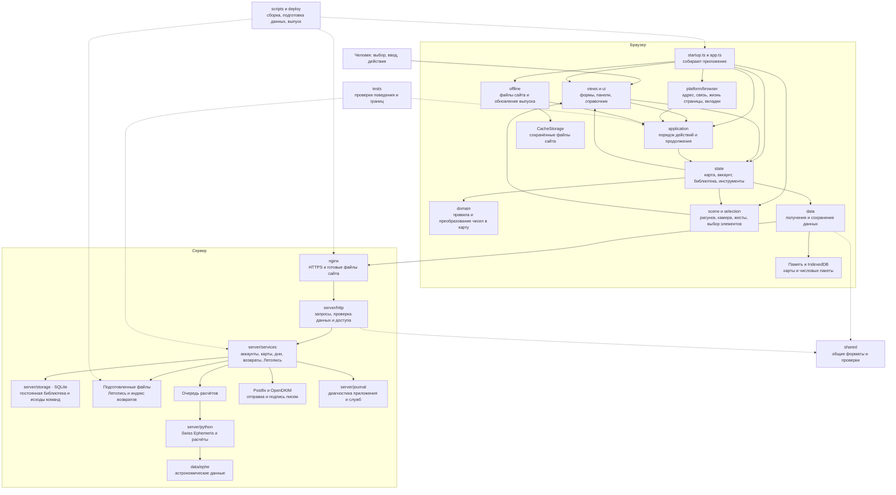
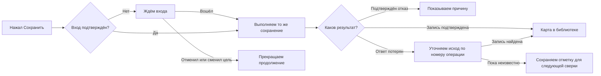

# Форма

[Форма](https://juxtaposition.ru) — сайт для построения и исследования карт Human Design. Можно рассмотреть свою карту, посмотреть текущий транзит, двигаться по времени и изучать возвраты планет. Аккаунт хранит личную библиотеку, а подготовленные копии на устройстве позволяют продолжать часть работы без интернета.

Здесь описано текущее приложение: возможности, устройство, данные, запуск и обслуживание. Это единственная инструкция в репозитории. Прежние документы, планы и отчёты хранятся отдельно, в папке «История проекта» по датам.

**Содержание**

- [Что умеет сайт](#что-умеет-сайт)
- [Как работает офлайн](#как-работает-офлайн)
- [Общая схема проекта](#общая-схема-проекта)
- [Машина состояний простыми словами](#машина-состояний-простыми-словами)
- [Путь одного действия](#путь-одного-действия)
- [Карта кода и переносимость](#карта-кода-и-переносимость)
- [Сервер и API](#сервер-и-api)
- [Данные и хранение](#данные-и-хранение)
- [Локальный запуск](#локальный-запуск)
- [Настройки и серверные каталоги](#настройки-и-серверные-каталоги)
- [Подготовленные файлы](#подготовленные-файлы)
- [Почта](#почта)
- [Деплой и обновление](#деплой-и-обновление)
- [Если что-то не работает](#если-что-то-не-работает)
- [Разработка и проверки](#разработка-и-проверки)

## Что умеет сайт

| Возможность | Что можно делать |
|---|---|
| Карта рождения | Указать дату, время и место рождения, получить карту и рассмотреть её элементы. Первое построение доступно гостю. |
| Текущий транзит | Смотреть карту текущего момента и её изменение во времени. |
| День | Перемещаться по минутам подготовленного дня и видеть, как меняется карта. Местное время учитывает часовой пояс и перевод часов. |
| Летопись | Исследовать моменты из большого заранее рассчитанного диапазона. Сервер отдаёт нужную точку, а не весь набор данных. |
| Возвраты | Находить события возвращения небесного тела к исходному положению и открывать карты этих событий. |
| Соположение | Рассматривать основную карту вместе с транзитом или возвратом. Исходная карта при этом не меняется. |
| Справочник | Читать объяснения выбранных элементов карты и искать нужные статьи. |
| Регистрация и вход | Подтвердить почту одноразовым кодом. Поддерживается также вход и привязка Telegram, когда он настроен на сервере. |
| Личная библиотека | Сохранять карты в аккаунте, менять название и заметку, редактировать и удалять свои записи. |
| Ссылки на карты | Открывать публичный вид карты и сохранять его в свою библиотеку. Личная заметка в публичный ответ не входит. |
| Продолжение работы | Восстанавливать выбор и состояние исследования после перезагрузки вкладки. |
| Офлайн | Открывать уже подготовленные локальные карты и пользоваться доступными для них наборами данных. |

Построенная гостевая карта остаётся временной, пока не сохранена в аккаунт. Копирование ссылки само по себе её не сохраняет. Если нажать «Сохранить» до входа, приложение предложит войти и затем продолжит это действие.

## Как работает офлайн

У приложения две разные задачи: открыть сам сайт и получить данные карты.

- **Файлы сайта** сохраняет Service Worker — браузерный механизм, который позволяет открыть уже загруженное приложение без сети.
- **Карты и числа** сохраняются отдельно в IndexedDB — локальной базе браузера. Библиотека постепенно получает карточки, дни и основные семейства возвратов.
- **Рабочая память вкладки** держит уже полученные результаты до закрытия или перезагрузки. Она помогает продолжить работу, даже если браузер отказал в записи на диск.

Офлайн доступно то, что успело подготовиться на этом устройстве. Строка с названием в библиотеке ещё не означает, что вся карта скачана. Для нового офлайн-открытия собственного Дня или возвратов нужен соответствующий полный пакет в локальной базе. Первая загрузка сайта, вход, сохранение в аккаунт и получение отсутствующих данных требуют связи.

**Готовую собственную карту приложение открывает из памяти или локальной базы. Наличие интернета само по себе не вызывает повторный запрос к серверу.** Сверка библиотеки отдельно сообщает, какие записи изменились; тогда можно получить нужную новую редакцию.

Если место закончилось, приложение пытается освободить допустимую локальную копию и повторить запись. Повторный отказ прекращает дальнейшее автоматическое вытеснение в этом запуске. Серверные карты остаются целыми; доступные данные в памяти и на диске можно читать. Подробный порядок — [ниже](#если-браузер-не-даёт-сохранить-данные).

## Общая схема проекта

В браузере находятся управление, инструменты исследования и рисунок. На сервере — аккаунты, постоянная библиотека, выдача готовых данных и расчёты. Почта и журнал обслуживаются отдельными службами.

Стрелки показывают основные обращения между частями. Возвращаемые ответы подразумеваются; это схема обязанностей, а не список всех импортов.



Один и тот же расчёт не нужно повторять во всех частях. Python получает астрономические числа. Сервер сохраняет или выдаёт результат. Браузер выбирает нужный момент, превращает числа в сведения о карте и рисует её. Если результат уже готов, путь через очередь расчётов не нужен.

## Машина состояний простыми словами

Машина состояний — часть программы, которая помнит, **какое действие сейчас идёт и что должно произойти дальше**. Например: ждём входа → сохраняем карту → принимаем результат. Она задаёт порядок и не даёт позднему ответу вернуть на экран карту, которую человек уже закрыл.

У неё несколько связанных областей: запуск приложения, открытие карты, смена аккаунта, сохранение, обновление публичной карты и фоновая работа с библиотекой. Области могут работать одновременно, но продолжение зависит от общих правил. Например, дозагрузка уступает место действию человека, а новая версия приложения ждёт завершения записи.

**Пример: сохранение карты.** Это схема пользовательского сценария; точные имена состояний находятся в коде.



**Разделение обязанностей простое:** машина решает, когда продолжать, отменять и принимать результат; исполнитель делает запрос или запись; расчётчик считает; представление рисует. Проверка чисел и работа с базой остаются у тех, кто ими занимается. Поэтому в машину не переносится весь `app.ts` и весь код приложения.

Если запрос уже ушёл, отмена ожидания не отменяет сделанную сервером запись. Такой результат можно позже найти в библиотеке. Если ответ потерялся, приложение сначала выясняет исход по идентификатору операции, а не отправляет сохранение заново.

Главный вход — [application.ts](src/application/application.ts), общие решения — [application-machine.ts](src/application/application-machine.ts). Браузер подключается через [ports.ts](src/application/ports.ts): это перечень операций, которые окружение предоставляет ядру.

Часть правил записана переходами состояний, часть — именованными действиями родительской машины. Например, `coordinate` проверяет, можно ли продолжить сохранение, сверить неизвестные исходы и разбудить фон. Это не пересчёт карт и не повторение всех запросов. Проверяются условия допуска. Эти условия видны в коде действий, поэтому одна диаграмма состояний не показывает всю логику.

<details>
<summary>Где находится каждое правило между областями</summary>

| Правило | Что его запускает | Где принимается решение |
|---|---|---|
| Подтверждённый вход продолжает ожидающее сохранение | Изменение аккаунта | `application-machine.ts`: `accountChanged` → `resumeWaitingWrite`; продолжение — [write-continuation.ts](src/application/write-continuation.ts). |
| Неизвестные исходы восстанавливаются после подготовки источников | Готовность аккаунта и запуска, возвращение среды | `recoverReadyWrites`; чтение исхода — владелец записи. |
| Новый выбор отменяет прежнее открытие и ненужное продолжение; переход ко входу сохраняет ожидающую запись | Запрос маршрута, карты или раздела | Переходы `destination`, `cancelOpening`, `cancelDepartingWrite` в `application-machine.ts`; получение цели — [route.ts](src/application/route.ts). |
| Смена аккаунта закрывает прежние права и отменяет публичное обновление | `AccountBoundaryStarted` | `boundary`; очистка и подключение — [account-boundary.ts](src/application/account-boundary.ts). |
| Полученная библиотека и результат формы сохраняют правильный выбор | `LibraryChanged`, `FormSaved` | `libraryChanged`, `formSaved`, `projectLibrary`, `presentFormResult` в `application-machine.ts`. |
| Возвращение страницы или связи разрешает только предусмотренное продолжение | Факты среды | [background-work.ts](src/application/background-work.ts) → `environmentObserved` в родительской машине. |
| Две вкладки не начинают одну фоновую работу независимо | Цель сверки, время, текущее разрешение | [background-coordinator.ts](src/platform/browser/background-coordinator.ts) и [background-policy.ts](src/domain/background-policy.ts). |
| Новая страница может один раз продолжить брошенную начальную сверку | Найдено чужое незавершённое начальное разрешение | `initialRecoveries`, `recoverInitial`, `reserveInitial` в браузерном координаторе; прежние таймер и процедура допуска. |
| Дозагрузка ждёт освобождения переднего плана; отмена ждёт завершения начатой записи | `FillWake`, `FillChanged`, результаты | Единственное `FillState` в [library-fill.ts](src/application/library-fill.ts). |
| После квоты дозагрузка возобновляется по более поздней подтверждённой записи данных | Уведомление с `payloadStoredAt` | `background-work.ts` передаёт `space`; `library-fill.ts` сохраняет продолжение; [domain/library-fill.ts](src/domain/library-fill.ts) сравнивает его с последним отказом. |
| Новый выпуск ждёт записи, восстановления исходов и сохранения снимка | Подготовка обновления | [update.ts](src/application/update.ts), `applicationUpdateReady`, `whenBackgroundIdle` в `application.ts`. |
| Остановка прекращает продолжения и освобождает окружение | `Stop`, уничтожение приложения | `application.ts`, выход из `running`; браузерная сборка освобождает свои ресурсы в `app.ts`. |

</details>

Меню и окно подтверждения принадлежат интерфейсу. Ядро может отменить начатое редактирование; способ закрытия окна выбирает браузерное представление.

## Путь одного действия

| Действие | Что происходит |
|---|---|
| Открыть свою готовую карту | Выбирается актуальная копия в памяти или IndexedDB. Сервер нужен, если копии нет либо известно, что она устарела. После ожидания проверяется, не изменились ли выбор и аккаунт. |
| Сохранить карту | Машина при необходимости ждёт входа. Исполнитель отправляет команду с идентификатором операции. Серверный результат принимается без обязательного повторного чтения карты. |
| Подвинуть время | Владелец инструмента выбирает момент из готового дня или Летописи. Числа превращаются в одну карту; весь день не преобразуется в тысячи объектов заранее. |
| Открыть День или возврат | Используется пригодный готовый пакет. Чтение подготовленного дня собственной карты не запускает новый расчёт. Ответ «ещё не готово» отличается от ошибки. |
| Просто открыть свою карту | Закрытый инструмент возвратов с выключенными маркерами не запрашивает пять списков событий. У временной гостевой карты есть своя предусмотренная подготовка. |
| Обновить библиотеку | Сначала сверяется лёгкий каталог. Полные карточки и пакеты загружаются отдельно, по необходимости. Полный подтверждённый каталог позволяет убрать отсутствующие записи; частичный список — нет. |
| Дозагрузить офлайн-копии | Фон получает карточки, затем дни, затем основные семейства возвратов. Вкладки согласуют работу, чтобы не делать её одновременно. Фоновая загрузка не считается открытием карты человеком. |
| Выйти из аккаунта | Прежние права и продолжения закрываются. Поздние ответы не возвращают личные данные в новый сеанс. Сами сохранённые карты остаются на сервере. |
| Обновить приложение | Service Worker скачивает новый выпуск. Перед переключением страница обращается к ядру: нужно закончить запись, сверку неизвестных исходов и сохранить состояние вкладки. |

Для движения по времени цепочка находится в [chart-exploration.ts](src/state/chart-exploration.ts) → владельце выбранного инструмента → [moment-projection.ts](src/domain/moment-projection.ts) → [chart-session.ts](src/state/chart-session.ts) → [chart-composition.ts](src/domain/chart-composition.ts) → представлении. Каждая часть отвечает за один шаг: выбрать, получить, преобразовать, принять, совместить и показать.

## Карта кода и переносимость

В таблице слово **владелец** означает часть кода, в которой находится правило или состояние и через которую его меняют.

| Место | За что отвечает |
|---|---|
| [startup.ts](src/startup.ts), [app.ts](src/app.ts) | Создают владельцев и браузерные адаптеры, соединяют ввод и представления, освобождают ресурсы. |
| [application/](src/application/) | Открытие, вход, сохранение, восстановление, продолжение, отмена и подготовка обновления. |
| [application/ports.ts](src/application/ports.ts) | Договор ядра с навигацией, аккаунтом, записью, фоном и представлением. |
| [state/](src/state/) | Состояние конкретных инструментов, выбранная карта, библиотека и выполняемые команды. |
| [domain/](src/domain/) | Правила предмета и преобразование данных; без работы с DOM. |
| [src/data/](src/data/) | Клиенты API, ограниченная память, IndexedDB, запись полных пакетов. |
| [platform/browser/](src/platform/browser/) | History API, жизненный цикл страницы и координация вкладок. |
| [views/](src/views/), [ui/](src/ui/) | Формы, панели, окна, справочник и отображение состояния. |
| [scene/](src/scene/), [selection/](src/selection/) | Рисунок карты и Мандалы, камера, жесты и выбор элементов. |
| [reference/](src/reference/) | Статьи и устройство справочника; показ и поиск подключаются через представления. |
| [shared/](shared/) | Общие проверяемые договоры клиента и сервера: записи, пакеты, UTC, адреса, библиотека. |
| [server/http/](server/http/) | HTTP-методы, входные данные, доступ и ответы. |
| [server/services/](server/services/), [server/storage/](server/storage/) | Получение готового результата, серверные правила, подготовка и хранение. |
| [server/python/](server/python/) | Расчёт, сетки времени и создание подготовленных файлов. |
| [offline/](src/offline/) | Файлы приложения для офлайн-запуска и безопасное переключение выпуска. |
| [server/runtime/](server/runtime/) | Очередь вычислений, запуск Python и освобождение серверных ресурсов. |
| [server/journal/](server/journal/), [journal.ts](src/journal.ts) | Сбор и ограниченное хранение диагностики. |
| [deploy/](deploy/) | Службы сайта и журнала, nginx, почта, подготовка постоянных каталогов. |
| [scripts/](scripts/) | Сборка браузерного выпуска, запуск подготовки данных и проверки архитектуры. |
| [data/](data/) | Исходные справочные и астрономические данные. Это другая папка, чем клиентская `src/data`. |
| [tests/](tests/) | Проверки пользовательских сценариев, расчётов, хранения, API и установки. |

`app.ts` создаёт части браузерного приложения, соединяет их и освобождает ресурсы. Правила продолжения живут в ядре, данные и инструменты — у своих владельцев, рисование — в представлениях.

**Что можно перенести.** Ядро управления, предметные правила и владельцы данных не требуют браузерного DOM. Для другой платформы нужно подключить её навигацию, часы, транспорт, хранение и координацию, а также сделать её интерфейс. Переносится эта связанная часть приложения, а не один файл машины.

Связанные сценарии проверяются без DOM с настоящими владельцами и разными координаторами. Это доказательство переносимости проверенных сценариев; готового интерфейса для другой платформы эти тесты не создают.

## Сервер и API

API — запросы, которыми браузер обращается к серверу. [server.ts](server/server.ts) собирает сервер, HTTP-обработчики проверяют входные данные и доступ, затем вызывают нужный сервис.

Три вида работы разделены: **получить готовое**, **посчитать отсутствующее**, **изменить запись аккаунта**. Готовое чтение не ждёт очереди Python-расчётов.

| Область | Договор и владелец |
|---|---|
| Вход и сессия | [account-contract.ts](shared/account-contract.ts), [http/accounts.ts](server/http/accounts.ts), [services/accounts.ts](server/services/accounts.ts). |
| Каталог, собственная и публичная карта, команды и их исходы | [chart-record-contract.ts](shared/chart-record-contract.ts), [library-catalog-contract.ts](shared/library-catalog-contract.ts), [http/charts.ts](server/http/charts.ts). |
| Готовые дни и семейства аккаунта | [library-package-contract.ts](shared/library-package-contract.ts), владельцы `library-packages` и `library-preparation` в `server/storage` и `server/services`. |
| Расчёт карты, дневные данные, возвраты | [http/app.ts](server/http/app.ts), обработчики `natal-days`, `transit-days`, `cycles`; одноимённые сервисы. |
| Летопись | [http/lifetime.ts](server/http/lifetime.ts), [services/lifetime.ts](server/services/lifetime.ts): метаданные и позиционное чтение файла. |

Клиент различает подтверждённый отказ, временную неготовность, отмену и неизвестный исход команды. Универсального автоматического повторения всех запросов нет. Чтение готового ресурса, новая вычислительная работа и запись в аккаунт имеют разные правила допуска и повтора.

Данные проверяются при получении из HTTP, файла или IndexedDB. Уже проверенный результат в памяти не нужно заново целиком проверять и записывать при каждом использовании. Проверки текущего доступа и актуальности после ожидания сохраняются; продление сессии выполняется не больше одного раза внутри одного HTTP-запроса.

Запросы, которым нужен Python, используют [compute-queue.ts](server/runtime/compute-queue.ts): по умолчанию четыре активные работы и 64 ожидающие. Готовые числа обходят эту очередь. У чтения Летописи своя очередь: четыре чтения и до 1024 незавершённых запросов. Это ограничения работы приложения, а не обещание времени ответа внешней сети.

Точные адреса приложения задаёт [app-routes.ts](shared/app-routes.ts), договор обновления — [offline-contract.ts](shared/offline-contract.ts), допустимые диагностические сообщения — [client-report-contract.ts](shared/client-report-contract.ts). Таблицы выше объясняют смысл; точный состав полей хранится в общем коде `shared`.

## Данные и хранение

Основная копия личной библиотеки — на сервере. Локальная база браузера даёт офлайн-доступ. RAM — оперативная память текущей вкладки; её содержимое теряется при перезагрузке. CacheStorage хранит файлы сайта, IndexedDB — записи и числа. Эти хранилища решают разные задачи.

### Основные понятия

| Слово | Что означает |
|---|---|
| Карта | Исходные данные и рассчитанное содержимое. У сохранённой карты есть владелец, адрес и редакция. |
| Каталог | Короткий список карт аккаунта. Название в списке не заменяет полную карту. |
| Пакет | Полный пригодный набор данных: например, минуты дня рождения или основное семейство возвратов. Половина пакета не считается готовыми данными. |
| Летопись | Подготовленный файл числовых точек с шагом десять минут. |
| Возврат | Точное событие возвращения небесного тела к исходному положению и карта этого события. |
| Проекция | Сведения о карте, полученные из готовых чисел выбранного момента. |
| Композиция | Одна карта либо соположение основной карты с транзитом или возвратом. |
| Снимок вкладки, `checkpoint` | Выбор и состояние исследования для восстановления. Он не заменяет базу и не подтверждает сохранение на сервере. |
| Редакция, `revision` | Версия конкретной записи. Старый ответ не заменяет уже принятую новую редакцию. |
| Маркер каталога, `catalogMarker` | Отметка изменений библиотеки: помогает сверять список без скачивания всех карт. |
| `lease` | Аккаунт и поколение локального владельца. Защищает от записи старого ответа после выхода или смены аккаунта. |
| `permit` | Временное право вкладки выполнить конкретную фоновую работу, чтобы вкладки не дублировали её. |
| Неизвестный исход | Запись могла выполниться, но её ответ потерялся. Сначала нужно выяснить результат по идентификатору операции. |

### Где лежат данные


| Данные | Место и владелец | Срок и правило использования |
|---|---|---|
| Аккаунты, сессии, карты, заметки, исходы команд | Серверная SQLite; [server/storage/](server/storage/) | Основные записи аккаунта. Очистка браузерных копий их не удаляет. Сроки и удаление задаёт соответствующий серверный владелец. |
| Готовые дни и основные семейства собственных карт | Серверные пакеты и очередь подготовки; `library-packages`, `library-preparation` | Подготовка отделена от выдачи готового результата. При чтении готового пакета повторный расчёт не нужен. |
| Летопись и индекс возвратов | Подготовленные серверные файлы | Файлы создаются и переводятся отдельными командами. Они не создаются заново при каждом открытии страницы. |
| Рабочий список и принятые карты | RAM; [account-library.ts](src/state/account-library.ts), [chart-store.ts](src/data/chart-store.ts) | Живут в текущем приложении. Готовая запись используется напрямую; строка лёгкого каталога не заменяет полный расчёт. |
| Локальная библиотека аккаунта | IndexedDB `forma-account-library`, схема 8; [account-library-store.ts](src/data/account-library-store.ts) | Полные карточки, общий каталог, числовые пакеты, связи, отметки использования и разрешения обслуживания. Данные ограничены текущим аккаунтом и поколением. |
| Общие локальные расчёты | IndexedDB `forma-calculation-cache`, схема 3; [calculation-cache.ts](src/data/calculation-cache.ts) | Общий бюджет 256 000 000 байт. Учёт и вытеснение принадлежат одному владельцу; активное подтверждённое окно транзитных дней защищено до своего срока. |
| Повторно используемые числа во вкладке | [memory-cache.ts](src/data/memory-cache.ts) | Общий бюджет 64 МиБ для полных дней, расчётов и списков событий. Неиспользуемое вытесняется, активные данные удерживаются потребителями. Это не предел всей памяти страницы. |
| Отдельные списки дат возвратов | Та же ограниченная RAM | Новые отдельные списки не записываются в IndexedDB. Даты внутри целого семейства сохраняются вместе с этим семейством. Чтение поддерживаемых старых списков осталось для перехода. |
| Выбор карты и состояние исследования вкладки | `sessionStorage`; [view-store.ts](src/data/view-store.ts), [view-session.ts](src/state/view-session.ts) | Снимок для восстановления этой вкладки. Не является копией базы и не доказывает, что команда на сервере выполнена. |
| Файлы оболочки приложения | CacheStorage; [offline/](src/offline/) | Управляются выпуском приложения и Service Worker. Числовые пакеты и библиотека имеют своих владельцев. |
| Диагностика | Клиентская очередь и серверный журнал; [journal.ts](src/journal.ts), [server/journal/](server/journal/) | Отдельные ограниченные данные. При недостатке места диагностике разрешено уступить место рабочим данным. Пути и лимиты журнала приведены в разделе эксплуатации ниже. |
| Миниатюры карт | Canvas видимых строк; [chart-preview-canvas.ts](src/views/chart-preview-canvas.ts) | Производятся из готового рисунка и освобождаются при уходе строки. Отдельного постоянного кэша миниатюр нет. |

Порядок чтения пригодных данных: рабочая память → предусмотренное локальное хранилище → адресный запрос. Это не универсальная цепочка для любой операции: проверка доступа, неизвестный исход команды и сверка каталога выполняют собственную работу. Готовую собственную карту не запрашивают повторно только из-за наличия интернета.

Скопированные числа и отметки использования различаются. Повторное использование дня из RAM не должно заново проверять, клонировать и записывать целый пакет. Чтение текущего транзита не обновляет дисковый LRU: его удерживает окно дней.

### Полные пакеты библиотеки

Договор находится в [library-package-contract.ts](shared/library-package-contract.ts). Карточка, день и семейство имеют отдельную идентичность. Общие числа хранятся один раз и связаны с картами, которым они принадлежат; удаление одной карты не удаляет пакет другой.

`charts`, `packages` и `packageMetadata` содержат данные и связи. Лёгкие строки `usage` отмечают настоящее открытие. При вытеснении пакета сохраняется отметка намеренного удаления; это не готовый пакет и не новая жертва следующей очистки. Удаление последней связанной карты убирает оставшиеся ссылки и отметки.

Приоритет локальных копий: карточки выше дней, дни выше целых основных семейств. Внутри уровня учитывается использование. Фоновое получение не считается открытием человеком.

Каталог принимается отдельно от числовых карточек. Только полный подтверждённый проход разрешает удалить отсутствующие записи. Неизменившийся каталог не требует повторной записи. Полная актуальная карта в RAM может открываться и офлайн до перезагрузки. Одна строка каталога без полной карты этого не позволяет. Отказ IndexedDB не скрывает готовую RAM-карту, но не подтверждает возможность восстановить её после перезагрузки. Для нового офлайн-действия инструментов собственного дня и возвратов дополнительно проверяется полный пакет на диске.


### Если браузер не даёт сохранить данные

Квота — объём места, который браузер разрешает занять сайту. Отказ квоты не означает, что закончился диск сервера.

Порядок в [storage-pressure.ts](src/data/storage-pressure.ts):

1. Попробовать обычную запись.
2. При отказе квоты один раз освободить допустимые данные. Сначала уступает диагностика; если она не освободила место, владелец хранилища выбирает допустимую копию. Библиотека может вытеснить одну менее важную копию.
3. Повторить запись целого нового пакета. Освобождение места — отдельная завершённая операция: если новая запись не удастся, удалённая копия сама не вернётся.
4. Если квота отказала снова, прекратить автоматическое вытеснение до нового запуска этого экземпляра приложения.

Следующие необходимые записи всё ещё могут пройти обычным путём. Даже если маленькая запись удалась, она не разрешает новый круг очистки. Уже полученный результат остаётся в ограниченной памяти; уцелевшие копии можно читать с диска. После перезагрузки память пропадёт, поэтому полный офлайн в этом случае не гарантируется.

Поздняя успешная запись **самой карточки или числового пакета** может продолжить дозагрузку через существующее уведомление `payloadStoredAt`. Продолжение ждёт свободного переднего плана и полного каталога, отменяется при смене аккаунта или сессии. Служебная отметка, пустая запись, вытеснение или запись самой дозагрузки таким поводом не служат. Таймеров и пробных скачиваний ради проверки свободного места нет.

Новые данные становятся доступными только после полной успешной записи. Удаление локальной копии не удаляет карту в аккаунте на сервере.

<details>
<summary>Числовые форматы, точность и переход старых данных</summary>

#### Числа и время

Числовые договоры общие для TypeScript и Python. Фиксированный порядок планет и полей задаёт [moment-columns.ts](shared/day-packets/moment-columns.ts): 11 долгот Личности, 11 долгот Дизайна, время Дизайна и остаток поиска дуги. Земля и Южный узел выводятся из Солнца и Северного узла прибавлением 180°.

Вычисления Дизайна используют найденный точный момент. Его текстовая подпись округляется до секунды отдельно от расчёта положений. Нельзя уменьшать точность готовых чисел ради размера JSON или удобства интерфейса.

| Формат | Действующий договор |
|---|---|
| Транзитный день, версия 2 | 1440 минут UTC, 24 колонки Float64. Только числовой блок занимает 276 480 байт; заголовок и упаковка учитываются отдельно. [transit-format.ts](shared/day-packets/transit-format.ts). |
| День рождения, версия 1 | Минуты местного дня, до 2880 отсчётов; сегменты хранят UTC-начало, смещение и `fold`. Нельзя считать любой местный день равным 1440 минутам. [natal-format.ts](shared/day-packets/natal-format.ts). |
| Файл Летописи, версия 3 | Шаг 600 секунд, 24 значения одной точки подряд, Float64 little-endian. Запись — 192 байта, смещение `(sample * 24 + column) * 8`. [lifetime-format.ts](shared/lifetime-format.ts). |
| Точное событие возврата | Идентичность события и точная строка UTC сохраняются. Человек выбирает событие, затем получает соответствующую карту. [chart-return-contract.ts](shared/chart-return-contract.ts), [cycles-format.ts](shared/cycles-format.ts). |

Заголовок и числа пакета проверяются общим [decode.ts](shared/day-packets/decode.ts). Правила местного дня не заменяются правилами транзитных суток. Проекция читает выбранный момент; весь день заранее не превращается в тысячи объектов карт.

Диапазоны находятся в [date-limits.ts](shared/date-limits.ts): данные 1801–2399 годов; создание натальной карты — до 2299 года включительно, чтобы оставались полные 100 лет дальнейших событий. После разрешения часового пояса дополнительно проверяется покрытие UTC. Исторические смещения и повторяющиеся минуты учитывает расчёт, а не сегодняшний часовой пояс пользователя.

Перед допуском чтений сервер один раз проверяет метаданные, точный размер и SHA-256 всего числового файла Летописи. Проверка идёт с ограниченной памятью; отдельное чтение точки не хеширует файл заново.

Летопись использует готовую минуту полного дня, когда она доступна и пригодна. Иначе читается точка десятиминутной сетки. Отдельного расчёта произвольного промежуточного момента и накопления истории таких вычислений нет.

Сравнение двух путей одного движка подтверждает их согласованность, но не заменяет независимый внешний эталон астрономических расчётов.

#### Версии и переходы

Версия формата, редакция пользовательской карты и версия выпуска приложения имеют разный смысл. Хеш исходников расчётчика не является ключом пригодности уже сохранённых чисел.

Поддерживаемые старые SQL-записи переводятся транзакционно при открытии схемы. IndexedDB обновляется через свой владелец; старое соединение должно отпустить upgrade. Числа, точный UTC, связи, заметки и давность использования при переходе сохраняются.

Общий преобразователь старых расчётных метаданных — [calculation-storage-transition.ts](shared/calculation-storage-transition.ts). Он убирает прежние служебные поля совместимости без пересчёта чисел. Старый текст движка внутри подписанной квитанции сохраняется вместе с ней: изменение подписанного сообщения разрушило бы подпись.

Готовые файлы Летописи и индекса возвратов переводятся **явной** командой [migrate-prepared-calculations.ts](scripts/migrate-prepared-calculations.ts), при остановленных старых читателях и писателях. Автоматического перехода этих файлов из HTTP или обычного запуска нет. Команды, порядок резервной копии и ограничения отката приведены в [разделе деплоя](#деплой-и-обновление).

Архив диагностики читается с учётом прежних служебных полей и названий ошибок. Сначала проверяется контрольная сумма исходной записи; её байты, идентификатор, хеш и срок хранения не меняются. Совместимость чтения архива не расширяет договор новых сообщений браузера.

</details>

## Локальный запуск

Нужны Node **24.x**, npm и Python **3.12** с venv. Команды ниже выполняются из корня исходников, где лежит `package.json`. Если для Python-зависимости нет готового пакета, понадобятся системные инструменты сборки. Зависимости закреплены в `package-lock.json` и `requirements.txt`.

```sh
npm ci
python3.12 -m venv .venv
.venv/bin/python -m pip install -r requirements.txt
.venv/bin/python -c 'import swisseph; import zoneinfo'
```

Сервер вызывает Python именно из проектной `.venv`; эфемериды читает из `data/ephe`. Эти файлы должны входить в выпуск. На Windows путь интерпретатора — `.venv/Scripts/python.exe`; приведённые shell-команды рассчитаны на macOS/Linux.

В необязательной локальной `.env` задайте `FORMA_JOURNAL_WRITER=embedded`. Не заменяйте уже существующий файл целиком: в нём могут быть действующие пути стенда и почты. Для отдельной рабочей копии задайте собственные абсолютные `FORMA_STATE_DIR` и `FORMA_JOURNAL_DIR`, отдельный порт и отдельную браузерную сессию. Почтовую очередь чужого стенда не подключайте.

```sh
npm run prepare:lifetime
npm run prepare:returns
npm start
```

По умолчанию адрес — `http://localhost:3636`, слушатель — `0.0.0.0`. Для отдельного стенда, доступного только на этом компьютере: `HOST=127.0.0.1 PORT=4177 npm start`. Не занимайте уже работающий 3636. Для последующих запусков достаточно `npm start`: подготовленные данные повторно создавать не нужно.

Сборка и запуск выпуска:

```sh
npm run build
npm run start:release
```

Обычный запуск читает исходники, release-режиму нужен `dist/manifest.json`. Браузер различает сайты по сочетанию протокола, имени и порта — это называется origin. Поэтому смена порта даёт отдельное браузерное хранилище. Телефон в общей сети может открыть сетевой адрес компьютера, но его локальная библиотека отдельная; `localhost` телефона не указывает на компьютер.

## Настройки и серверные каталоги

Параметры читаются из окружения процесса; сервер также загружает локальную `.env`. В боевом выпуске `.env` запрещена: systemd получает настройки из двух явно заданных файлов. Образец — [forma.environment.example](deploy/forma.environment.example).

| Параметр | Смысл и значение |
| --- | --- |
| `HOST`, `PORT` | По умолчанию `0.0.0.0:3636`; служба сайта — `127.0.0.1:4173`. |
| `FORMA_STATE_DIR` | Абсолютный закрытый каталог аккаунтов; по умолчанию `~/.local/share/forma`, на сервере `/var/lib/forma`. |
| `FORMA_JOURNAL_DIR` | Отдельный абсолютный каталог журнала; локально по умолчанию `<state>/journal`, на сервере `/var/log/forma`. |
| `FORMA_ENVIRONMENT` | `stand` по умолчанию либо `production`. |
| `FORMA_JOURNAL_WRITER` | Обязательный выбор: `embedded` для местного запуска, `external` для отдельной службы журнала. Автоматической подмены режима нет. |
| `FORMA_JOURNAL_NGINX_SOCKET` | В боевом окружении `/run/forma-journal/nginx.sock`; источник событий nginx. |
| `FORMA_APP_VERSION` | В production обязателен полный SHA выпуска. Это версия приложения, не расчётов, и не самостоятельная проверка целостности исходников. |
| `FORMA_ACCOUNT_ORIGINS` | Разрешённые origins через запятую; локально по умолчанию localhost/loopback текущего порта, на сервере `https://juxtaposition.ru`. |
| `FORMA_TRUST_PROXY` | На сервере `loopback`: доверенный местный nginx. Другие значения не поддерживаются. |
| `FORMA_POSTFIX_SOCKET`, `FORMA_POSTFIX_PORT` | Задаются вместе: сокет управления очередью и её SMTP-порт; на сервере `/var/lib/forma-postfix/run/control.sock` и `2525`. Без пары почта не подключена. |
| `FORMA_TELEGRAM_CLIENT_ID` | Необязательный числовой ID зарегистрированного приложения Telegram. |
| `FORMA_LOCAL_MAILBOX` | `1` включает местный просмотрщик при допустимом локальном запуске; на сервере `0` или отсутствует. Само значение не перенастраивает Postfix. |
| `TRANSIT_CACHE_DIR` | Путь прежнего дискового кэша транзитных дней для его очистки; локально `.cache/transit`, systemd задаёт `/var/cache/forma/transit`. Новые транзитные дни хранятся в оперативной памяти сервера. |

| Данные | Где находятся и как обращаться |
| --- | --- |
| Аккаунты, карты, подготовленные пакеты библиотеки, пометки операций | `<state>/forma.sqlite`; это постоянная серверная база. Не заменять базой с другого стенда. |
| Ключ подписей аккаунта | `<state>/keys/account-hmac.bin`, 32 байта. Сохранять вместе с базой, не создавать новый поверх прежнего. |
| Журнал | `<journal>/archive`, вспомогательные данные и `<journal>/run/services.sock`; на сервере отдельный владелец записи `forma-journal`. |
| Летопись | `.cache/lifetime/lifetime-1801-2400.f64le` и соседний `.metadata.json`. На сервере каталог связан с `/var/cache/forma/lifetime`. |
| Индекс возвратов | `.cache/returns/return-index.bin`; на сервере каталог связан с `/var/cache/forma/returns`. |
| Код и сборка | `/opt/forma/releases/<SHA>`; `/opt/forma/current` — ссылка на действующий выпуск. |
| Почтовая очередь | Временные тела писем — `/var/spool/forma-postfix`, служебные программы/данные — `/var/lib/forma-postfix`, настройки — `/etc/forma-postfix`. |
| Подпись почты | `/etc/forma-dkim`; приватный DKIM-ключ сохраняется при обновлении. |
| Копии браузера | IndexedDB и кэш приложения соответствующего origin на устройстве; это не резервная копия всей серверной базы. |

### Службы сайта и журнала

Маршрут сайта: HTTPS nginx → Node на `127.0.0.1:4173` → проектный Python и постоянное хранилище. [forma.service](deploy/forma.service) работает от `forma`, [forma-journal.service](deploy/forma-journal.service) владеет единым журналом. Обе службы перезапускаются при отказе с задержкой 5 секунд. В шаблонах заданы `MemoryMax=400M` для сайта и `256M` для журнала, `CPUQuota=50%` у каждой службы; это параметры шаблона, а не измеренный предел нагрузки. Если отдельная служба журнала отказала, приложение не запускает второй журнал внутри себя.

Журнал ограничен 500 000 000 байт и 30 днями; это диагностическое хранение, не копия пользовательской библиотеки. Службы передают ограниченные сведения о сбое через закрытый сокет. Если служба записи недоступна, разовое диагностическое событие может не сохраниться. Не переименовывайте и не удаляйте сокеты при живом владельце; сначала дождитесь его остановки.


## Подготовленные файлы

Летопись и индекс возвратов общие для всех людей. Они не входят в Git и не создаются запуском сайта. Летопись содержит готовые числовые точки; индекс помогает находить участки для уточнения времени возврата. Проверка индекса без пересчёта:

```sh
npm run prepare:returns -- --check
```

Сервер проверяет формат и контрольную сумму готовой Летописи до открытия HTTP, затем читает отдельные точки. Поэтому активный процесс systemd ещё не означает готовый сайт. Отсутствующий/ещё не готовый набор оставляет ограниченный режим: `/api/lifetime/meta` отвечает `503 lifetime_preparing`; готовые файлы обнаружатся при следующем обращении. Повреждённый готовый набор блокирует запуск. Не меняйте содержимое открытого файла на месте.

Без подходящего индекса поиск дат медленнее, а открытие возврата планеты/узлов, которому нужна проверка полного оборота, недоступно. Перед приёмкой выпуска нужны оба набора.

### Однократный переход прежних файлов

Он **не запускается автоматически** ни через HTTP, ни при старте, ни обычной подготовкой. Остановите читателей и подготовительные задания. Укажите только существующие файлы; команда допускает один из двух аргументов, но не допускает отсутствие путей:

```sh
node scripts/migrate-prepared-calculations.ts \
  --lifetime .cache/lifetime/lifetime-1801-2400.f64le \
  --returns .cache/returns/return-index.bin
```

Числа не пересчитываются. У Летописи атомарно заменяются метаданные после проверки числового файла. У индекса заменяется заголовок с копированием неизменённого числового блока; нужно свободное место для временной копии индекса. Владелец и права сохраняются, повтор команды допустим. Обратного CLI-перехода нет: совместимость старого читателя с новым форматом нужно проверить до выпуска.

## Почта

### Местная почта

На macOS приёмник устанавливает `python3 deploy/local_mailbox.py install`: закреплённый Mailpit с проверкой скачанного файла, пользовательская служба, HTTP `127.0.0.1:8025`, SMTP с STARTTLS `127.0.0.1:1025`. Служебные файлы находятся в `~/.local/share/forma-mailbox`; база писем временная, штатный перезапуск очищает её. Это не архив кодов входа.

Для просмотра через `/__mail/` нужны `FORMA_LOCAL_MAILBOX=1`, `stand`, обычный запуск без `--release` и обращение с этого компьютера через localhost/loopback. Просмотрщик и маршрут доставки — разные настройки. В местном Postfix подготовитель запускают с `--local-mailbox-port 1025`; тогда все пользовательские письма идут в местный ящик, и при его остановке интернет-доставка не включается. Сам установщик Mailpit не изменяет Postfix, сайт или DNS.

Для подготовки местной очереди используйте [prepare.ts](deploy/postfix/prepare.ts) от владельца локальной базы, с новым абсолютным `--output`, явным `--database`, `--journal-socket` и `--local-mailbox-port 1025`. Затем просмотрите комплект и план `python3 <комплект>/install.py --bundle <комплект>`; применение требует `--apply` и прав администратора. Установщик использует фиксированный системный экземпляр очереди: его нельзя повторно подключить к другому стенду, сохранив прежнему стенду ту же очередь.

### Почта на сервере

Почта — отдельный экземпляр Postfix и подписант OpenDKIM. Приём приложения слушает только `127.0.0.1:2525`, подписант — `127.0.0.1:8891`; исходящая доставка идёт к чужим SMTP-серверам. Входящие ящики этот комплект не создаёт. Очередь ограничена 500 письмами / 10 МиБ и ожиданием до 5 минут; постоянного архива тел писем нет. Контроллер очереди имеет `Restart=always`, 5 секунд до перезапуска; необработанный сбой очистки завершает контроллер для восстановления службой.

Нужны системные Postfix/OpenDKIM, отдельный настроенный `forma-dkim.service`, закрытый ключ `/etc/forma-dkim/forma.private`, домен `juxtaposition.ru` и selector `forma`. Подписант работает от `opendkim`, с `Mode s`, `Socket inet:8891@[127.0.0.1]`, без сырых журналов писем. Системные экземпляры Postfix/OpenDKIM не должны запускать дополнительный входящий SMTP. На пустом сервере установку пакетов и подписанта проводят отдельно до подключения приложения: готового установщика всей этой части в репозитории нет.

Для новой установки один раз создают DKIM-ключ и публикуют **публичное** значение в `forma._domainkey.juxtaposition.ru`; при обновлении ключ сохраняют. Проверяют A/PTR имени `mail.juxtaposition.ru`, единственную SPF и DMARC. Существующие MX и сторонние TXT не заменяют. Настройки прежнего IP из старых записей не подтверждают нынешний DNS. Собственный HTTPS-сертификат сайта не нужен для исходящего STARTTLS. Почтовая политика требует шифрование, но не задаёт проверку имени чужого сертификата в режиме `verify`.

На подготовленном сервере из нового выпуска, после создания/подготовки базы и её снимка, команды root:

```sh
runuser -u forma -- /opt/forma/node/bin/node deploy/postfix/prepare.ts \
  --output /var/tmp/forma-postfix-prepared \
  --database /var/lib/forma/forma.sqlite --port 2525 \
  --dkim-port 8891 --journal-socket /var/log/forma/run/services.sock
/usr/sbin/postconf -c /var/tmp/forma-postfix-prepared -e 'inet_protocols=ipv4'
chown -R root:root /var/tmp/forma-postfix-prepared
chmod -R go-rwx /var/tmp/forma-postfix-prepared
python3 /var/tmp/forma-postfix-prepared/install.py --bundle /var/tmp/forma-postfix-prepared
# После просмотра плана установки:
python3 /var/tmp/forma-postfix-prepared/install.py --bundle /var/tmp/forma-postfix-prepared --apply
```

Каталог комплекта должен быть новым. Подготовитель фиксирует UID вызывающего пользователя, поэтому его запускают от `forma`, а не root. IPv4 сохраняет существующую схему доставки; подключение IPv6 требует согласованного DNS. В production не указывают `--local-mailbox-port`. Установщик сохраняет очередь и базу, но **сам запускает почтовую службу**: при обновлении сайта выполняйте его после резервного снимка, держите веб-приложение остановленным, затем снова остановите `forma-postfix` до общего старта. Если отправка в этот момент недопустима, сначала дождитесь пустой очереди; у установщика нет флага «установить без запуска».

Окружение приложения установщик не меняет. `/etc/forma-postfix/environment` должен содержать только:

```dotenv
FORMA_POSTFIX_SOCKET=/var/lib/forma-postfix/run/control.sock
FORMA_POSTFIX_PORT=2525
```

`control.json` обязан указывать ту же базу, UID `forma` и `/var/log/forma/run/services.sock`. Приватный ключ не печатайте. Настоящее проверочное письмо требует разрешения автора; статус службы или синтетический SMTP не доказывают доставку в реальный ящик.

Для отдельного комплекта только почтовых служебных программ выполните `node deploy/postfix/package-linux.ts --output /абсолютный/новый/каталог`. Он собирает существующих владельцев в `deploy/prepare-accounts.mjs` и `deploy/postfix/prepare.mjs`, добавляет программы установщика, этот README и `SHA256SUMS`; службы не запускает. После передачи проверьте `sha256sum -c SHA256SUMS`. В приведённых выше командах такого комплекта используйте `.mjs` вместо исходных `.ts`. Этот комплект не является выпуском сайта; ссылки на исходный код в README относятся к полному репозиторию.

## Деплой и обновление

Порядок рассчитан на Ubuntu 24.04, systemd ≥253, пользователя `forma`, Node 24 в `/opt/forma/node/bin`, Python 3.12 и подготовленную почту. Нужны nginx и действующий сертификат `juxtaposition.ru` в `/etc/letsencrypt/live/juxtaposition.ru/`. DNS, выдача/продление сертификата и перезагрузка nginx после продления настраиваются отдельно; конфиг проекта их не выполняет. Серверные блоки выполняйте в отдельной root-сессии с `set -eu`: при ошибке не продолжайте следующий шаг. Команды с `runuser` сами переходят к пользователю приложения.

### 1. Собрать новый выпуск до остановки

Выберите полный SHA интегрированного коммита. На машине с этим коммитом задайте `REVISION`, затем создайте архив исходников и его контрольную сумму; не архивируйте рабочую папку с `.env` и местными данными:

```sh
: "${REVISION:?Задайте полный SHA выпуска}"
git archive --format=tar --output="/tmp/forma-$REVISION.tar" "$REVISION"
shasum -a 256 "/tmp/forma-$REVISION.tar"
```

Передайте архив в закрытый временный каталог сервера и сравните `sha256sum` с полученной суммой. Распакуйте в новый, прежде не существовавший `/opt/forma/releases/<SHA>`, владелец `forma:forma`; не меняйте `current`. В новом каталоге от `forma`, с `/opt/forma/node/bin` в начале PATH:

```sh
build_cache="$(mktemp -d)"
npm ci --cache "$build_cache/npm" --no-audit --no-fund
python3.12 -m venv .venv
.venv/bin/python -m pip install --no-cache-dir -r requirements.txt
.venv/bin/python -c 'import swisseph'
npm run build
test ! -e .env
rm -r -- "$build_cache"
```

Зависимости собираются на Linux, не переносятся с Mac. Проверьте наличие `data/ephe`. В дальнейшей root-сессии задайте `REVISION`, `NEW_RELEASE=/opt/forma/releases/$REVISION` и, при обновлении, `OLD_RELEASE` по `readlink -f /opt/forma/current`; работайте из `NEW_RELEASE`. Это проверенные абсолютные пути. Не перезаписывайте существующий каталог выпуска.

### 2. Подготовить окружение

`/etc/forma/environment`: каталог `root:forma` с правами `0750`, файл `root:forma` с правами `0640`. Заполните по образцу, задайте SHA в `FORMA_APP_VERSION`, `production`, `external`, публичный origin и `FORMA_LOCAL_MAILBOX=0`. Почтовое окружение храните отдельно, с закрытой записью для root. Сохраните прежние настройки перед изменением. У нового выпуска не должно быть локальной `.env`.

Конфиг [forma.nginx](deploy/forma.nginx) включается в контексте `http`. Он требует существующих TLS-файлов; до получения сертификата оставляют рабочий HTTP и обработку ACME, а не включают конфиг с отсутствующим сертификатом. Лимиты расчётов, диагностики и возвратов уже заданы шаблоном.

### 3. Остановить владельцев и сделать снимок

Это окно обслуживания: во время остановки/проверки файла посетители могут получить `502`. Запишите старый путь выпуска; остановите отдельно запущенные задания подготовки и дождитесь их завершения. Остановите сайт и почтовую очередь, затем журнал (при первой установке отсутствующие службы пропускают):

```sh
systemctl stop forma.service forma-postfix.service
systemctl stop forma-journal.service
```

Убедитесь, что процессы завершились. Для существующей базы используйте SQLite Backup API, а не копию одного файла рядом с WAL. Следующий блок root сам создаёт **новый** закрытый каталог; если он уже есть, сначала разберите прежнее обновление:

```sh
python3 - <<'PY'
import os, pathlib, shutil, sqlite3
os.umask(0o077)
backup = pathlib.Path('/var/tmp/forma-release-backup')
backup.mkdir(mode=0o700)
source = sqlite3.connect('file:/var/lib/forma/forma.sqlite?mode=ro', uri=True)
target = sqlite3.connect(backup / 'forma.sqlite')
try:
    source.backup(target)
    if target.execute('PRAGMA integrity_check').fetchall() != [('ok',)]:
        raise RuntimeError('Backup integrity check failed')
finally:
    target.close()
    source.close()
shutil.copyfile('/var/lib/forma/keys/account-hmac.bin', backup / 'account-hmac.bin')
if (backup / 'account-hmac.bin').stat().st_size != 32:
    raise RuntimeError('Invalid existing account key')
PY
```

Добавьте в тот же закрытый каталог старый путь выпуска, действующие units/drop-ins, окружение и nginx-конфигурацию. База и HMAC-ключ — пара. При первой установке зафиксируйте отсутствие прежней базы; не создавайте фиктивный резерв и не копируйте базу разработчика. Это временный снимок окна выпуска, не автоматически работающая система резервирования. Если для отката нужны прежние форматы, сохраните до перехода метаданные Летописи и индекс возвратов: обычный снимок SQLite их не включает. Неизменяемый числовой файл Летописи этот переход не переписывает.

### 4. Подготовить хранилище и выполнить переход

Команды из **нового** выпуска. Сначала план, затем применение от root:

```sh
# Только при наличии прежнего выпуска:
python3 deploy/prepare-storage.py --release "$OLD_RELEASE"
python3 deploy/prepare-storage.py --release "$OLD_RELEASE" --apply
# Для нового выпуска:
python3 deploy/prepare-storage.py --release "$NEW_RELEASE"
python3 deploy/prepare-storage.py --release "$NEW_RELEASE" --apply
runuser -u forma -- /opt/forma/node/bin/node --env-file=/etc/forma/environment deploy/prepare-accounts.ts
```

Помощник переносит существующие каталоги Летописи/индекса в общую зону и ставит ссылки, не копируя многогигабайтный файл. Конфликт двух заполненных каталогов, другой диск или неверные права требуют разбора. Подготовленные файлы должны принадлежать `forma` и читаться им; помощник не исправляет их рекурсивно. `prepare-accounts.ts` открывает/обновляет схему базы без подключения SMTP: поэтому резерв сделан раньше.

**До запуска новых читателей** выполните миграцию прежних подготовленных файлов из раздела [подготовленных файлов](#подготовленные-файлы), теперь от `forma`:

```sh
runuser -u forma -- /opt/forma/node/bin/node scripts/migrate-prepared-calculations.ts \
  --lifetime .cache/lifetime/lifetime-1801-2400.f64le \
  --returns .cache/returns/return-index.bin
```

Если есть только один набор, оставьте только соответствующий аргумент. Если обоих ещё нет, переход пропустите; генерация описана ниже. Не подменяйте миграцию пересчётом готовых чисел. Для индекса обеспечьте место под временную копию. Старые процессы в этот момент должны быть остановлены.

При необходимости обновите программы почты по [инструкции почты](#почта-на-сервере), сохраняя базу, очередь и DKIM-ключ. После подготовки выполните от root:

```sh
/opt/forma/node/bin/node deploy/check-release.ts --release "$NEW_RELEASE" --revision "$REVISION"
```

Это только чтение: окружение, права, ключ, совпадение базы/UID/сокетов, SMTP-порт, версия Node, наличие Python и сборки. Проверка не запускает сайт, не проверяет Python-импорты, числовые файлы, DNS, сертификат или доставку письма и не изменяет SQLite.

### 5. Переключить и проверить

Установите из выпуска `deploy/forma.service` и `deploy/forma-journal.service` в `/etc/systemd/system/`, `deploy/nginx-journal.conf` — в `/etc/systemd/system/nginx.service.d/forma-journal.conf`, `deploy/postfix-journal.conf` — в `/etc/systemd/system/forma-postfix.service.d/forma-journal.conf`. Не теряйте почтовый drop-in при обновлении основного unit. Проверьте units через `systemd-analyze verify`.

Пример атомарного переключения на Linux из root-сессии; временное имя должно быть свободно:

```sh
set -eu
test ! -e /opt/forma/current.next
test ! -L /opt/forma/current.next
ln -s "$NEW_RELEASE" /opt/forma/current.next
mv -Tf /opt/forma/current.next /opt/forma/current
systemctl daemon-reload
systemctl enable forma-journal.service forma.service
systemctl start forma-journal.service
systemctl start forma-postfix.service forma.service
```

Журнал имеет `Type=notify`: дождитесь успешного старта. Установите nginx-конфиг в принятую на сервере точку подключения без повторных limit-зон; выполните `nginx -t` и только после успеха `systemctl reload nginx`. Если сертификат ещё не готов, этот шаг не выполняют.

Если подготовленных файлов раньше не было, создайте их от `forma` после подключения общей зоны и запуска журнала, из нового выпуска:

```sh
runuser -u forma -- /opt/forma/node/bin/node --env-file=/etc/forma/environment scripts/python.ts \
  -m server.python.lifetime_file --file .cache/lifetime/lifetime-1801-2400.f64le
runuser -u forma -- /opt/forma/node/bin/node --env-file=/etc/forma/environment scripts/python.ts \
  -m server.python.return_index --file .cache/returns/return-index.bin
```

Совместимые готовые данные заново не генерируйте. Прежде чем объявлять сайт готовым, дождитесь HTTP и `200` от `http://127.0.0.1:4173/api/lifetime/meta`. `systemctl is-active` этого не доказывает: запуск проверяет большую Летопись до открытия порта. Фиксированного обещания времени запуска нет.

Проверьте через HTTPS `/`, `/account`, `/library`, `/service-worker.js`, `/api/cities?q=Moscow`, гостевой ответ `/api/account`; затем обычный расчёт, чтение Летописи, возврат и специально подготовленную публичную карту. Проверьте заголовки/сжатие реальных файлов `dist`, отсутствие цикла рестартов, loopback-слушатель Node. Переключение уже открытых вкладок и сохранность пользовательской работы проверяют на полном интегрированном выпуске. Не смешивайте старый клиент с половиной нового серверного контракта.

### 6. Откат и завершение

Если новый выпуск не принят, остановите сайт и почту, затем журнал. Возврат кода допускается только после проверки, что старый код читает нынешние SQLite и подготовленные файлы. Верните вместе старую ссылку, units/drop-ins, окружение и nginx-конфиг; встроенная и отдельная службы записи журнала не должны работать одновременно. Повторите проверку конфигураций и готовности.

Восстановление базы — отдельное решение. После новых записей или отправки писем автоматический возврат снимка потеряет принятые изменения; отправленное письмо назад не вернуть. Снимок должен сохранять полный реестр `chart_identifiers`: выданные адреса не становятся свободными после удаления карты. При разрешённом восстановлении останавливают всех владельцев, сохраняют нынешнее состояние отдельно, восстанавливают согласованную базу с её ключом и правами `forma`, учитывают оставшиеся WAL/SHM и согласованность почтовой очереди. Не накладывайте старый `.sqlite` поверх живой базы.

Если совместимость неизвестна, сохраните данные и исправьте выпуск; не пробуйте старую программу на рабочей базе наугад. После приёмки уберите временный архив передачи и кэши установки. Предыдущий рабочий выпуск и закрытый снимок сохраняйте, пока они нужны для отката; после этого удалите ненужное, проверив `current` и общую зону подготовленных файлов. Автоматического резервного копирования эта процедура не создаёт.

## Если что-то не работает

| Симптом | Что проверить |
| --- | --- |
| `EADDRINUSE` | Кто уже владеет выбранным портом; не завершать все процессы Node. |
| Нет `.venv/bin/python` / `swisseph` | Установку Python-зависимостей именно в этом выпуске. |
| Нет `dist` / manifest | Выполнена ли сборка для release-режима. |
| Процесс активен, HTTP ещё закрыт | Проверку Летописи; статус процесса не равен готовности. |
| `503 lifetime_preparing` | Наличие обоих файлов Летописи и состояние отдельно запущенной подготовки. |
| Повреждённый готовый файл | Остановить читателей, проверить файл/формат; не обходить контроль целостности. |
| Вход не отправляет письмо | Пару SMTP/сокет, UID и путь базы в `control.json`, службу очереди, подписант; локально — маршрут в Mailpit. |
| Нет служебных событий | Явный режим writer, службу журнала, права и путь сокета; не включать второй writer. |


### Старая вкладка после обновления

Если сервер уже выдаёт новый выпуск, а вкладка показывает прежний интерфейс и ошибку открытия, она может оставаться под старым Service Worker. Обычная перезагрузка и параметр в адресе не гарантируют замену сохранённой оболочки. Сначала сохраните незавершённый ввод и закройте все вкладки Формы в этом профиле, затем откройте сайт заново.

Если этого недостаточно, в инструментах разработчика браузера проверьте регистрацию Service Worker именно `https://juxtaposition.ru/`: запросите Update, затем закройте все вкладки сайта. Последний точечный способ — Unregister только этой регистрации и повторное открытие после закрытия вкладок. Это не удаляет IndexedDB, localStorage и cookies. Не используйте вместо этого общую очистку данных сайта или принудительную активацию поверх незавершённого ввода. Отдельной аварийной кнопки у старого выпуска нет.

## Разработка и проверки

Сначала найдите владельца изменяемого правила в [карте кода](#карта-кода-и-переносимость) и его непосредственных потребителей. Правило должно оставаться в одном месте. При подключении нового управления сразу удаляйте прежнее и проверяйте работу с настоящими соседями.

Главный вопрос оптимизации: **сколько запросов, расчётов, записей и обновлений вызывает одно действие до и после**. Количество файлов и строк само по себе на него не отвечает.

Выбирайте проверки под законченный блок. Для изменения записи важны повторное действие и неизвестный исход; для открытия карты — поздний ответ и смена выбора; для аккаунта — выход и смена сессии. Проверяется результат действия, а не число внутренних уведомлений. Новые тесты нужны там, где защищают реальное поведение.

Основные команды:

```sh
npm run typecheck
npm run check:architecture
npm run build
```

Для отдельного сценария можно запускать конкретный существующий файл: например, `node --test tests/postfix-package.test.ts` проверяет почтовый комплект. Полный `npm test` и `npm run test:python` нужны для общей приёмки или риска для общей части, а не после каждой мелкой правки.

`npm run typecheck:tests` проверяет типы самих тестов отдельно от продукта; в тестовых заготовках есть известный долг. Успех продуктового `typecheck` не означает успех этой команды. Правила направлений импортов находятся в [architecture-boundaries.json](scripts/architecture/architecture-boundaries.json); отсутствие циклов дополняет проверку сценариев, но не доказывает простоту архитектуры.

Новый кэш или изменение его состава, места, лимитов и очистки согласуются с автором. Уже принятое решение и исправление внутри согласованной политики повторного разрешения не требуют. Таблицу хранения обновляйте вместе с кодом.

Текущее устройство и инструкции поддерживаются **только в этом README**. Законченные планы, аудиты, ключевые отчёты и прежние редакции переносите в «Историю проекта» в папку соответствующей даты. Они сохраняют основания решений и не становятся новой очередью задач. GitHub Actions в проекте не используются; проверки запускаются вручную.
