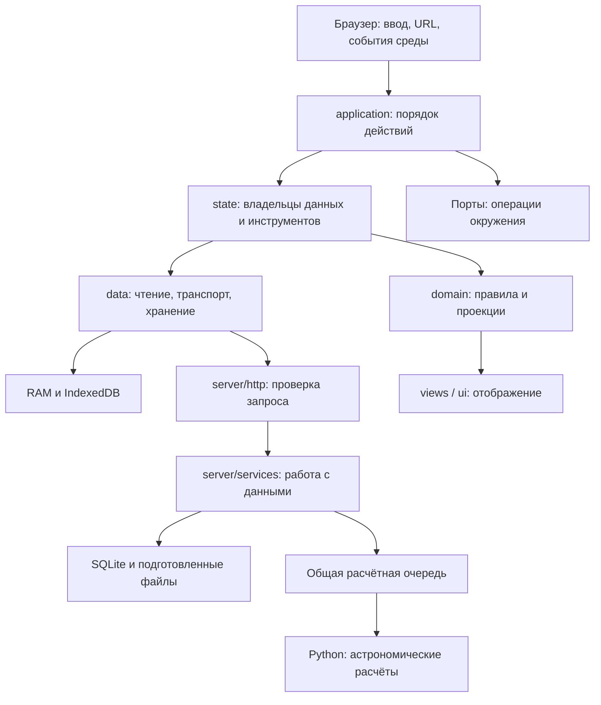

# Как устроена Форма

Форма состоит из браузерного приложения, сервера на Node.js и расчётных программ на Python. Браузер выбирает и показывает данные; сервер хранит аккаунты и карты, выдаёт готовые результаты и организует необходимые расчёты. Установка, запуск и выпуск описаны в [эксплуатации](operations.md), числовые форматы и места хранения — в [данных](data.md).

## Слова, которыми пользуется проект

| Термин | Смысл |
|---|---|
| Карта | Запись с исходными данными, принадлежностью, редакцией и готовым расчётом. Своя сохранённая карта находится в аккаунте на сервере; её копия на устройстве необязательна. |
| Временная карта | Результат текущего ввода, который ещё не сохранён в аккаунте. Копирование ссылки само по себе её не сохраняет. |
| Каталог | Лёгкий список карт аккаунта. Строка каталога не доказывает, что полная карта уже есть на устройстве. |
| Пакет | Целый пригодный набор чисел: день рождения или основное семейство возвратов. Частично записанный набор не считается готовым. |
| День рождения | Минутные данные местного календарного дня с часовым поясом, включая пропущенные и повторяющиеся часы. |
| День транзита | Минутные данные суток UTC. Текущий транзит может следовать часам. |
| Летопись | Заранее подготовленный файл моментов с шагом десять минут. В браузер передаются нужные точки, а не весь файл. |
| Возврат | Точное событие возвращения небесного тела к исходному положению и карта этого события. |
| Проекция | Представление готовых чисел для выбранного момента: активации, ворота и сведения о карте. |
| Композиция | Одна карта либо соположение основной карты с транзитом или возвратом. Исходные карты при этом не изменяются. |
| Редакция (`revision`) | Версия конкретной серверной записи карты. Более старый ответ не заменяет уже принятую новую редакцию. |
| Маркер каталога (`catalogMarker`) | Позиция изменений библиотеки аккаунта. Он помогает сверять список, не скачивая все полные карты заново. |
| Поколение библиотеки (`lease`) | Пара «аккаунт + поколение локального владельца». Она не позволяет старому ответу записать данные после выхода или замены аккаунта. |
| Разрешение фоновой работы (`permit`) | Ограниченное по времени право выполнить конкретную фоновую операцию. Это не пользовательское разрешение и не владение всеми данными. |
| Снимок вкладки (`checkpoint`) | Сохранённые выбор и состояние исследования для восстановления. Это не копия всего приложения и не подтверждение записи карты на сервер. |
| Неизвестный исход | Команда могла выполниться, но ответ не дошёл. Нужно прочитать её результат по идентификатору операции, а не повторить POST вслепую. |

## Где живут обязанности

| Место | За что отвечает |
|---|---|
| [startup.ts](../src/startup.ts), [app.ts](../src/app.ts) | Создают владельцев и браузерные адаптеры, соединяют ввод и представления, освобождают ресурсы. |
| [application/](../src/application/) | Открытие, вход, сохранение, восстановление, продолжение, отмена и подготовка обновления. |
| [application/ports.ts](../src/application/ports.ts) | Договор ядра с навигацией, аккаунтом, записью, фоном и представлением. |
| [state/](../src/state/) | Состояние конкретных инструментов, выбранная карта, библиотека и выполняемые команды. |
| [domain/](../src/domain/) | Правила предмета и преобразование данных; без работы с DOM. |
| [data/](../src/data/) | Клиенты API, ограниченная память, IndexedDB, целое размещение пакетов. |
| [platform/browser/](../src/platform/browser/) | History API, жизненный цикл страницы и координация вкладок. |
| [views/](../src/views/), [ui/](../src/ui/) | Рисунок, формы, окна и отображение состояния. |
| [shared/](../shared/) | Общие проверяемые договоры клиента и сервера: записи, пакеты, UTC, адреса, библиотека. |
| [server/http/](../server/http/) | HTTP-методы, входные данные, доступ и ответы. |
| [server/services/](../server/services/), [server/storage/](../server/storage/) | Получение готового результата, серверные правила, подготовка и хранение. |
| [server/python/](../server/python/) | Расчёт, сетки времени и создание подготовленных файлов. |

`app.ts` остаётся местом сборки браузерного приложения. Расчёты, проверку пакетов и рисование не нужно переносить в машину ради сокращения этого файла.

## Что решает машина состояний

Вход в ядро — [createApplication](../src/application/application.ts). Родительская [application-machine](../src/application/application-machine.ts) связывает владельцев маршрута, аккаунта, записи, запуска, публичной карты и фона. У каждого владельца своё состояние и свои данные.

Машина определяет, какое действие сейчас допустимо, что продолжить после входа, что отменить при смене цели и чей результат ещё актуален. Исполнитель записи по-прежнему отвечает за сам запрос и защиту от повторной отправки. Отмена ожидания не означает, что сервер отменил уже выполненную запись.

Часть правил выражена переходами, часть — именованными действиями родителя. `coordinate` последовательно вызывает проверки допуска `resumeWaitingWrite`, `recoverReadyWrites`, `backgroundChanged` и `wakeLibrary`. Это сознательная форма записи условий между областями: схема состояний показывает вызов, сами условия читаются в этих действиях.

### Таблица правил между областями

Это указатель на решения, а не второй набор условий. При изменении сценария сначала меняется его владелец, затем эта таблица.

| Правило | Что его запускает | Где принимается решение |
|---|---|---|
| Подтверждённый вход продолжает ожидающее сохранение | Изменение аккаунта | `application-machine.ts`: `accountChanged` → `resumeWaitingWrite`; продолжение — [write-continuation.ts](../src/application/write-continuation.ts). |
| Неизвестные исходы восстанавливаются после подготовки источников | Готовность аккаунта и запуска, возвращение среды | `recoverReadyWrites`; чтение исхода — владелец записи. |
| Новый выбор отменяет прежнее открытие и ненужное продолжение; переход ко входу сохраняет ожидающую запись | Запрос маршрута, карты или раздела | Переходы `destination`, `cancelOpening`, `cancelDepartingWrite` в `application-machine.ts`; получение цели — [route.ts](../src/application/route.ts). |
| Смена аккаунта закрывает прежние права и отменяет публичное обновление | `AccountBoundaryStarted` | `boundary`; очистка и подключение — [account-boundary.ts](../src/application/account-boundary.ts). |
| Полученная библиотека и результат формы сохраняют правильный выбор | `LibraryChanged`, `FormSaved` | `libraryChanged`, `formSaved`, `projectLibrary`, `presentFormResult` в `application-machine.ts`. |
| Возвращение страницы или связи разрешает только предусмотренное продолжение | Факты среды | [background-work.ts](../src/application/background-work.ts) → `environmentObserved` в родительской машине. |
| Две вкладки не начинают одну фоновую работу независимо | Цель сверки, время, текущее разрешение | [background-coordinator.ts](../src/platform/browser/background-coordinator.ts) и [background-policy.ts](../src/domain/background-policy.ts). |
| Новая страница может один раз продолжить брошенную начальную сверку | Найдено чужое незавершённое начальное разрешение | `initialRecoveries`, `recoverInitial`, `reserveInitial` в браузерном координаторе; прежние таймер и процедура допуска. |
| Дозагрузка ждёт освобождения переднего плана; отмена ждёт завершения начатой записи | `FillWake`, `FillChanged`, результаты | Единственное `FillState` в [library-fill.ts](../src/application/library-fill.ts). |
| После квоты дозагрузка возобновляется по более поздней подтверждённой записи данных | Уведомление с `payloadStoredAt` | `background-work.ts` передаёт `space`; `library-fill.ts` сохраняет продолжение; [domain/library-fill.ts](../src/domain/library-fill.ts) сравнивает его с последним отказом. |
| Новый выпуск ждёт записи, восстановления исходов и сохранения снимка | Подготовка обновления | [update.ts](../src/application/update.ts), `applicationUpdateReady`, `whenBackgroundIdle` в `application.ts`. |
| Остановка прекращает продолжения и освобождает окружение | `Stop`, уничтожение приложения | `application.ts`, выход из `running`; браузерная сборка освобождает свои ресурсы в `app.ts`. |

Меню, окно подтверждения и их открытость принадлежат представлению. Ядро знает, например, об отмене начатого редактирования, но не решает, какой DOM-элемент закрыть.

## Как проходят обычные действия

**Открытие своей карты.** Маршрут выбирает источник. Готовая актуальная карта берётся из рабочей памяти или локальной библиотеки; само наличие интернета не вызывает GET. Если пригодной копии нет либо известна новая редакция, клиент получает нужную запись. Поздний ответ проверяется против текущей цели и аккаунта.

**Сохранение до входа.** Ядро сохраняет намерение и исходную цель, ждёт входа и продолжает то же действие. [chart-actions.ts](../src/state/chart-actions.ts) выполняет команду с идентификатором операции. Подтверждённая серверная проекция принимается без обязательного повторного GET. Если ответ потерян, сохраняется неизвестный исход и выполняется его сверка.

**День или возврат.** Клиент сначала проверяет пригодные данные в памяти и хранилище. Для собственной карты чтение готового дня не превращается в POST расчёта: ответ «ещё не готово» остаётся отдельным результатом. Открытие собственной карты с закрытым инструментом возвратов и выключенными маркерами не заказывает пять списков дат. Для временной гостевой карты сохраняется её предусмотренная подготовка дат.

**Движение по времени.** [chart-exploration.ts](../src/state/chart-exploration.ts) выбирает инструмент, его владелец получает момент, [moment-projection.ts](../src/domain/moment-projection.ts) переводит числа в карту. [chart-session.ts](../src/state/chart-session.ts) принимает текущий результат, [chart-composition.ts](../src/domain/chart-composition.ts) собирает соположение, представление рисует его. Готовая минута полного дня используется без серверного запроса; при её отсутствии Летопись читает допустимую точку своей сетки.

**Сверка и дозагрузка.** Каталог проверяется отдельно от полных карточек. Полный подтверждённый каталог разрешает сверить отсутствующие записи; частичный список этого права не даёт. Дозагрузка идёт по уровням: карточки → дни → основные семейства возвратов. Отдельные разрешения и ограниченные повторы защищают от повторной работы вкладок. Фон не выбирает карту за человека и не повышает отметку её использования.

## Сервер и API

Сборка сервера находится в [server.ts](../server/server.ts). HTTP-обработчик передаёт работу существующему сервису; готовое чтение не должно ждать общей очереди расчётов.

| Область | Договор и владелец |
|---|---|
| Вход и сессия | [account-contract.ts](../shared/account-contract.ts), [http/accounts.ts](../server/http/accounts.ts), [services/accounts.ts](../server/services/accounts.ts). |
| Каталог, собственная и публичная карта, команды и их исходы | [chart-record-contract.ts](../shared/chart-record-contract.ts), [library-catalog-contract.ts](../shared/library-catalog-contract.ts), [http/charts.ts](../server/http/charts.ts). |
| Готовые дни и семейства аккаунта | [library-package-contract.ts](../shared/library-package-contract.ts), владельцы `library-packages` и `library-preparation` в `server/storage` и `server/services`. |
| Расчёт карты, дневные данные, возвраты | [http/app.ts](../server/http/app.ts), обработчики `natal-days`, `transit-days`, `cycles`; одноимённые сервисы. |
| Летопись | [http/lifetime.ts](../server/http/lifetime.ts), [services/lifetime.ts](../server/services/lifetime.ts): метаданные и позиционное чтение файла. |

Клиент различает подтверждённый отказ, временную неготовность, отмену и неизвестный исход команды. Универсального автоматического повторения всех запросов нет. Чтение готового ресурса, новая вычислительная работа и запись в аккаунт имеют разные правила допуска и повтора.

Результаты проходят проверку на границе: HTTP, файл, IndexedDB. Повторять полную проверку и размещение одного пакета на каждом попадании в RAM не требуется. Проверки текущего доступа и актуальности после ожидания сохраняются; продление сессии выполняется не больше одного раза внутри одного HTTP-запроса.

Запросы, которым нужен Python, используют [compute-queue.ts](../server/runtime/compute-queue.ts): по умолчанию четыре активные работы и 64 ожидающие. Готовые числа обходят эту очередь. У чтения Летописи своя очередь: четыре чтения и до 1024 незавершённых запросов. Это ограничения работы приложения, а не обещание времени ответа внешней сети.

## Хранение, квота и обновление

Серверная запись аккаунта — основная копия. IndexedDB хранит необязательные локальные копии, общий кэш вкладки — повторно используемые данные в RAM. Полная [таблица хранения](data.md#что-и-где-хранится) описывает их раздельно.

При отказе квоты [storage-pressure.ts](../src/data/storage-pressure.ts) допускает одну ограниченную очистку и повтор записи. Сначала уступает диагностика; если там нечего освободить, соответствующий владелец выбирает допустимую копию. Библиотека может удалить одну менее важную копию, затем записать новый пакет целиком. Удаление подтверждается отдельно и не откатывается вместе с последующим отказом новой записи.

Если повтор снова получил отказ квоты, автоматическая очистка прекращается до нового запуска этого экземпляра приложения. Следующие нужные записи могут пройти обычным путём. Успех маленькой записи не выдаёт новое право вытеснять. Уже полученный результат остаётся в существующей ограниченной памяти, уцелевшие локальные данные можно читать. Перезагрузка уничтожает RAM; гарантии полного офлайн при отказе браузера нет.

Настоящая успешная запись карточки или пакета может возобновить дозагрузку через существующее уведомление. Оно ждёт завершения пользовательского действия и полного каталога, не переживает замену аккаунта или сессии. Служебная отметка, no-op, вытеснение и собственная запись фоновой дозагрузки не создают такой повод. Новых таймеров и пробных загрузок ради проверки места нет. Запрет очистки относится к экземпляру приложения, а не ко всем вкладкам навсегда.

[Service Worker](../src/offline/service-worker.ts) обслуживает оболочку приложения отдельно от числовых пакетов. [Координатор страницы](../src/offline/page-coordinator.ts) запрашивает подготовку обновления у ядра. Новая оболочка не активируется посреди незавершённой записи только потому, что её файлы уже скачаны.

## Что можно переносить в другое приложение

`application`, предметные владельцы и договоры не требуют DOM. Платформа предоставляет навигацию, часы, транспорт, хранение и координацию. Браузерные адаптеры и представления заменяются отдельно. Аккаунт, карта и библиотека остаются понятиями продукта и не нуждаются в обезличивании ради переносимости.

Связанные сценарии с настоящими владельцами проверены без DOM на разных координаторах. Это подтверждает переносимость этих сценариев. Оно не означает, что готов весь мобильный интерфейс или что можно перенести один файл машины без её предметных владельцев и договоров. Выбор следующей платформы не входит в текущую реализацию.

## Как менять код дальше

1. Найти владельца правила в таблице выше и его потребителей. Сохранить одно место принятия решения; внешние подписки передают факты.
2. Для действия сравнить HTTP-запросы, расчёты и реальные записи до и после. Число файлов или успешный граф импортов этого не заменяют.
3. Удалить прежнее управление при подключении нового. Соединять владельцев сразу, не откладывать взаимодействие до финальной приёмки.
4. Выбрать проверку поведения затронутого пути. Для временных гонок важны поздний ответ, смена аккаунта и остановка. Внутренние уведомления не стоит фиксировать как публичный контракт.
5. Обновить только соответствующую текущую инструкцию. Замеры, планы и отчёты законченной работы относятся к истории.

Направления импортов и циклы проверяет `npm run check:architecture`; правила находятся в [architecture-boundaries.json](../scripts/architecture/architecture-boundaries.json). Проверка структуры дополняет сценарии, но не доказывает сама по себе, что действие стало проще.
